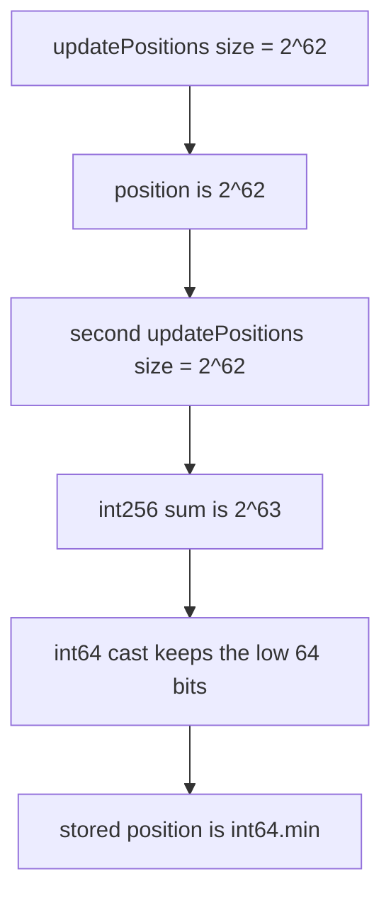

# Ithaca Ledger: an int64 downcast stores −2^63 instead of +2^63

> **Vulnerability classes:** vuln/arithmetic/int-downcast · vuln/logic/position-accounting

<!-- non-defihacklabs -->
<!-- source-auditvault: https://github.com/Auditware/AuditVault/blob/main/findings/59726-false-accounting-in-position-due-to-downcasting-int256-to-in.md -->
<!-- date: 2023-10 -->

## Key info

| Field | Value |
|---|---|
| **Loss** | The client's position is stored as **−9,223,372,036,854,775,808** (`int64.min`) instead of **+9,223,372,036,854,775,808** (`2^63`) |
| **Vulnerable contract** | `Ledger.processPositionUpdates` |
| **Attacker EOA** | `0x1111111111111111111111111111111111111111` |
| **Attack contract** | `Exploit` |
| **Attack tx** | `Exploit.run()` |
| **Chain / block / date** | Ethereum model · block 0 · 2023-10 |
| **Compiler** | solc 0.8.27, cancun, via IR |
| **Bug class** | Explicit `int256` → `int64` cast truncates |

## TL;DR

`processPositionUpdates` adds the new size in `int256`, then stores the sum with an `int64(...)` cast. The report's input is `4611686018427387904` (`2^62`). The first call fits. The second call sums to `2^63`, and the cast keeps the low 64 bits, which is `int64.min`. The published simplified `updatePositions` is external and has no caller check, so any address can write the client's position.

An `int256` ledger given the same two calls stores `+2^63`, which is not `int64.min`.

## The vulnerable code

```solidity
clientPositions[position.contractId][position.client] = int64(
    int256(clientPositions[position.contractId][position.client]) + int256(position.size)
); // @> VULN: downcast truncates 2^63 to int64.min
```

Solidity 0.8 checks arithmetic overflow. An explicit narrowing cast does not. It cuts off the high bits.

## Root cause

The position map is `int64`. The addition is widened to `int256` and then narrowed again. `2^63` is `0x8000000000000000`. As `int64` that bit pattern is `−2^63`, not `+2^63`.

## Preconditions

- The caller can reach `updatePositions`. In the published snippet that function is `external` and has no modifier.
- The same client and contract id are updated twice by `2^62`, or by any pair of sizes whose `int256` sum is outside `int64`.

## Attack walkthrough

1. Call `updatePositions` with size `2^62`. The stored position is `2^62`.
2. Call it again with size `2^62`.
3. The `int256` sum is `2^63`. The `int64` cast stores `−9223372036854775808`.
4. The sink is minted `2^63` of FALSE-POS, the magnitude of that false balance.

## Diagrams



## Impact

The client's position balance is the sign-flipped minimum `int64` instead of a long of `2^63`. Anything that settles, margins, or pays from that stored position uses a balance that is off by `2^64`.

## How to reproduce

```bash
cd 59726-false-accounting-in-position-due-to-downcasting-int256-to-in_exp
forge test -vv
```

`test_run_positionBecomesInt64Min` calls `run()` and checks the stored position is `int64.min`. `test_control_int256KeepsPositiveSum` stores `+2^63` and asserts it is not `int64.min`.

## Sources

- AuditVault finding: https://github.com/Auditware/AuditVault/blob/main/findings/59726-false-accounting-in-position-due-to-downcasting-int256-to-in.md
- Quantstamp Ithaca Finance: https://certificate.quantstamp.com/full/ithaca-finance/8cacdbf3-9f47-4135-854d-1d004abad065/index.html
