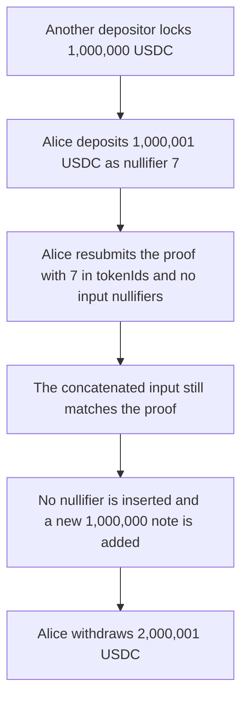

# Hinkal: moving a nullifier into tokenIds duplicates a 1,000,001 USDC note

> **Vulnerability classes:** vuln/logic/missing-check · vuln/logic/state-update

<!-- non-defihacklabs -->
<!-- source-auditvault: https://github.com/Auditware/AuditVault/blob/main/findings/60148-the-protocol-can-be-drained-through-commitment-duplication-q.md -->
<!-- date: 2024-06 -->


`formBasicInput` appends `tokenIds` and then `inputNullifiers`. A transfer proof whose public input is the single nullifier `7` still verifies if that nullifier is placed in `tokenIds` and `inputNullifiers` is empty. `insertNullifiers` then writes nothing. Alice's old 1,000,001 USDC commitment stays spendable next to a new 1,000,000 USDC commitment. She withdraws both. The pool also held another depositor's 1,000,000 USDC, so she leaves with 2,000,001.

```solidity
require(verifyProof(input), "proof");
insertNullifiers(inputNullifiers); // empty, so nullifier 7 is not spent
commitments[newNullifiers[i]] = Commitment(newOwners[i], newAmounts[i], false); // @> VULN
```

## Diagrams



## Impact

Alice's balance is 2,000,001 USDC after a 1,000,001 deposit. The extra 1,000,000 is the other depositor's USDC. The pool is empty and Bob's 1 USDC note is unbacked. The fixed path requires the verified input itself to be the nullifier list, so the swapped call reverts and the other 1,000,000 USDC stays in the contract.

## PoC

```bash
cd 60148-the-protocol-can-be-drained-through-commitment-duplication-q_exp
forge test -vv
```

