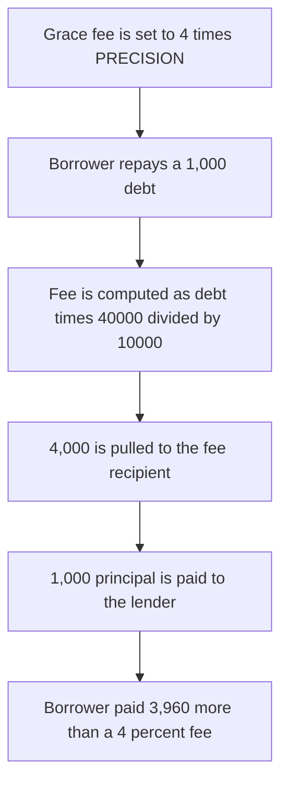

# Altr: a documented 4% grace fee charges 4,000 on a 1,000 debt

> **Vulnerability classes:** vuln/logic/fee-calculation · vuln/arithmetic/precision-loss

<!-- non-defihacklabs -->
<!-- source-auditvault: https://github.com/Auditware/AuditVault/blob/main/findings/60243-inconsistent-use-of-basis-points-leading-to-enormous-fees-qu.md -->
<!-- date: 2024-06 -->


`PRECISION` is 10,000 and `MAX_REPAY_GRACE_FEE` is `4 * PRECISION`. The comments treat that cap as 4%. `repay` computes `platformFee += (totalPayable * repayGraceFee) / PRECISION`. On a 1,000 debt that is `1000 * 40000 / 10000 = 4000`, four times the debt, instead of the 40 a basis-point 4% would charge.

```solidity
uint256 public constant PRECISION = 10000;
uint256 public constant MAX_REPAY_GRACE_FEE = 4 * PRECISION;
platformFee += (totalPayable * repayGraceFee) / PRECISION; // @> VULN
```

## Diagrams



## Impact

The fee recipient receives 4,000. The lender receives the 1,000 principal. A fee stored as 400 basis points, with the same division, charges 40. The excess is 3,960.

## PoC

```bash
cd 60243-inconsistent-use-of-basis-points-leading-to-enormous-fees-qu_exp
forge test -vv
```

