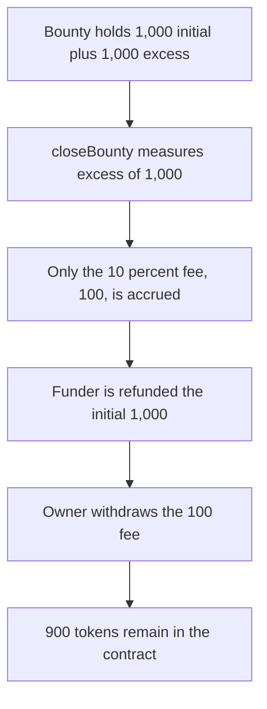

# Arkham bounty: 900 of 1,000 excess tokens stay locked after close

> **Vulnerability classes:** vuln/dos/frozen-funds

<!-- non-defihacklabs -->
<!-- source-auditvault: https://github.com/Auditware/AuditVault/blob/main/findings/60261-excess-funds-are-locked-in-the-bounty-contract-quantstamp-ar.md -->
<!-- date: 2024-06 -->


The bounty comment says excess funding from rejected submissions is accrued as fees. `closeBounty` only does `_accruedFees += fee(excessAccrued, true)`. `fee` returns 10% of the excess. A bounty with 1,000 initial funding and 1,000 excess therefore accrues 100, refunds the funder 1,000, and lets the owner withdraw 100. The other 900 remains in the contract with no withdrawal path.

```solidity
excessAccrued = _bounties[bounty].amount - _bounties[bounty].initialAmount;
_accruedFees += fee(excessAccrued, true); // @> VULN: 100 of 1,000
_bounties[bounty].amount = _bounties[bounty].initialAmount;
```

## Diagrams



## Impact

After close and `burnAndWithdraw`, the bounty contract still holds 900 tokens. The funder has 1,000 and the owner has 100. The fixed close accrues the entire excess, so the owner withdraws 1,000 and the contract balance is 0.

## PoC

```bash
cd 60261-excess-funds-are-locked-in-the-bounty-contract-quantstamp-ar_exp
forge test -vv
```

