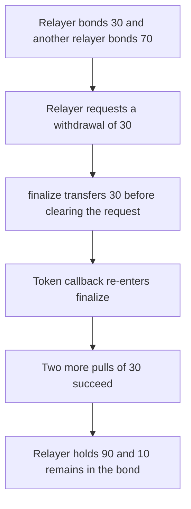

# Pheasant: reentrancy lets a relayer pull 90 from a 100 bond

> **Vulnerability classes:** vuln/reentrancy/single-function

<!-- non-defihacklabs -->
<!-- source-auditvault: https://github.com/Auditware/AuditVault/blob/main/findings/60329-reentrancy-lets-relayer-withdraw-more-than-expected-by-bond.md -->
<!-- date: 2024-06 -->


`finalizeWithdrawalBond` transfers the requested amount `A` before clearing `withdrawalAmount` or reducing `totalLocked`. The bond token callbacks into the relayer. The relayer bonded 30 and another relayer bonded 70, so `totalLocked` is 100 and `A` is 30. Each re-entry pulls another 30 while the request is still open. Three pulls succeed. 10 remains, which is `100 % 30`. The relayer receives 90, of which 60 belonged to the other relayer.

```solidity
uint256 A = withdrawalAmount[msg.sender];
require(token.balanceOf(address(this)) >= A, "short");
token.transfer(msg.sender, A); // @> VULN: callback before the request is cleared
if (totalLocked >= A) totalLocked -= A;
withdrawalAmount[msg.sender] = 0;
```

## Diagrams



## Impact

The relayer receives 90 tokens. The bond contract keeps 10. `totalLocked` ends at 10, so the other relayer's 70 is no longer backed. The fixed function clears the request and decreases the bond before the transfer, and the callback's second entry reverts. The relayer receives 30 and 70 stays in the contract.

## PoC

```bash
cd 60329-reentrancy-lets-relayer-withdraw-more-than-expected-by-bond_exp
forge test -vv
```

