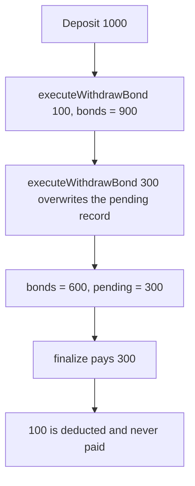

# Pheasant BondManager: the second withdrawal request locks the first 100

> **Vulnerability classes:** `vuln/logic` · `vuln/defi`

<!-- non-defihacklabs -->
<!-- source-auditvault: https://github.com/Auditware/AuditVault/blob/main/findings/60331-relayers-bond-funds-can-be-lost-quantstamp-pheasant-network.md -->
<!-- date: 2023-05 -->

## Key info

| Field | Value |
|---|---|
| **Loss** | **100** bond tokens stay in the contract. A 1000 deposit with requests of 100 and then 300 pays only **300** |
| **Vulnerable contract** | `BondManager.executeWithdrawBond` |
| **Attacker EOA** | `0x1111111111111111111111111111111111111111` |
| **Attack contract** | `Exploit` |
| **Attack tx** | `Exploit.run()` |
| **Chain / block / date** | Ethereum model · block 0 · 2023-05 |
| **Compiler** | solc 0.8.27, cancun, via IR |
| **Bug class** | One pending-withdrawal slot is overwritten after the amount was already deducted |

## TL;DR

A depositor withdraws in two steps: `executeWithdrawBond`, then `finalizeWithdrawalBond`. The execute call subtracts the amount from `bonds` immediately and stores a single `bondWithdrawal`. A second execute replaces that struct. Finalize pays only the second amount. The first amount has already left `bonds` and is never transferred.

The report's numbers, here in 18-decimal units: deposit 1000, request 100 (`bonds` = 900), request 300 (`bonds` = 600), finalize pays 300. The contract still holds 700. `700 − 600 = 100` has no withdrawal record.

The fixed manager rejects a new request while one is pending. Finalizing the 100 before requesting the 300 pays both. Stuck is 0, not 100.

## The vulnerable code

```solidity
function executeWithdrawBond(uint256 tokenId, uint256 amount) external {
    bonds[tokenId] -= amount;
    bondWithdrawal[msg.sender] = Withdrawal(block.timestamp, tokenId, amount); // @> VULN
}
```

`finalizeWithdrawalBond` transfers `bondWithdrawal.amount` and nothing else.

## Root cause

The deduction and the record are not the same object. `bonds` is reduced on every request. The record that `finalize` reads can remember only one request. Replacing the record does not put the previous amount back into `bonds`.

## Preconditions

- The caller has a bond balance of at least 400, so both requests succeed.
- The caller invokes `executeWithdrawBond` twice before `finalizeWithdrawalBond`.
- No admin key is required. Deposit and both withdrawal calls are open to the depositor.

## Attack walkthrough

1. Deposit 1000. `bonds[1] = 1000`.
2. `executeWithdrawBond(1, 100)`. `bonds[1] = 900`. Pending amount is 100.
3. `executeWithdrawBond(1, 300)`. `bonds[1] = 600`. Pending amount is 300. The 100 record is gone.
4. Finalize transfers 300.
5. The contract holds 700 and `bonds` says 600. The gap of 100 is stuck.

## Diagrams



## Impact

The depositor asked to withdraw 400 and can receive only 300. The other 100 remains in `BondManager` and is not tracked by `bonds` or by `bondWithdrawal`, so a later finalize of the remaining 600 does not return it.

## How to reproduce

```bash
cd 60331-relayers-bond-funds-can-be-lost-quantstamp-pheasant-network_exp
forge test -vv
```

`test_run_overwrittenRequestLocks100` calls `run()` and checks the stuck amount is 100, the payout is 300, and `bonds` is 600. `test_control_finalizeBetweenRequestsPaysBoth` pays 400 and checks the stuck amount is 0, not 100.

## Sources

- AuditVault finding: https://github.com/Auditware/AuditVault/blob/main/findings/60331-relayers-bond-funds-can-be-lost-quantstamp-pheasant-network.md
- Quantstamp Pheasant Network: https://certificate.quantstamp.com/full/pheasant-network/0b120935-78d1-45a1-88c4-f770c8e5fa52/index.html
