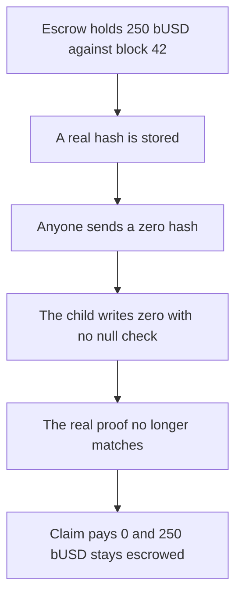

# Pheasant — a zero block hash invalidates a 250 bUSD proof

> **Vulnerability classes:** vuln/bridge/missing-validation · vuln/logic/missing-check

> **Reproduction:** a self-contained Foundry PoC that compiles and runs offline
> with only `forge-std` — no fork and no RPC. Trace: [output.txt](output.txt).
> PoC: [test/60332-invalidated-block-hash-in-cross-layer-communication-quantsta_exp.sol](test/60332-invalidated-block-hash-in-cross-layer-communication-quantsta_exp.sol).

<!-- non-defihacklabs -->
<!-- source-auditvault: https://github.com/Auditware/AuditVault/blob/main/findings/60332-invalidated-block-hash-in-cross-layer-communication-quantsta.md -->
<!-- date: 2024-06 -->

---

## Key info

| | |
|---|---|
| **Impact** | **HIGH** — a permissionless zero hash makes a valid exit proof pay **0 of 250 bUSD** |
| **Protocol** | Pheasant Network child checkpoint |
| **Vulnerable code** | `_processMessageFromRoot` stores `blockHash` with no null check |
| **Bug class** | A zero checkpoint invalidates proofs |
| **Finding** | Quantstamp (Danny Aksenov) — Pheasant Network · id 60332 |
| **Report** | [Quantstamp Pheasant Network](https://certificate.quantstamp.com/full/pheasant-network/0b120935-78d1-45a1-88c4-f770c8e5fa52/index.html) |
| **Source** | [AuditVault finding](https://github.com/Auditware/AuditVault/blob/main/findings/60332-invalidated-block-hash-in-cross-layer-communication-quantsta.md) |
| **Status** | Fixed by requiring `blockHash != bytes32(0)`. Reproduced here as a one-chain synthetic. |
| **Compiler** | solc 0.8.27, cancun, via IR |

---

## TL;DR

`optimismSendBlockInfo` can be called by any user and forwards the hash into `_processMessageFromRoot`. That function writes `blockHashs[blockNumber] = blockHash` even when the hash is zero.

The child already holds **250 bUSD** against block 42, and the real hash has been stored. The next call writes `bytes32(0)`. `claim` of the real hash returns **0**. The escrow stays at **250 bUSD**.

The control rejects a zero hash. The same proof then pays **250 bUSD** and the escrow ends at 0. One contract models both the permissionless send and the child store, so a second chain is not required.

## The vulnerable code

```solidity
function optimismSendBlockInfo(uint256 blockNumber, bytes32 blockHash) external {
    blockHashs[blockNumber] = blockHash;
    // @> VULN: a zero hash was just stored; both the real hash and zero are accepted
    writes += 1;
}
```

## Preconditions

- The child escrow holds **250 bUSD** for block 42.
- A real non-zero hash was stored, and the claimer still has that hash.
- Anyone can call `optimismSendBlockInfo` on this chain.

## Attack walkthrough

1. Deposit **250 bUSD** into the child.
2. Store the real hash for block 42.
3. Call `optimismSendBlockInfo(42, 0)`.
4. `claim(realHash)` returns 0 because the stored hash is zero.
5. The child still holds **250 bUSD**.

Control: the zero write reverts, and `claim` transfers **250 bUSD** to the claimer.

## Diagrams



## Impact

The claimer who should receive **250 bUSD** receives nothing. Those tokens stay in the child checkpoint. The control pays the same **250 bUSD**.

## Remediation

Require `blockHash != bytes32(0)` before writing `blockHashs[blockNumber]`, on both the Optimism and Polygon child checkpoint paths.

## Sources

- [AuditVault finding 60332](https://github.com/Auditware/AuditVault/blob/main/findings/60332-invalidated-block-hash-in-cross-layer-communication-quantsta.md)
- [Quantstamp Pheasant Network certificate](https://certificate.quantstamp.com/full/pheasant-network/0b120935-78d1-45a1-88c4-f770c8e5fa52/index.html)

### Taxonomy

- `severity/high`
- `vuln/bridge/missing-validation` · `vuln/logic/missing-check`
