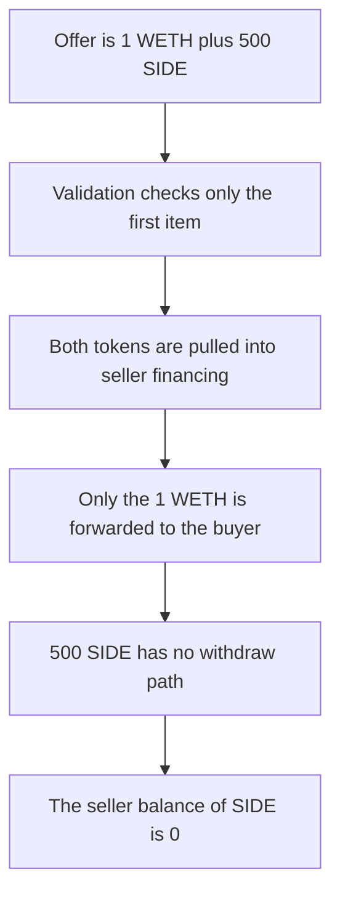

# NiftyApes — a second Seaport offer item locks 500 SIDE

> **Vulnerability classes:** vuln/dos/frozen-funds · vuln/input-validation/missing

> **Reproduction:** a self-contained Foundry PoC that compiles and runs offline
> with only `forge-std` — no fork and no RPC. Trace: [output.txt](output.txt).
> PoC: [test/60495-locked-funds-when-fulfilling-seaport-orders-quantstamp-nifty_exp.sol](test/60495-locked-funds-when-fulfilling-seaport-orders-quantstamp-nifty_exp.sol).

<!-- non-defihacklabs -->
<!-- source-auditvault: https://github.com/Auditware/AuditVault/blob/main/findings/60495-locked-funds-when-fulfilling-seaport-orders-quantstamp-nifty.md -->
<!-- date: 2024-06 -->

---

## Key info

| | |
|---|---|
| **Impact** | **HIGH** — fulfilling a two-item offer locks **500 SIDE** in seller financing |
| **Protocol** | NiftyApes `SellerFinancing` |
| **Vulnerable code** | `fulfillOrder` pulls every offer item and forwards only WETH |
| **Bug class** | Non-WETH offer tokens have no withdraw path |
| **Finding** | Quantstamp (Michael Boyle) — NiftyApes seller financing · id 60495 |
| **Report** | [Quantstamp NiftyApes](https://certificate.quantstamp.com/full/nifty-apes-seller-financing/edbc671f-08c9-44ab-b24c-c3807c9ef43d/index.html) |
| **Source** | [AuditVault finding](https://github.com/Auditware/AuditVault/blob/main/findings/60495-locked-funds-when-fulfilling-seaport-orders-quantstamp-nifty.md) |
| **Status** | Fixed by requiring a single offer item. Reproduced here as a local synthetic. |
| **Compiler** | solc 0.8.27, cancun, via IR |

---

## TL;DR

`_validateSaleOrder` checks that the first offer item is WETH. It does not require `offer.length == 1`.

The seller fulfills an order whose offer is **1 WETH** plus **500 SIDE**. The contract pulls both. It forwards only the **1 WETH** to the buyer. **500 SIDE** remains in the contract, and there is no withdraw. The seller's SIDE balance is 0.

The control rejects `offer.length != 1` before any pull. The seller keeps **500 SIDE**.

## The vulnerable code

```solidity
for (uint256 i; i < offer.length; i++) {
    // @> VULN: every offer item is pulled; only WETH is forwarded
    Token(offer[i].token).transferFrom(msg.sender, address(this), offer[i].amount);
}
weth.transfer(BUYER, wethOut);
```

## Preconditions

- The seller holds **1 WETH** and **500 SIDE** and has approved the financing contract.
- The order's first offer item is the WETH leg. A second item is SIDE.
- The contract forwards only WETH.

## Attack walkthrough

1. Build an offer of `[WETH 1, SIDE 500]`.
2. `fulfillOrder` validates the WETH leg and does not check the length.
3. The loop pulls both tokens.
4. **1 WETH** is sent to the buyer.
5. The financing contract still holds **500 SIDE**.

Control: `offer.length == 1` fails, and the seller still holds **500 SIDE**.

## Diagrams



## Impact

The seller loses **500 SIDE**. The buyer receives the **1 WETH** they were quoted. The SIDE balance stays in seller financing.

## Remediation

In `_validateSaleOrder`, require `order.parameters.offer.length == 1` so the only pulled token is the WETH leg.

## Sources

- [AuditVault finding 60495](https://github.com/Auditware/AuditVault/blob/main/findings/60495-locked-funds-when-fulfilling-seaport-orders-quantstamp-nifty.md)
- [Quantstamp NiftyApes certificate](https://certificate.quantstamp.com/full/nifty-apes-seller-financing/edbc671f-08c9-44ab-b24c-c3807c9ef43d/index.html)

### Taxonomy

- `severity/high`
- `vuln/dos/frozen-funds` · `vuln/input-validation/missing`
