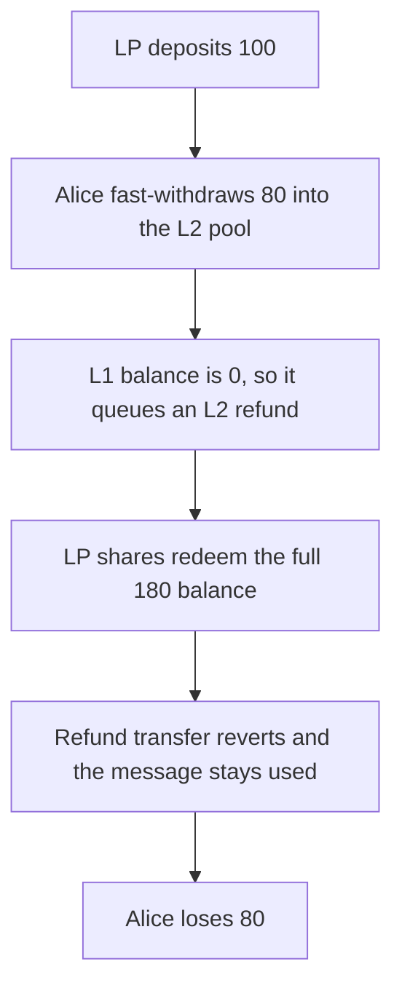

# Boba LP: an unreserved fast withdraw loses 80 when the undo cannot be retried

> **Vulnerability classes:** vuln/logic/share-redemption · vuln/bridge/unreserved-escrow

<!-- non-defihacklabs -->
<!-- source-auditvault: https://github.com/Auditware/AuditVault/blob/main/findings/60698-unsafe-replyneeded-messaging-mechanism-quantstamp-boba-1-bri.md -->
<!-- date: 2023-05 -->

## Key info

| Field | Value |
|---|---|
| **Loss** | Alice's **80** tokens. The LP is paid **180** on a **100** share redemption and the L2 refund never lands |
| **Vulnerable contract** | `L2Pool.withdrawLiquidity` and `Messenger.relay` |
| **Attacker EOA** | `0x1111111111111111111111111111111111111111` |
| **Attack contract** | `Exploit` |
| **Attack tx** | `Exploit.run()` |
| **Chain / block / date** | Ethereum model · block 0 · 2023-05 |
| **Compiler** | solc 0.8.27, cancun, via IR |
| **Bug class** | Fast-withdraw escrow is not reserved, and a failed `replyNeeded` compensation is consumed |

## TL;DR

Alice calls the L2 fast-withdraw path with 80. The tokens sit in the L2 pool and a message asks L1 to pay her. L1's balance is 0, so it queues `clientPayL2Settlement` instead of paying. The 80 was never reserved. The LP, who holds every share from a 100 deposit, redeems `shares * balance / totalShares` and receives 180. The settlement transfer then reverts, and the messenger has already marked that message used, so it cannot be relayed again. Alice's balance stays 0.

The reserved pool does the same sequence and pays Alice the 80 back. The LP receives only its 100. Stolen is 0, not 80.

## The vulnerable code

```solidity
uint256 amount = shareAmount * bal / totalShares; // @> VULN: redemption uses the full balance, including the unreserved fast-withdraw escrow
```

```solidity
m.used = true;
(bool ok,) = m.to.call(m.data); // @> VULN: a failed compensation is consumed and cannot be relayed again
```

`clientDepositL2` pulls the user's tokens and does not increase a `reserved` counter. `clientPayL1` sends the compensation when L1 cannot pay.

## Root cause

The undo of a fast withdraw needs the same tokens that were just deposited, and it needs a message that can be attempted again if the pool is short. Neither is true. Liquidity withdrawal redeems against the raw balance, and `relay` sets `used` before it knows the call succeeded. A reverting refund does not restore `used`.

## Preconditions

- An LP has deposited the only shares. Adding and removing liquidity is permissionless.
- L1 does not hold enough of the token to pay the fast withdraw. Here it holds 0.
- The compensation is relayed after the LP has withdrawn.

## Attack walkthrough

1. The LP adds 100. `totalShares` is 100 and the pool balance is 100.
2. Alice fast-withdraws 80. The pool balance is 180. A `clientPayL1` message is queued. `reserved` does not exist on this pool.
3. Relaying that message finds L1 short and queues `clientPayL2Settlement(Alice, 80)`.
4. The LP withdraws 100 shares. `100 * 180 / 100 = 180`. The pool balance is 0.
5. Relaying the settlement tries to transfer 80, reverts inside the call, and leaves the message marked used.
6. Alice still has 0. The sink is minted 80.

## Diagrams



## Impact

The fast-withdraw user loses the amount they deposited. In this run that is 80 tokens, and the LP holds 180. Because the L2 message cannot be relayed again, later liquidity does not replay the failed compensation.

## How to reproduce

```bash
cd 60698-unsafe-replyneeded-messaging-mechanism-quantstamp-boba-1-bri_exp
forge test -vv
```

`test_lp_redeems_unreserved_deposit` calls `run()` and checks the sink holds 80, Alice holds 0, and the LP holds 180. `test_control_reserved_deposit_is_returned` checks the stolen amount is 0, not 80, and Alice receives 80.

## Sources

- AuditVault finding: https://github.com/Auditware/AuditVault/blob/main/findings/60698-unsafe-replyneeded-messaging-mechanism-quantstamp-boba-1-bri.md
- Quantstamp Boba bridges and LP floating fee: https://certificate.quantstamp.com/full/boba-1-bridges-and-lp-floating-fee/1e5a1e09-bde0-417d-83cd-083234b1409c/index.html
