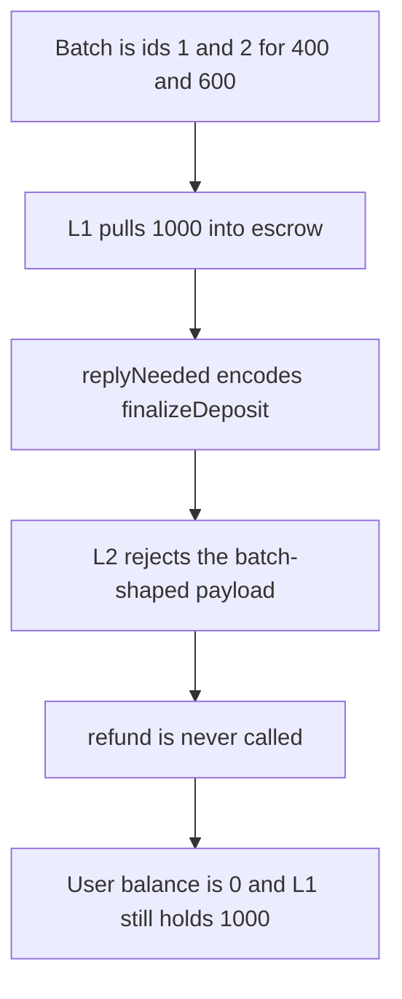

# Boba — the wrong ERC1155 selector keeps 1000 tokens on L1

> **Vulnerability classes:** vuln/bridge/missing-validation · vuln/logic/wrong-condition

> **Reproduction:** a self-contained Foundry PoC that compiles and runs offline
> with only `forge-std` — no fork and no RPC. Trace: [output.txt](output.txt).
> PoC: [test/60699-using-the-wrong-selector-causes-token-loss-during-erc1155-br_exp.sol](test/60699-using-the-wrong-selector-causes-token-loss-during-erc1155-br_exp.sol).

<!-- non-defihacklabs -->
<!-- source-auditvault: https://github.com/Auditware/AuditVault/blob/main/findings/60699-using-the-wrong-selector-causes-token-loss-during-erc1155-br.md -->
<!-- date: 2024-08 -->

---

## Key info

| | |
|---|---|
| **Impact** | **HIGH** — a failed batch reply leaves **1000** escrowed tokens on L1 |
| **Protocol** | Boba `L1ERC1155Bridge.finalizeWithdrawalBatch` |
| **Vulnerable code** | `replyNeeded` encodes `finalizeDeposit.selector` instead of `finalizeDepositBatch.selector` |
| **Bug class** | The refund message cannot be decoded |
| **Finding** | Quantstamp (Pavel Shabarkin) — Boba bridges · id 60699 |
| **Report** | [Quantstamp Boba](https://certificate.quantstamp.com/full/boba-1-bridges-and-lp-floating-fee/1e5a1e09-bde0-417d-83cd-083234b1409c/index.html) |
| **Source** | [AuditVault finding](https://github.com/Auditware/AuditVault/blob/main/findings/60699-using-the-wrong-selector-causes-token-loss-during-erc1155-br.md) |
| **Status** | Fixed in commit `535c64c9` by using the batch selector. Reproduced here as a local synthetic. |
| **Compiler** | solc 0.8.27, cancun, via IR |

---

## TL;DR

The user bridges an ERC1155 batch: id 1 for **400** and id 2 for **600**. The escrow token models that sum, **N = 1000**.

`finalizeWithdrawalBatch` pulls the 1000 first. Because `replyNeeded` is true, it sends a message to L2. The selector on that message is `finalizeDeposit`, the single-id function, while the arguments are the batch arrays.

L2's `finalizeDeposit` requires a three-word payload. The batch encoding is longer, so the call returns false. Nothing calls `refund`. The user balance is **0** and the L1 bridge still holds **1000**.

The control encodes `finalizeDepositBatch.selector`. L2 sums the amounts and `refund` returns **1000** to the user.

## The vulnerable code

```solidity
// @> VULN: batch reply uses the single-deposit selector
bytes memory message =
    abi.encodeWithSelector(IL2ERC1155Bridge.finalizeDeposit.selector, user, ids, amounts);
(bool ok,) = l2.call(message);
```

## Preconditions

- The withdrawal is a batch of two ids whose amounts sum to **1000**.
- `replyNeeded` is true, so the bridge must send a completing message.
- The tokens are pulled before that message is attempted.

## Attack walkthrough

1. Mint **1000** and approve the L1 bridge.
2. Call `finalizeWithdrawalBatch` with ids `[1, 2]`, amounts `[400, 600]`, and `replyNeeded = true`.
3. The bridge escrows **1000**.
4. The message uses `finalizeDeposit.selector`.
5. L2 reverts on payload length. The refund never runs.
6. The bridge balance is **1000** and the user balance is **0**.

Control: the same call with `finalizeDepositBatch.selector` returns **1000** to the user.

## Diagrams



## Impact

The user loses the **1000** tokens that were escrowed for the batch. A correct selector returns the same **1000**.

## Remediation

Encode `iL2ERC1155Bridge.finalizeDepositBatch.selector` when the reply is for a batch withdrawal.

## Sources

- [AuditVault finding 60699](https://github.com/Auditware/AuditVault/blob/main/findings/60699-using-the-wrong-selector-causes-token-loss-during-erc1155-br.md)
- [Quantstamp Boba certificate](https://certificate.quantstamp.com/full/boba-1-bridges-and-lp-floating-fee/1e5a1e09-bde0-417d-83cd-083234b1409c/index.html)

### Taxonomy

- `severity/high`
- `vuln/bridge/missing-validation` · `vuln/logic/wrong-condition`
