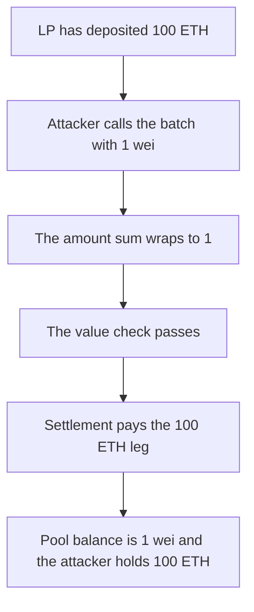

# Boba — a wrapping native sum drains 100 ETH from the L1 pool

> **Vulnerability classes:** vuln/arithmetic/overflow · vuln/logic/missing-check

> **Reproduction:** a self-contained Foundry PoC that compiles and runs offline
> with only `forge-std` — no fork and no RPC. Trace: [output.txt](output.txt).
> PoC: [test/60700-native-tokens-from-the-l1-liquidity-pools-could-be-drained-d_exp.sol](test/60700-native-tokens-from-the-l1-liquidity-pools-could-be-drained-d_exp.sol).

<!-- non-defihacklabs -->
<!-- source-auditvault: https://github.com/Auditware/AuditVault/blob/main/findings/60700-native-tokens-from-the-l1-liquidity-pools-could-be-drained-d.md -->
<!-- date: 2024-08 -->

---

## Key info

| | |
|---|---|
| **Impact** | **HIGH** — **1 wei** withdraws the LP's **100 ETH** from the L1 pool |
| **Protocol** | Boba `L1LiquidityPool.clientDepositL1Batch` |
| **Vulnerable code** | The native-amount sum wraps, so it still equals `msg.value` |
| **Bug class** | Pre-0.8 addition in the batch deposit |
| **Finding** | Quantstamp (Pavel Shabarkin) — Boba L1 liquidity pool · id 60700 |
| **Report** | [Quantstamp Boba](https://certificate.quantstamp.com/full/boba-1-bridges-and-lp-floating-fee/1e5a1e09-bde0-417d-83cd-083234b1409c/index.html) |
| **Source** | [AuditVault finding](https://github.com/Auditware/AuditVault/blob/main/findings/60700-native-tokens-from-the-l1-liquidity-pools-could-be-drained-d.md) |
| **Status** | Deployments compiled with 0.8.9 were not affected. The pre-0.8 wrap is reproduced locally with `unchecked`. |
| **Compiler** | solc 0.8.27, cancun, via IR. The vulnerable add is inside `unchecked` so the pre-0.8 wrap still happens. |

---

## TL;DR

The pool already holds **100 ETH** from an LP. `clientDepositL1Batch` adds each native amount into `ethAmount` and requires `ethAmount == msg.value`.

On a compiler older than 0.8 that add wraps. This file is compiled with 0.8.27, so the same add is inside `unchecked`. The attacker sends **1 wei** and two amounts: **100 ETH**, and `2^256 - 100 ETH + 2`. The wrapped sum is **1**. The value check passes.

Settlement pays each stored leg that fits in the balance. The **100 ETH** leg is paid to the attacker. The huge leg is skipped. The pool is left with **1 wei**. The LP's deposit accounting still says **100 ETH**.

The control uses a checked add. The batch reverts and the pool still holds **100 ETH**.

## The vulnerable code

```solidity
unchecked {
    // @> VULN: pre-0.8 addition wraps, so a 1-wei call credits the pool
    ethAmount += amounts[i];
}
```

## Preconditions

- The pool's native balance is **100 ETH** deposited by an LP.
- The batch is compiled so the amount sum can wrap.
- Settlement pays each credited amount independently when the balance covers it.

## Attack walkthrough

1. LP deposits **100 ETH**.
2. Attacker calls `clientDepositL1Batch` with `msg.value = 1` and amounts `[100 ETH, 2^256 - 100 ETH + 2]`.
3. The wrapped sum equals 1, so the require passes.
4. `clientPayL1Settlement` sends the **100 ETH** leg to the attacker.
5. The pool balance is **1 wei**. The attacker balance is **100 ETH**.

Control: the checked addition reverts. The pool balance stays **100 ETH**.

## Diagrams



## Impact

The liquidity provider's **100 ETH** is transferred to the attacker, who paid **1 wei**. A checked sum leaves the **100 ETH** in the pool.

## Remediation

Use a compiler that reverts on overflow, or a checked add, so `ethAmount == msg.value` cannot be satisfied by a wrapped list of amounts.

## Sources

- [AuditVault finding 60700](https://github.com/Auditware/AuditVault/blob/main/findings/60700-native-tokens-from-the-l1-liquidity-pools-could-be-drained-d.md)
- [Quantstamp Boba certificate](https://certificate.quantstamp.com/full/boba-1-bridges-and-lp-floating-fee/1e5a1e09-bde0-417d-83cd-083234b1409c/index.html)

### Taxonomy

- `severity/high`
- `vuln/arithmetic/overflow` · `vuln/logic/missing-check`
