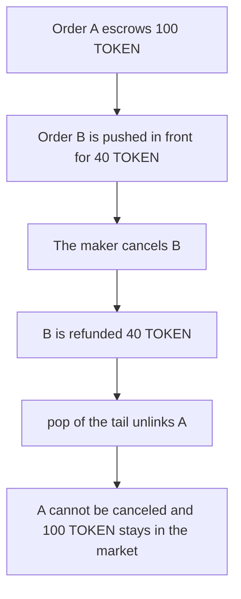

# Talentir — canceling order B locks order A's 100 TOKEN

> **Vulnerability classes:** vuln/logic/incorrect-state-transition · vuln/logic/state-update

> **Reproduction:** a self-contained Foundry PoC that compiles and runs offline
> with only `forge-std` — no fork and no RPC. Trace: [output.txt](output.txt).
> PoC: [test/60731-incorrect-accounting-in-removeorder-leading-to-loss-of-orde_exp.sol](test/60731-incorrect-accounting-in-removeorder-leading-to-loss-of-orde_exp.sol).

<!-- non-defihacklabs -->
<!-- source-auditvault: https://github.com/Auditware/AuditVault/blob/main/findings/60731-incorrect-accounting-in-removeorder-leading-to-loss-of-orde.md -->
<!-- date: 2024-09 -->

---

## Key info

| | |
|---|---|
| **Impact** | **HIGH** — canceling order B unlinks order A and locks its **100 TOKEN** escrow |
| **Protocol** | Talentir `TalentirMarketplaceV1` |
| **Vulnerable code** | `_removeOrder` calls `pop(false)` instead of removing the requested id |
| **Bug class** | The price list drops the oldest order |
| **Finding** | Quantstamp (Zeeshan Meghji) — Talentir marketplace · id 60731 |
| **Report** | [Quantstamp Talentir](https://certificate.quantstamp.com/full/talentir-token-marketplace/08aae35f-7537-45ef-ae98-0dc5c0e1abe1/index.html) |
| **Source** | [AuditVault finding](https://github.com/Auditware/AuditVault/blob/main/findings/60731-incorrect-accounting-in-removeorder-leading-to-loss-of-orde.md) |
| **Status** | Fixed in commit `29e5bc9a` by removing the specific order id. Reproduced here as a local synthetic. |
| **Compiler** | solc 0.8.27, cancun, via IR |

---

## TL;DR

`_addOrder` pushes new ids to the front of `orderList[price]`. `_removeOrder` always `pop(false)`, which removes the tail. The tail is the oldest order.

The maker places order A for **100 TOKEN**, then order B for **40 TOKEN**, at the same price. Canceling B refunds the **40 TOKEN** and pops A. A is marked off-book without a refund. `cancelOrder(A)` then reverts because A is not on the book. The market still holds **100 TOKEN**.

`getBestOrder` returns B, which is already inactive. The book no longer contains the order that still has escrow.

The control removes the requested id. Canceling B leaves A on the book, and a second cancel returns the **100 TOKEN**.

## The vulnerable code

```solidity
token.transfer(msg.sender, o.amount);
// @> VULN: pop(false) drops the tail, not this order id
uint256 removed = _popBack(o.price);
if (removed != orderId) orders[removed].onBook = false;
```

## Preconditions

- Two orders share a token, a price, and a side.
- A was inserted first, so it is the tail after B is pushed to the front.
- Escrow is returned only for the order id the caller passed. The popped id is only unlinked.

## Attack walkthrough

1. `addOrder` escrows **100 TOKEN** as order A.
2. `addOrder` escrows **40 TOKEN** as order B. The list is `[B, A]`.
3. `cancelOrder(B)` refunds **40 TOKEN** and pops the tail.
4. The popped id is A. A is no longer on the book. Its **100 TOKEN** stays.
5. `cancelOrder(A)` reverts. `getBestOrder` returns B.

Control: cancel B removes B only. Cancel A then returns the **100 TOKEN**, and the market balance is 0.

## Diagrams



## Impact

The maker who cancels the newer **40 TOKEN** order loses access to the older **100 TOKEN** escrow. That **100 TOKEN** stays in the marketplace. The best order left on the book is the one that was just canceled.

## Remediation

Walk the price list until the id matches the order being removed, and refund that id only.

## Sources

- [AuditVault finding 60731](https://github.com/Auditware/AuditVault/blob/main/findings/60731-incorrect-accounting-in-removeorder-leading-to-loss-of-orde.md)
- [Quantstamp Talentir certificate](https://certificate.quantstamp.com/full/talentir-token-marketplace/08aae35f-7537-45ef-ae98-0dc5c0e1abe1/index.html)

### Taxonomy

- `severity/high`
- `vuln/logic/incorrect-state-transition` · `vuln/logic/state-update`
