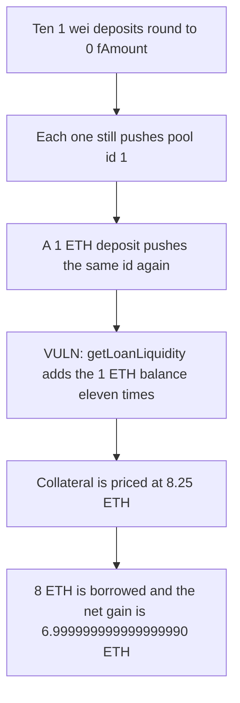

# Folks Finance: ten zero-fAmount deposits make 1 ETH of collateral count eleven times

> **Vulnerability classes:** vuln/logic/missing-check · vuln/arithmetic/precision-loss

<!-- non-defihacklabs -->
<!-- source-auditvault: https://github.com/Auditware/AuditVault/blob/main/findings/61051-attacker-can-get-unlimited-loan-for-some-minimum-deposit-due.md -->
<!-- date: 2024-07 -->

## Key info

| Field | Value |
|---|---|
| **Loss** | Net 6999999999999999990 wei is extracted. 8 ETH is borrowed against 1 ETH plus 10 wei. A single pool entry would allow 0.75 ETH |
| **Vulnerable contract** | `LoanManager.getLoanLiquidity` |
| **Attacker EOA** | `0x0000000000000000000000000000000000610511` |
| **Attack contract** | `Exploit` |
| **Attack tx** | `Exploit.run()` |
| **Chain / block / date** | Ethereum model · block 0 · 2024-07 |
| **Compiler** | solc 0.8.27, cancun, via IR |
| **Bug class** | Duplicate `colPools` entries re-add the same collateral balance |

## TL;DR

`toFAmount` is `amount * 1e18 / index`. With the deposit index at 2e18, a 1 wei deposit rounds to 0. `increaseCollateral` still pushes the pool id whenever the stored balance is 0. Ten dust deposits plus one real ether leave `colPools` as eleven copies of pool 1 and a balance that converts back to 1 ETH. `getLoanLiquidity` adds that balance on every entry, so collateral is priced at 8.25 ETH under a 0.75 factor. The attacker borrows 8 ETH. Keeping a single pool entry rejects that borrow and allows only 0.75 ETH.

## Background

Immunefi report 33816, submitted 30 July 2024 by OxAnmol against Folks Finance. `UserLoanLogic.increaseCollateral` pushes a pool id when `balance == 0`, and `getLoanLiquidity` assumes `colPools` contains each id once. The report's deposit index example is 1.2e18. This model uses 2e18 so the 1 ETH deposit converts back to exactly 1 ETH.

## The vulnerable code

```solidity
uint256 balance = loan.collaterals[poolId].balance * INDEX / 1e18;
// @> VULN: every duplicate colPools entry adds the same collateral balance again
effectiveValue += balance * COLLATERAL_FACTOR / 1e18;
```

The push that creates the duplicates is the `balance == 0` branch of `increaseCollateral`, copied from the report.

## Root cause

A zero fAmount does not change `balance`, so the next deposit still sees 0 and pushes the same id again. The liquidity loop has no uniqueness check. One real balance is multiplied by the length of the array.

## Preconditions

- The deposit index is greater than 1e18, so 1 wei rounds to 0 fAmount.
- The collateral factor is 0.75 ether and the price is 1.
- The pool holds 10 ETH of lender liquidity. The attacker posts 1 ETH and 10 wei.

## Attack walkthrough

1. Ten `deposit(pool 1, 1 wei)` calls append pool 1 while the balance stays 0.
2. `deposit(pool 1, 1 ether)` appends pool 1 once more and sets the fAmount to 0.5e18, which converts back to 1 ETH. `colPools.length` is 11.
3. `getLoanLiquidity` adds 0.75 ETH eleven times. `lastEffective` is 8.25 ETH.
4. `borrow(8 ether)` passes and the attacker receives 8 ETH. Net of the 1 ETH plus 10 wei posted, the gain is 6999999999999999990 wei.
5. The control records the pool id once. The 8 ETH borrow reverts. A 0.75 ETH borrow succeeds.

## Diagrams


