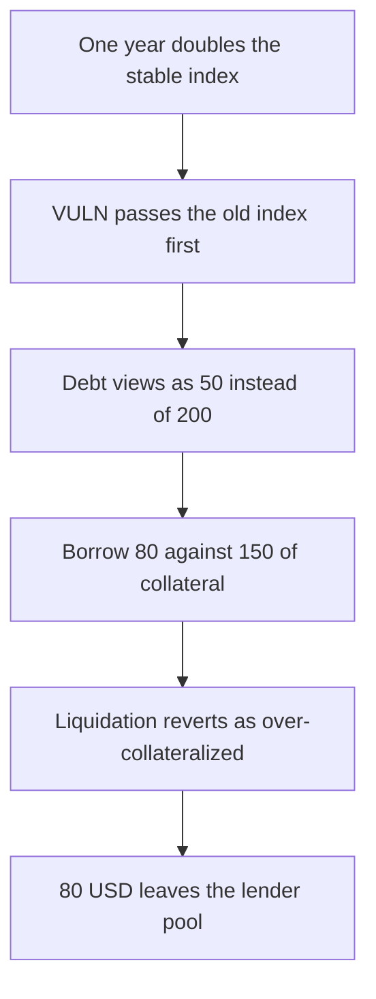

# Folks Finance: swapped stable-borrow indexes turn a 200 debt into 50 and release 80 more

> **Vulnerability classes:** vuln/logic/incorrect-order-of-operations · vuln/logic/liquidation-logic

<!-- non-defihacklabs -->
<!-- source-auditvault: https://github.com/Auditware/AuditVault/blob/main/findings/61079-wrong-borrow-balance-calculation-in-the-getloanliquidity-fun.md -->
<!-- date: 2024-08 -->

## Key info

| Field | Value |
|---|---|
| **Loss** | 80 USD drawn from lender cash while the true debt is already 200 against 150 of collateral |
| **Vulnerable contract** | `LoanManager.calcStableBorrowBalance` |
| **Attacker EOA** | `0x6107900000000000000000000000000000000001` |
| **Attack contract** | `Exploit` |
| **Attack tx** | `Exploit.run()` |
| **Chain / block / date** | Ethereum model · block 0 · 2024-08 |
| **Compiler** | solc 0.8.27, cancun, via IR |
| **Bug class** | `calcBorrowBalance` is called with the old index first |

## TL;DR

`calcBorrowBalance` expects `(balance, newIndex, oldIndex)`. `calcStableBorrowBalance` passes the stored index first and the updated index second. A year at 100 percent should turn 100 of principal into 200. The swapped call returns 50. Collateral of 150 then allows another 80 to be borrowed, and liquidation reverts as over-collateralized. The corrected order reports 200 and the extra borrow reverts.

## Background

Immunefi Boost Folks Finance report 34122, submitted 5 August 2024 by Nyksx. `updateLoanBorrowInterests` already calls `calcBorrowBalance` with the new index first. `getLoanLiquidity` does not, so stable loans look healthier as interest accrues.

## The vulnerable code

```solidity
uint256 stableBorrowInterestIndex = MathUtils.calcBorrowInterestIndex(
    loanInterestRate, loanInterestIndex, stableBorrowChangeDelta
);
// @> VULN: loanInterestIndex is the old index, so calcBorrowBalance divides the debt by the updated index
return balance.calcBorrowBalance(loanInterestIndex, stableBorrowInterestIndex);
```

`calcBorrowInterestIndex` returns `2e18` from a stored index of `1e18`. Dividing by that index yields half the principal.

## Root cause

The updated index and the stored index are passed in the opposite order from `updateLoanBorrowInterests`.

## Preconditions

- A stable borrow with principal 100, index `1e18`, and rate `1e18`.
- One year of elapsed time stored on the loan.
- Collateral value 150 and 200 of lender cash in the pool.

## Attack walkthrough

1. `debtOf` builds the new index and calls `calcBorrowBalance` with the indexes swapped. The result is 50.
2. The same numbers in the correct order are 200, which is already above collateral.
3. `borrow(80)` uses the view of 50, so `50 + 80` fits under 150. 80 USD is transferred.
4. `liquidate` reads the swapped debt again and reverts `OverCollateralizedLoan`. Collateral stays.
5. The fixed manager reverts the borrow and leaves the 200 in the pool.

## Diagrams


