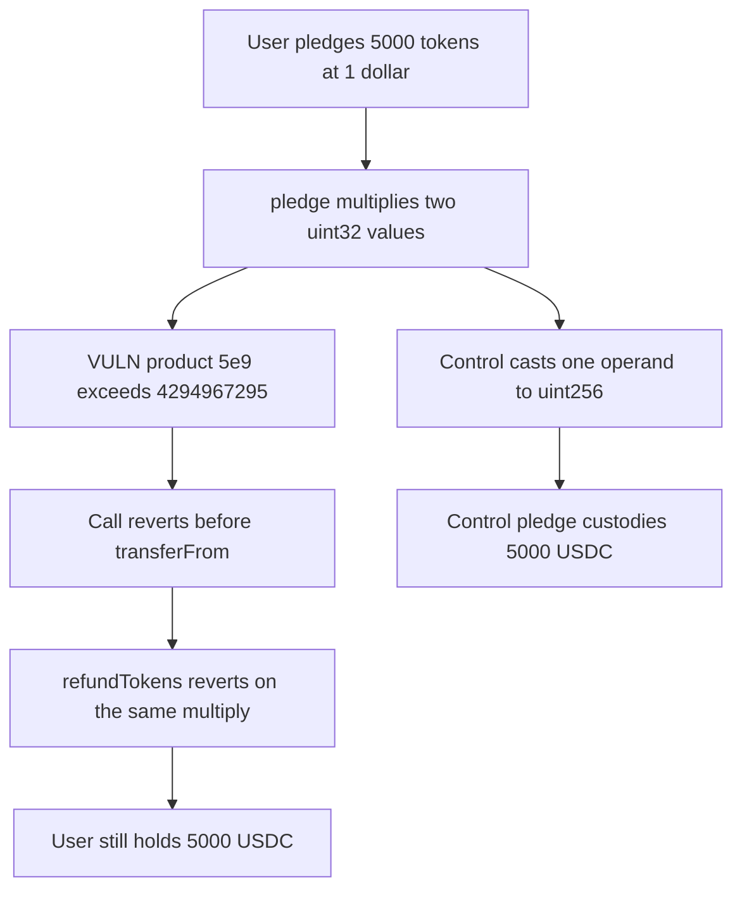

# Remora Pledge: uint32 multiplication reverts every pledge above about 4294 dollars

> **Vulnerability classes:** `vuln/arithmetic/decimal-mismatch` · `vuln/arithmetic/underflow`

<!-- non-defihacklabs -->
<!-- source-auditvault: https://github.com/Auditware/AuditVault/blob/main/findings/61172-pledgemanagerpledge-refundtokens-will-revert-due-to-overflow.md -->
<!-- date: 2025-07 -->

## Key info

| Field | Value |
|---|---|
| **Loss** | A 5000 USDC pledge reverts. The user still holds 5e9 units and the matching refund reverts too |
| **Vulnerable contract** | `PledgeManager.pledge` |
| **Attacker EOA** | `0x1111111111111111111111111111111111111111` |
| **Attack contract** | `Exploit` |
| **Attack tx** | `Exploit.run()` |
| **Chain / block / date** | Ethereum model · block 0 · 2025-07 |
| **Compiler** | solc 0.8.27, cancun |
| **Bug class** | uint32 times uint32 overflows before the uint256 assignment |

## TL;DR

`pledge` writes `uint256 stablecoinAmount = pricePerToken * numTokens` while both operands are `uint32`. Solidity multiplies in `uint32` first. At 6 decimals, `type(uint32).max` is about $4,294.96. A $1 price times 5,000 tokens is `5e9` and the call panics. `refundTokens` does the same multiply. The contract is not upgradeable.

## The vulnerable code

```solidity
uint256 stablecoinAmount = pricePerToken * numTokens; // @> VULN: uint32 product reverts above 4294967295
uint256 refundAmount = numTokens * pricePerToken; // @> VULN: same uint32 product
```

```diff
- uint256 stablecoinAmount = pricePerToken * numTokens;
+ uint256 stablecoinAmount = uint256(pricePerToken) * numTokens;
```

## Root cause

The widening to `uint256` happens after the product is evaluated. Checked arithmetic in 0.8 reverts instead of wrapping, so the pledge cannot be stored and cannot be refunded. A 4-token pledge at the same price fits and succeeds, which shows the approval and transfer path are fine.

## Preconditions

- `pricePerToken` is `1_000_000` (one dollar at 6 decimals).
- `numTokens` for the denied pledge is `5000`.
- The user has approved the manager and holds the `5e9` stablecoin units.

## Attack walkthrough

1. A 4-token pledge at $1 succeeds. The product is `4e6`, under the uint32 cap.
2. `pledge(1e6, 5000)` hits the multiply and reverts.
3. `refundTokens` with the same inputs reverts on `numTokens * pricePerToken`.
4. The user still holds `5e9` units.
5. The control casts one operand to `uint256` and custodies the full `5,000` USDC.

## Diagrams



## Impact

Any pledge whose 6-decimal notional exceeds about $4,294 reverts, and so does the refund of that size. Ordinary users cannot pledge 5,000 tokens at $1. Because the contract is not upgradeable, the cap is permanent.

## How to reproduce

```bash
cd 61172-pledgemanagerpledge-refundtokens-will-revert-due-to-overflow_exp
forge test -vv
```

`output.txt` is the captured passing run. The control test checks the recommended fix.

## Sources

- AuditVault finding: https://github.com/Auditware/AuditVault/blob/main/findings/61172-pledgemanagerpledge-refundtokens-will-revert-due-to-overflow.md
- Report: https://github.com/solodit/solodit_content/blob/main/reports/Cyfrin/2025-07-04-cyfrin-remora-pledge-v2.0.md
- Provenance: Cyfrin Remora Pledge v2.0, 2025-07-04, Dacian. Fixed in remora-projects/remora-smart-contracts commits a0b277f and ced21ba.
