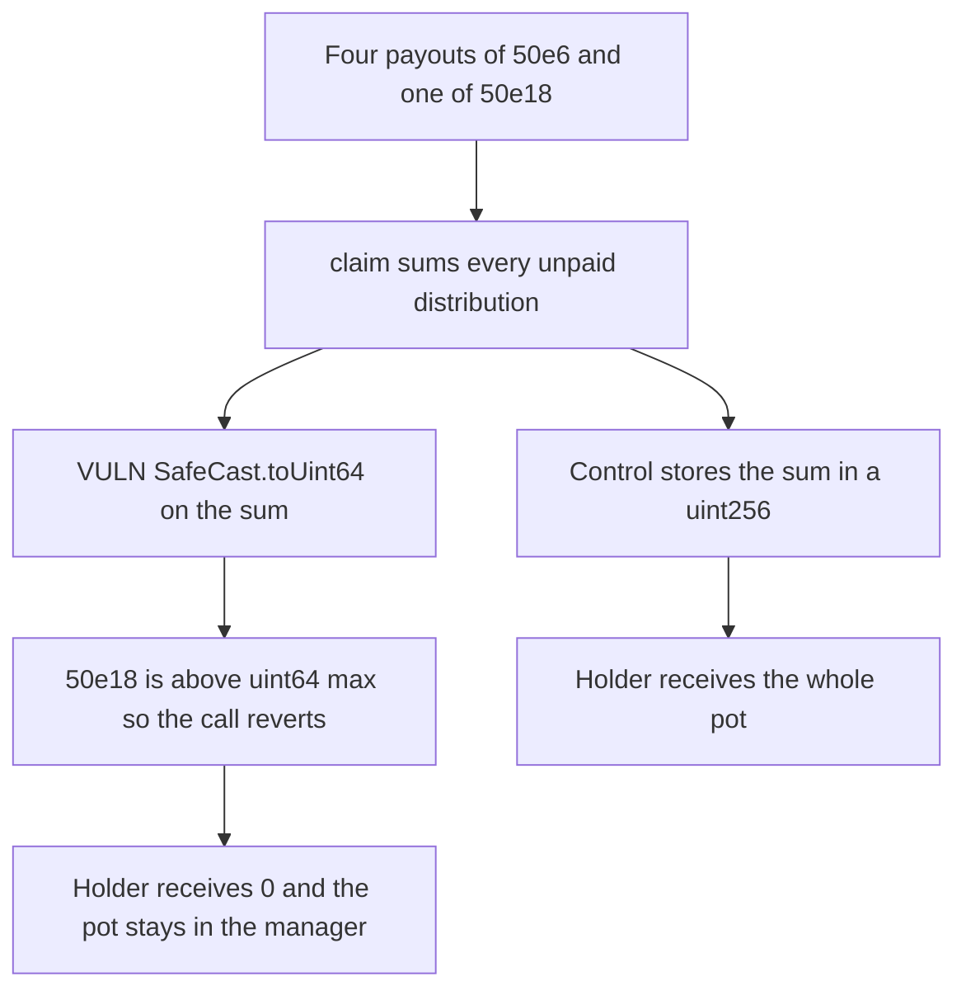

# Remora Pledge: a uint64 payout cast reverts and locks earlier distributions

> **Vulnerability classes:** `vuln/arithmetic/overflow` · `vuln/dos/frozen-funds`

<!-- non-defihacklabs -->
<!-- source-auditvault: https://github.com/Auditware/AuditVault/blob/main/findings/61173-distribution-of-payouts-will-revert-due-to-overflow-when-pay.md -->
<!-- date: 2025-07 -->

**AuditVault taxonomy:** `lang/solidity` · `sector/stable` · `platform/cyfrin` · `has/github` · `severity/high` · genome: `integer-bounds` · `known-pattern`

## Key info

| Field | Value |
|---|---|
| **Loss** | The whole pot stays in DividendManager. Four payouts of 50e6 plus one of 50e18 cannot be claimed. The holder balance stays 0 |
| **Vulnerable contract** | `DividendManager.payoutBalance` |
| **Attacker EOA** | `0x1111111111111111111111111111111111111111` |
| **Attack contract** | `Exploit` |
| **Attack tx** | `Exploit.run()` |
| **Chain / block / date** | Ethereum model · block 0 · 2025-07 |
| **Compiler** | solc 0.8.27, cancun, via IR |
| **Bug class** | `calculatedPayout` is a uint64 and the sum is cast with `SafeCast.toUint64` |

## TL;DR

Payouts were sized for a 6-decimal stablecoin. `calculatedPayout` was later narrowed to `uint64`. A payment token with 18 decimals makes one distribution of 50 tokens equal 50e18, which is larger than `type(uint64).max` (about 1.84e19). `payoutBalance` adds every unpaid distribution and then casts the sum. The cast reverts, so the holder cannot collect the new distribution or the four earlier ones of 50e6. The tokens stay in the manager. A uint256 accumulator pays the same pot.

## Background

Cyfrin's 4 July 2025 Remora Pledge review, Dacian. `DividendManager.calculatedPayout` was changed from `uint256` to `uint64` when PaymentSettler was introduced. The report shows `type(uint64).max > 20e18` is false, and walks a holder with several unpaid distributions whose latest one uses an 18-decimal stablecoin. Remora fixed it in commits `a0b277f` and `ced21ba`. Cyfrin verified the fix. The recommendation is a wider integer and decimal normalization inside PaymentSettler.

## The vulnerable code

```solidity
payoutAmount += (curEntry.tokenBalance * pInfo.amount) / pInfo.totalSupply;
if (payoutForwardAddr == address(0)) {
    // @> VULN: 50e18 plus the earlier payouts does not fit in uint64, so every unpaid distribution reverts
    holderStatus[holder].calculatedPayout += SafeCast.toUint64(payoutAmount);
}
```

`SafeCast.toUint64` reverts when `value > type(uint64).max`.

## Root cause

The stored payout is a raw token amount. Changing the stablecoin from 6 decimals to 18 multiplies a human amount by 1e12, and the narrowed storage type cannot hold the product. The cast sits after the loop, so one overflowing distribution blocks every distribution the loop already summed.

## Preconditions

- The holder owns the full supply, so each distribution contributes its face amount.
- Distributions 0 through 3 are 50e6. Distribution 4 is 50e18.
- `payRangeStart` is 4 and `payRangeEnd` is 0, so one claim covers all five. The manager holds the sum.

## Attack walkthrough

1. The pot is `4 * 50e6 + 50e18`, which is greater than `uint64` max. The four small payouts alone would fit.
2. `claim` calls `payoutBalance`. The loop adds all five amounts.
3. `SafeCast.toUint64` reverts. `claimed` stays false. The holder token balance stays 0. The manager still holds the pot.
4. The control writes the same sum into a `uint256` and transfers it. The holder receives the pot and the manager is empty.

## Diagrams



## Impact

The holder receives nothing. The manager keeps every unpaid token, including the 200e6 from the four distributions that would have fit in a uint64 by themselves. No later claim succeeds until the overflowing distribution is removed or the accumulator is widened, because the loop always reaches it.

## Remediation

Store `calculatedPayout` as at least `uint128`, and normalize payout amounts to a fixed decimal width in PaymentSettler before they are written, which is the review's recommendation.

## How to reproduce

```bash
cd 61173-distribution-of-payouts-will-revert-due-to-overflow-when-pay_exp
forge test -vv
```

`test_uint64_cast_locks_earlier_payouts` asserts the revert, a zero holder balance, and the pot still in the manager. `test_control_uint256_pays_the_pot` asserts the same sum transfers. Captured output is `output.txt`.

## Sources

- AuditVault finding: https://github.com/Auditware/AuditVault/blob/main/findings/61173-distribution-of-payouts-will-revert-due-to-overflow-when-pay.md
- Cyfrin report: https://github.com/solodit/solodit_content/blob/main/reports/Cyfrin/2025-07-04-cyfrin-remora-pledge-v2.0.md
- Blamed lines: https://github.com/remora-projects/remora-smart-contracts/blob/audit/Dacian/contracts/RWAToken/DividendManager.sol#L435-L440
- Fixes: https://github.com/remora-projects/remora-smart-contracts/commit/a0b277fe4a59354f3b3783c4b8c06eb60f5157610 and https://github.com/remora-projects/remora-smart-contracts/commit/ced21ba9758b814eb48a09a5e792aa89cc87e8f5
