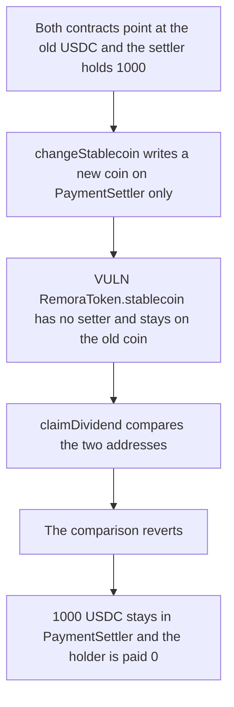

# Remora: changing PaymentSettler.stablecoin bricks dividend claims

> **Vulnerability classes:** `vuln/logic/incorrect-state-transition` · `vuln/logic/state-update`

<!-- non-defihacklabs -->
<!-- source-auditvault: https://github.com/Auditware/AuditVault/blob/main/findings/61177-paymentsettler-can-change-stablecoin-but-remoratoken-cant-re.md -->
<!-- date: 2025-07 -->

## Key info

| Field | Value |
|---|---|
| **Loss** | 1000 USDC dividends locked in PaymentSettler. claimDividend reverts |
| **Vulnerable contract** | `PaymentSettler.changeStablecoin` |
| **Attacker EOA** | `0x1111111111111111111111111111111111111111` (the holder, and the restricted caller in this reduction) |
| **Attack contract** | `Exploit` |
| **Attack tx** | `Exploit.run()` |
| **Chain / block / date** | Ethereum model · block 0 · 2025-07 |
| **Compiler** | solc 0.8.27, cancun, via IR |
| **Bug class** | One stablecoin slot can be updated and the other cannot |

## TL;DR

`RemoraToken.stablecoin` is documented as the same coin `PaymentSettler` uses, and the setter that used to live on `DividendManager` was removed. `PaymentSettler.changeStablecoin` still replaces its own slot. After that call the two addresses differ. `claimDividend` reverts on the mismatch, so 1000 USDC sitting in the settler for the holder is not paid. Before the change, the same claim pays the 1000.

## Background

Cyfrin's 4 July 2025 Remora Pledge v2.0 review, reported by Dacian. `RemoraToken` carries `address public stablecoin` with the comment that it must match the payment settler. `PaymentSettler` has the same member and a `restricted` `changeStablecoin`. Remora fixed this in commit `ced21ba` by deleting `stablecoin` from `RemoraToken` and settling fees through `PaymentSettler.settleTransferFee`. Cyfrin verified that commit.

## The vulnerable code

```solidity
address public stablecoin; // make sure same stablecoin is used here that is used in payment settler
```

```solidity
function changeStablecoin(address newStablecoin) external {
    if (newStablecoin == address(0)) revert InvalidAddress(); // @> VULN: this setter stores newStablecoin and RemoraToken has no matching write
    stablecoin = newStablecoin;
}
```

`claimDividend` reads both slots and reverts when they differ, which is the core payout the report says stops working:

```solidity
address tokenCoin = stablecoin;
address settlerCoin = settler.stablecoin();
if (tokenCoin != settlerCoin) revert("stablecoin mismatch");
```

The report's fix removes the token-side slot entirely:

```diff
- address public stablecoin;
- if (tokenCoin != settlerCoin) revert("stablecoin mismatch");
+ settler.pay(user, amount);
```

## Root cause

The two contracts each store a stablecoin address, and only one of them can change. Any later function that requires the addresses to be equal becomes unreachable. The dividend tokens are already in `PaymentSettler` under the old coin, and `pay` would transfer that old coin. The claim never gets that far.

## Preconditions

- `RemoraToken.stablecoin` and `PaymentSettler.stablecoin` both start as the old USDC.
- The holder is owed 1000, and the settler holds 1000 of the old USDC.
- The restricted caller invokes `changeStablecoin` with a new non-zero coin. `RemoraToken` has no function that can follow it.

## Attack walkthrough

1. Mint 1000 old USDC to the settler and record a 1000 dividend for the holder.
2. Call `changeStablecoin` with a freshly deployed USDC. The settler's slot updates. The token's slot does not.
3. `claimDividend` reads both addresses, sees they differ, and reverts.
4. The settler still holds 1000. The holder's balance is 0.
5. The control calls `claimDividend` before the change. The holder receives 1000 and the settler is empty.

## Diagrams



## Impact

The holder cannot claim 1000 USDC. The coins remain in `PaymentSettler` and every later `claimDividend` reverts on the same mismatch. There is no token function that restores the old pairing. The claim that runs before `changeStablecoin` pays the 1000 in full.

## Remediation

Do not keep a second `stablecoin` on `RemoraToken`. That is the change in `ced21ba`: the token calls `PaymentSettler` for the transfer, so there is only one slot to update. The report also warns that a new coin with different decimals corrupts accounting, which is a separate check on `changeStablecoin` itself.

## How to reproduce

```bash
cd 61177-paymentsettler-can-change-stablecoin-but-remoratoken-cant-re_exp
forge test -vv
```

`test_exploit_dividend_claim_reverts_and_locks_1000` asserts the claim reverts, the two slots differ, and the settler still holds 1000. `test_control_claim_pays_before_the_coin_changes` asserts the claim pays 1000 while the slots still match. Captured output is `output.txt`.

## Sources

- AuditVault finding: https://github.com/Auditware/AuditVault/blob/main/findings/61177-paymentsettler-can-change-stablecoin-but-remoratoken-cant-re.md
- Cyfrin report: https://github.com/solodit/solodit_content/blob/main/reports/Cyfrin/2025-07-04-cyfrin-remora-pledge-v2.0.md
- Fix commit: https://github.com/remora-projects/remora-smart-contracts/commit/ced21ba9758b814eb48a09a5e792aa89cc87e8f5
