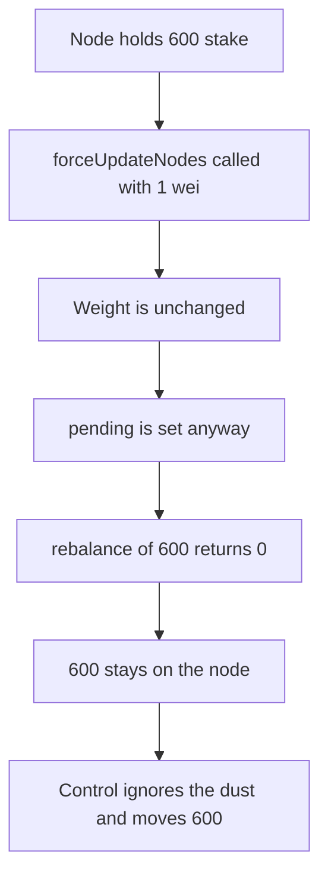

# Suzaku dust `forceUpdateNodes` leaves 600 stake that a rebalance should have moved

> **Vulnerability classes:** vuln/dos/permanent · vuln/logic/incorrect-state-transition

<!-- non-defihacklabs -->
<!-- source-auditvault: https://github.com/Auditware/AuditVault/blob/main/findings/61229-dust-limit-attack-on-forceupdatenodes-allows-dos-of-rebalanc.md -->
<!-- date: 2025-07 -->

## Key info

| Field | Value |
|---|---|
| **Loss** | 600 stake stays on the node. The control moves 600 |
| **Vulnerable contract** | `Middleware.forceUpdateNodes` |
| **Attacker EOA** | `0x1111111111111111111111111111111111111111` |
| **Attack contract** | `Exploit` |
| **Attack tx** | `Exploit.run()` |
| **Chain / block / date** | Ethereum model · block 0 · 2025-07 |
| **Compiler** | solc 0.8.27, cancun, via IR |
| **Bug class** | Dust update sets pending without changing weight |

## TL;DR

`forceUpdateNodes` is called with `limitStake` of 1 wei across two nodes. Weight is `stake / 1e12`, so 1 wei does not change it, but each node is still marked pending. `rebalance(600)` then returns 0 and the 600 stake stays on node 0. The control ignores an update whose weight does not change, so the same rebalance moves the 600.

## The vulnerable code

```solidity
if (!ignoreDust || beforeW != afterW) {
    // @> VULN: pending is set even when the dust update does not change weight.
    nodes[i].setPending(true);
}
```

The loop is two iterations. The control requires `beforeW != afterW` before setting pending.

## Root cause

A pending flag is how the middleware stops a second stake update in the same epoch. The dust call sets that flag without moving stake and without changing the P-Chain weight. The real rebalance, which should pull excess stake back to the vault, sees the flag and does nothing.

## Attack walkthrough

1. Node 0 is funded with 600 stake.
2. `forceUpdateNodes(1)` runs the two-node loop. Weight before and after is equal.
3. Both nodes are marked pending.
4. `rebalance(600)` sets `rebalanceReverted` and returns 0. The node still holds 600.
5. The control middleware sees equal weights and does not set pending.
6. Its rebalance pulls 600. The control node ends at 0.

## Diagrams



## Impact

600 stake that the vault withdrawal required to be rebalanced stays on the operator node for the epoch. The control moves that 600.

## PoC

```bash
cd 61229-dust-limit-attack-on-forceupdatenodes-allows-dos-of-rebalanc_exp
forge test -vv
```

`test_exploit_dust_blocks_rebalance` asserts 600e18 stayed, the rebalance was blocked, and the control moved 600e18.

## Sources

- AuditVault finding: https://github.com/Auditware/AuditVault/blob/main/findings/61229-dust-limit-attack-on-forceupdatenodes-allows-dos-of-rebalanc.md
- Cyfrin report: https://github.com/solodit/solodit_content/blob/main/reports/Cyfrin/2025-07-07-cyfrin-suzaku-core-v2.0.md
