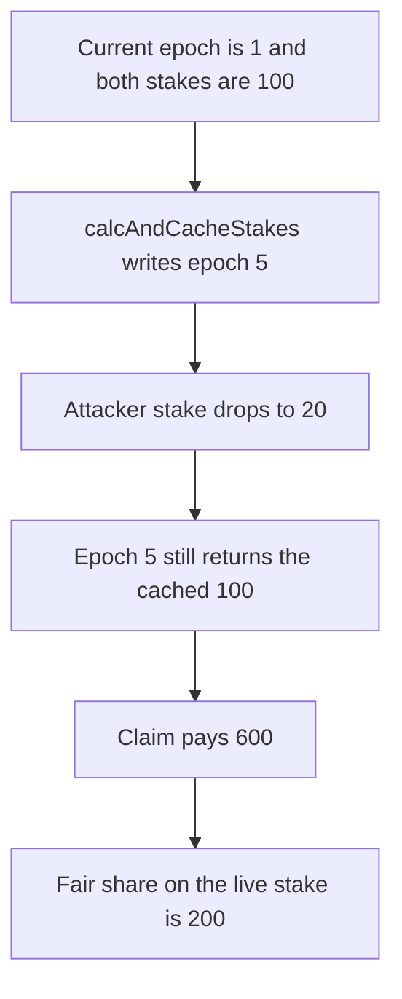

# Suzaku — caching a future epoch inflates the reward share

> **Vulnerability classes:** vuln/logic/reward-calculation · vuln/logic/missing-validation

> **Reproduction:** a self-contained Foundry PoC that compiles and runs offline
> with only `forge-std` — no fork and no RPC. Trace: [output.txt](output.txt).
> PoC: [test/61230-future-epoch-cache-manipulation-via-calcandcachestakes-allow_exp.sol](test/61230-future-epoch-cache-manipulation-via-calcandcachestakes-allow_exp.sol).

<!-- non-defihacklabs -->
<!-- source-auditvault: https://github.com/Auditware/AuditVault/blob/main/findings/61230-future-epoch-cache-manipulation-via-calcandcachestakes-allow.md -->
<!-- date: 2025-07 -->

---

## Key info

| | |
|---|---|
| **Impact** | **HIGH** — the attacker is paid **600 RWD** when the fair share is **200 RWD** |
| **Protocol** | Suzaku Core `AvalancheL1Middleware` |
| **Vulnerable code** | `calcAndCacheStakes` caches any epoch, including a future one |
| **Bug class** | A future-epoch cache freezes today's stake and the reward math keeps using it |
| **Finding** | Cyfrin (0kage) — Suzaku Core, 7 July 2025 · id 61230 |
| **Report** | [2025-07-07-cyfrin-suzaku-core-v2.0.md](https://github.com/solodit/solodit_content/blob/main/reports/Cyfrin/2025-07-07-cyfrin-suzaku-core-v2.0.md) |
| **Source** | [AuditVault finding](https://github.com/Auditware/AuditVault/blob/main/findings/61230-future-epoch-cache-manipulation-via-calcandcachestakes-allow.md) |
| **Status** | Fixed in suzaku-core commit `32b1a6c`. Reproduced here as a local synthetic. |
| **Compiler** | solc 0.8.27, cancun, via IR |

---

## TL;DR

`calcAndCacheStakes` calls `getEpochStartTs(epoch)` and writes the stake cache. It never requires `epoch <= getCurrentEpoch()`. Once `totalStakeCached` is set, `getOperatorStake` returns the cached value forever.

The current epoch is **1**. The attacker caches epoch **5** while their stake is **100** and the honest operator's stake is **100**. The cached total is **200**. The attacker then drops their live stake to **20**. The live total is **120**.

A reward of **1200 RWD** is paid from that cache:

- Cached share: `1200 * 100 / 200 = 600 RWD`.
- Fair share on the live stake: `1200 * 20 / 120 = 200 RWD`.

The attacker receives **600**. The honest operator receives **600** instead of **1000**. The fixed function returns without writing the cache when the epoch is in the future, and the same claim pays **200**.

`run()` does not warp. The epoch number is an argument. The current epoch stays 1 for the whole transaction.

## The vulnerable code

```solidity
function calcAndCacheStakes(uint48 epoch, uint96 assetClassId) public returns (uint256 totalStake) {
    uint48 epochStartTs = getEpochStartTs(epoch); // No validation of epoch timing
    lastEpochStart = epochStartTs;
    // @> VULN: epoch is not checked against getCurrentEpoch, so today's stake is stored for a future epoch
    totalStakeCached[epoch][assetClassId] = true;
    operatorStakeCache[epoch][assetClassId][operatorA] = stakeOf[operatorA];
    operatorStakeCache[epoch][assetClassId][operatorB] = stakeOf[operatorB];
    totalStakeCache[epoch][assetClassId] = stakeOf[operatorA] + stakeOf[operatorB];
    totalStake = totalStakeCache[epoch][assetClassId];
}

function getOperatorStake(address operator, uint48 epoch, uint96 assetClassId) public view returns (uint256 stake) {
    if (totalStakeCached[epoch][assetClassId]) {
        uint256 cachedStake = operatorStakeCache[epoch][assetClassId][operator];
        return cachedStake;
    }
    return stakeOf[operator];
}
```

A future `epochStartTs` is what the report's checkpoint lookup treats as "latest known stake". This reduction snapshots `stakeOf` at the call, which is that latest value.

## Root cause

The cache is a permanent answer for that epoch and asset class. Writing it before the epoch starts freezes a stake that the operator can still change. `getOperatorStake` does not fall through to the live stake once the flag is set, so the reward weight stays at the pre-drop number.

## Preconditions

- `getCurrentEpoch()` is **1**. The cached epoch is **5**.
- At the cache call the attacker has **100** and the honest operator has **100**.
- After the cache the attacker's live stake is **20**. The honest stake stays **100**.
- The epoch reward is **1200 RWD**, minted to the middleware before the claims.

## Attack walkthrough

1. Set both stakes to **100**. Call `calcAndCacheStakes(5, 1)`. The returned total is **200**. `getEpochStartTs(5)` is stored and not checked.
2. Set the attacker's live stake to **20**. `getOperatorStake(attacker, 5)` is still **100**.
3. Fair share from the live numbers: `1200 * 20 / 120 = 200`.
4. Mint **1200 RWD** and claim epoch 5. The attacker is paid `1200 * 100 / 200 = 600`. The honest operator is paid the other **600**.
5. **600** is greater than **200**. The attacker's balance is **600 RWD**.

Control: `calcAndCacheStakes(5)` returns **0** and leaves `totalStakeCached` clear. After the same drop to **20**, `getOperatorStake` is **20** and the claim pays **200 RWD**.

## Diagrams



## Impact

The attacker receives **600 RWD** from a **1200 RWD** reward. The fair share after the stake drop is **200 RWD**. The extra **400 RWD** is taken from the honest operator, who is paid **600** instead of **1000**. The fixed path pays the attacker **200** and does not keep the future cache.

## Remediation

Require `epoch <= getCurrentEpoch()` at the start of `calcAndCacheStakes`, and return without setting `totalStakeCached` when the epoch is still in the future. Suzaku did this in commit `32b1a6c`.

## Sources

- [AuditVault finding 61230](https://github.com/Auditware/AuditVault/blob/main/findings/61230-future-epoch-cache-manipulation-via-calcandcachestakes-allow.md)
- [Cyfrin Suzaku Core report, 7 July 2025](https://github.com/solodit/solodit_content/blob/main/reports/Cyfrin/2025-07-07-cyfrin-suzaku-core-v2.0.md)
- Fix: [suzaku-core@32b1a6c](https://github.com/suzaku-network/suzaku-core/commit/32b1a6c55c1ab436c557114939afb3163cc9ec8f)

### Taxonomy

- `severity/high`
- `vuln/logic/reward-calculation` · `vuln/logic/missing-validation`
