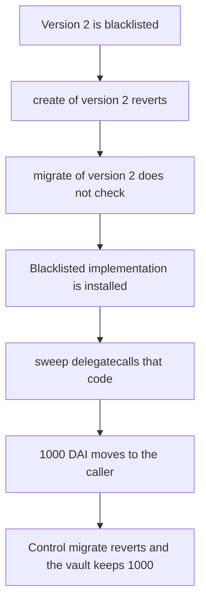

# Suzaku migrate installs blacklisted version 2, which sweeps 1,000 DAI

> **Vulnerability classes:** vuln/access-control/missing-auth · vuln/dependency/upgradeable-contract

<!-- non-defihacklabs -->
<!-- source-auditvault: https://github.com/Auditware/AuditVault/blob/main/findings/61231-blacklisted-implementation-versions-are-accessible-through-m.md -->
<!-- date: 2025-07 -->

## Key info

| Field | Value |
|---|---|
| **Loss** | Blacklisted version 2 sweeps 1,000 DAI. The control migrate reverts and the vault keeps 1,000 |
| **Vulnerable contract** | `Factory.migrate` |
| **Attacker EOA** | `0x1111111111111111111111111111111111111111` |
| **Attack contract** | `Exploit` |
| **Attack tx** | `Exploit.run()` |
| **Chain / block / date** | Ethereum model · block 0 · 2025-07 |
| **Compiler** | solc 0.8.27, cancun, via IR |
| **Bug class** | Blacklist enforced on create, skipped on migrate |

## TL;DR

Version 2 is blacklisted. `create(2)` reverts. `migrate(vault, 2)` does not read the blacklist and installs that implementation. The vault then delegatecalls `sweep`, and the blacklisted code transfers 1,000 DAI to the caller. The control migrate checks the blacklist, reverts, and its vault still holds 1,000 DAI.

## The vulnerable code

```solidity
function migrate(Vault vault, uint64 version) external {
    if (checkMigrate) {
        require(!blacklisted[version], "blacklisted");
    }
    // @> VULN: migrate does not read blacklisted[version], so version 2 is installed.
    vault.setImpl(address(bad));
}
```

`create` always requires `!blacklisted[version]`.

## Root cause

The blacklist was added on the creation path only. Migration of an existing vault writes the implementation directly. Once that implementation is installed, its code runs through the vault, including a sweep of the vault's collateral.

## Attack walkthrough

1. The vault holds 1,000 DAI. Version 2 is already blacklisted.
2. `create(2)` hits `require(!blacklisted[2])` and reverts.
3. `migrate(vault, 2)` skips that require and calls `setImpl`.
4. `sweep` delegatecalls the blacklisted implementation.
5. `Dai.transfer` moves 1,000 DAI to the caller. The vault balance is 0.
6. The control factory's migrate hits the same require and reverts. Its vault still holds 1,000 DAI.

## Diagrams



## Impact

A version the factory refused to deploy is still reachable. Its code executes and moves 1,000 DAI out of the vault. The control blocks the version and the 1,000 stays.

## PoC

```bash
cd 61231-blacklisted-implementation-versions-are-accessible-through-m_exp
forge test -vv
```

`test_exploit_blacklisted_impl_sweeps` asserts 1,000e18 was swept, create and the control migrate both reverted, and the control vault still holds 1,000e18.

## Sources

- AuditVault finding: https://github.com/Auditware/AuditVault/blob/main/findings/61231-blacklisted-implementation-versions-are-accessible-through-m.md
- Cyfrin report: https://github.com/solodit/solodit_content/blob/main/reports/Cyfrin/2025-07-07-cyfrin-suzaku-core-v2.0.md
