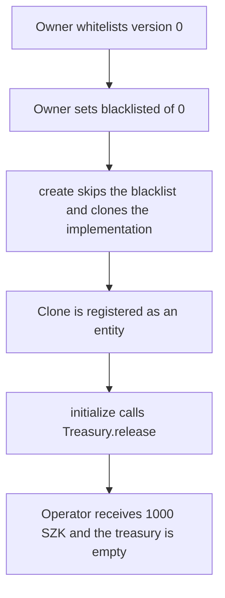

# Suzaku Core — a blacklisted delegator version still becomes an entity and pulls 1000 SZK

> **Vulnerability classes:** vuln/access-control/missing-check · vuln/access-control/broken-logic · vuln/logic/missing-check

> **Reproduction:** a self-contained Foundry PoC that compiles and runs offline
> with only `forge-std` — no fork and no RPC. Trace: [output.txt](output.txt).
> PoC: [test/61232-in-delegatorfactory-new-entity-can-be-created-for-a-blacklis_exp.sol](test/61232-in-delegatorfactory-new-entity-can-be-created-for-a-blacklis_exp.sol).

<!-- non-defihacklabs -->
<!-- source-auditvault: https://github.com/Auditware/AuditVault/blob/main/findings/61232-in-delegatorfactory-new-entity-can-be-created-for-a-blacklis.md -->
<!-- date: 2025-07 -->

---

## Key info

| | |
|---|---|
| **Impact** | **HIGH** — version 0 is blacklisted and `create` still registers an entity. That entity pulls **1000 SZK** out of the treasury |
| **Protocol** | Suzaku Core `DelegatorFactory` |
| **Vulnerable code** | `create` clones and initializes without reading `blacklisted[type_]` |
| **Bug class** | A governance blacklist does not bind the factory |
| **Finding** | Cyfrin (0kage) — Suzaku Core, 7 July 2025 · id 61232 |
| **Report** | [2025-07-07-cyfrin-suzaku-core-v2.0.md](https://github.com/solodit/solodit_content/blob/main/reports/Cyfrin/2025-07-07-cyfrin-suzaku-core-v2.0.md) |
| **Source** | [AuditVault finding](https://github.com/Auditware/AuditVault/blob/main/findings/61232-in-delegatorfactory-new-entity-can-be-created-for-a-blacklis.md) |
| **Status** | Fixed in suzaku-core commit `292d5b7` (`DelegatorFactory__VersionBlacklisted`). Reproduced here as a local synthetic. |
| **Compiler** | solc 0.8.27, cancun, via IR |

---

## TL;DR

The owner whitelists an entity implementation as version 0, then blacklists that version. `DelegatorFactory.create` never loads `blacklisted[type_]`. The call still `cloneDeterministic`s the implementation, pushes it into the entity set, and calls `initialize`. The treasury treats every registered entity as allowed to `release` funds, so the new entity transfers **1000 SZK** to the caller. The treasury balance goes from 1000 to 0 while `blacklisted[0]` stays true.

The fixed factory reverts `DelegatorFactory__VersionBlacklisted` on the same inputs. No entity is created and the 1000 SZK stays in the treasury.

## Vulnerable code

Pre-fix `create`, copied from the factory body Suzaku patched in `292d5b7`:

```solidity
function create(uint64 type_, bytes calldata data) external returns (address entity_) {
    entity_ = implementation(type_).cloneDeterministic(keccak256(abi.encode(totalEntities(), type_, data)));
    _addDelegatorEntity(entity_);
    IEntity(entity_).initialize(data);
}

function cloneDeterministic(address implementation, bytes32 salt) internal returns (address instance) {
    // @> VULN: create2 still deploys this version after it was blacklisted
    assembly ("memory-safe") {
        mstore(0x00, or(shr(0xe8, shl(0x60, implementation)), 0x3d602d80600a3d3981f3363d3d373d3d3d363d73000000))
        mstore(0x20, or(shl(0x78, implementation), 0x5af43d82803e903d91602b57fd5bf3))
        instance := create2(0, 0x09, 0x37, salt)
    }
}
```

The patch that shipped:

```diff
 function create(uint64 type_, bytes calldata data) external returns (address entity_) {
+    if (blacklisted[type_]) {
+        revert DelegatorFactory__VersionBlacklisted();
+    }
     entity_ = implementation(type_).cloneDeterministic(keccak256(abi.encode(totalEntities(), type_, data)));
     _addDelegatorEntity(entity_);
     IEntity(entity_).initialize(data);
 }
```

## Attack walkthrough

1. The operator mints **1000 SZK** into the treasury. The treasury's `release` pays any address the factory has registered with `isEntity`.
2. `whitelist` accepts the implementation as version 0. `FACTORY()` and `TYPE()` match.
3. `blacklist(0)` sets `blacklisted[0] = true`.
4. `create(0, abi.encode(treasury, operator, 1000 ether))` still clones the implementation. The clone is registered, then `initialize` runs.
5. `initialize` calls `Treasury.release`. The clone is already an entity, so the treasury transfers **1000 SZK** to the operator.
6. `blacklisted[0]` is still true, `isEntity(clone)` is true, the operator holds 1000 SZK, and the treasury holds 0.

Control: `DelegatorFactoryFixed.create` hits `DelegatorFactory__VersionBlacklisted` and returns no entity. The treasury still holds 1000 SZK. The caller receives 0.

## Diagrams



## Impact

The operator receives **1000 SZK** from the treasury by deploying an entity of a version the owner has already blacklisted. The blacklist flag does not stop `create`, and the entity set is what the treasury trusts. The same call on the fixed factory reverts and moves 0.

## Remediation

Reject blacklisted versions at the top of `create` with `DelegatorFactory__VersionBlacklisted`, which is what suzaku-core commit `292d5b7` does. Do not register or initialize the clone when the flag is set.

## Sources

- [AuditVault finding 61232](https://github.com/Auditware/AuditVault/blob/main/findings/61232-in-delegatorfactory-new-entity-can-be-created-for-a-blacklis.md)
- [Cyfrin Suzaku Core report, 7 July 2025](https://github.com/solodit/solodit_content/blob/main/reports/Cyfrin/2025-07-07-cyfrin-suzaku-core-v2.0.md)
- Vulnerable factory and the fix: [suzaku-core@292d5b7 `src/contracts/DelegatorFactory.sol`](https://github.com/suzaku-network/suzaku-core/blob/292d5b71ac3a377351d66f239405c4d38af53830/src/contracts/DelegatorFactory.sol)

### Taxonomy

- `severity/high`
- `vuln/access-control/missing-check` · `vuln/access-control/broken-logic` · `vuln/logic/missing-check`
