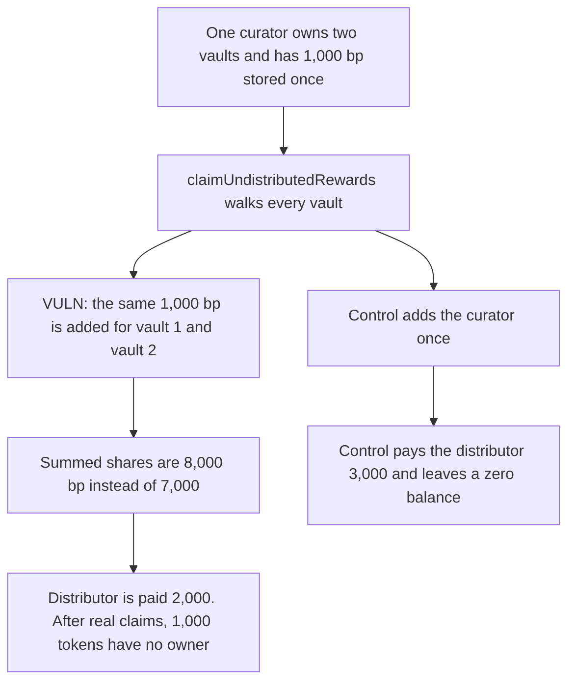

# Suzaku counts one curator's share twice and locks 1,000 of the epoch's reward tokens

> **Vulnerability classes:** vuln/logic/reward-calculation · vuln/dos/frozen-funds

<!-- non-defihacklabs -->
<!-- source-auditvault: https://github.com/Auditware/AuditVault/blob/main/findings/61233-incorrect-summation-of-curator-shares-in-claimundistributedr.md -->
<!-- date: 2025-07 -->

## Key info

| Field | Value |
|---|---|
| **Loss** | 1,000 reward tokens left in the contract. The distributor is paid 2,000 instead of 3,000 |
| **Vulnerable contract** | `Rewards.claimUndistributedRewards` |
| **Attacker EOA** | `0x0000000000000000000000000000000000061233` (the rewards distributor) |
| **Attack contract** | `Exploit` |
| **Attack tx** | `Exploit.run()` |
| **Chain / block / date** | Ethereum model · block 0 · 2025-07 |
| **Compiler** | solc 0.8.27, cancun, via IR |
| **Bug class** | Curator total is added once per vault the curator owns |

## TL;DR

`curatorShares[epoch][curator]` already stores that curator's total. `claimUndistributedRewards` adds it again for every vault the curator owns. Two vaults turn 1,000 bp into 2,000 bp, so the summed shares are 8,000 instead of 7,000. Of 10,000 reward tokens, the distributor is paid 2,000 rather than 3,000. After the operator, both vaults, and the curator take their real shares, 1,000 tokens have no claimant. Counting the curator once pays the distributor 3,000 and leaves a zero balance.

## Background

Cyfrin's July 2025 Suzaku Core review. Undistributed rewards are whatever basis points were not assigned to operators, vaults, or curators. The curator figure is accumulated once, across every vault that curator owns, and then the claim loop walks vaults again.

## The vulnerable code

```solidity
// @> VULN: curatorShares already stores the curator's total, but it is added again for every vault they own
for (uint256 i = 0; i < vaults.length; i++) {
    address curatorOwner = VaultTokenized(vaults[i]).owner();
    totalDistributedShares += curatorShares[epoch][curatorOwner];
}
```

Both vaults return the same owner. The stored share is 1,000 bp. The loop adds 2,000 bp. Operator 2,000 plus two vaults at 2,000 plus that double count is 8,000 bp.

## Root cause

The mapping is a total, and the loop treats it as a per-vault value. The second add does not correspond to any second claim the curator can make.

## Preconditions

- One curator owns two vaults that were active in the epoch.
- Stored shares are operator 2,000 bp, each vault 2,000 bp, curator 1,000 bp.
- The epoch is funded with 10,000 reward tokens.
- The distributor calls `claimUndistributedRewards`. Individual claimants then take their stored shares once.

## Attack walkthrough

1. 10,000 reward tokens are minted into the rewards contract.
2. The distributor claims. The curator loop runs twice.
3. `totalDistributedShares` is 8,000. Undistributed rewards are 2,000, not 3,000.
4. The operator claims 2,000, each vault claims 2,000, and the curator claims 1,000.
5. 1,000 tokens are still in the contract. No remaining share points at them.
6. The control adds the curator once. The distributor receives 3,000 and the contract balance is 0.

## Diagrams



## Impact

1,000 of the 10,000 reward tokens stay in the contract after every party with a stored share has claimed. The distributor is short 1,000 tokens relative to the fair undistributed amount. The control pays that 1,000 to the distributor and empties the contract.

## Remediation

Iterate the unique curator addresses for the epoch, and add `curatorShares[epoch][curator]` once per curator.

## How to reproduce

```bash
cd 61233-incorrect-summation-of-curator-shares-in-claimundistributedr_exp
forge test -vv
```

`test_exploit_double_counts_curator_and_locks_rewards` asserts an 8,000 bp sum, a 2,000 token distributor payment, and 1,000 tokens left behind. `test_control_curator_is_counted_once` asserts a 3,000 token payment and a zero balance. Captured output is `output.txt`.

## Sources

- AuditVault finding: https://github.com/Auditware/AuditVault/blob/main/findings/61233-incorrect-summation-of-curator-shares-in-claimundistributedr.md
- Cyfrin report: https://github.com/solodit/solodit_content/blob/main/reports/Cyfrin/2025-07-07-cyfrin-suzaku-core-v2.0.md
- Fix: https://github.com/suzaku-network/suzaku-core/pull/155/commits/8f4adaaca91402b1bde166f2d02c3ac9d72fc96c
