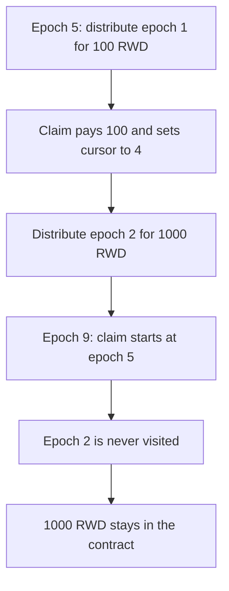

# Suzaku — claiming sets the cursor past undistributed epochs

> **Vulnerability classes:** vuln/logic/reward-calculation · vuln/logic/incorrect-state-transition

> **Reproduction:** a self-contained Foundry PoC that compiles and runs offline
> with only `forge-std` — no fork and no RPC. Trace: [output.txt](output.txt).
> PoC: [test/61234-incorrect-reward-claim-logic-causes-loss-of-access-to-interm_exp.sol](test/61234-incorrect-reward-claim-logic-causes-loss-of-access-to-interm_exp.sol).

<!-- non-defihacklabs -->
<!-- source-auditvault: https://github.com/Auditware/AuditVault/blob/main/findings/61234-incorrect-reward-claim-logic-causes-loss-of-access-to-interm.md -->
<!-- date: 2025-07 -->

---

## Key info

| | |
|---|---|
| **Impact** | **HIGH** — **1,000 RWD** of epoch-2 operator rewards are left in the contract and can never be claimed |
| **Protocol** | Suzaku Core `Rewards` |
| **Vulnerable code** | `claimOperatorFee` assigns `lastEpochClaimedOperator = currentEpoch - 1` |
| **Bug class** | Claim cursor skips epochs that are distributed later |
| **Finding** | Cyfrin (0kage) — Suzaku Core, 7 July 2025 · id 61234 |
| **Report** | [2025-07-07-cyfrin-suzaku-core-v2.0.md](https://github.com/solodit/solodit_content/blob/main/reports/Cyfrin/2025-07-07-cyfrin-suzaku-core-v2.0.md) |
| **Source** | [AuditVault finding](https://github.com/Auditware/AuditVault/blob/main/findings/61234-incorrect-reward-claim-logic-causes-loss-of-access-to-interm.md) |
| **Status** | Fixed in suzaku-core commit `6a0cbb1`. Reproduced here as a local synthetic. |
| **Compiler** | solc 0.8.27, cancun, via IR |

---

## TL;DR

`claimOperatorFee` pays whatever epochs are already in the map, then sets the operator's cursor to `currentEpoch - 1`. Epochs that get distributed after that claim, but before the cursor, are never visited again.

In the report's sequence, with **N = 1,000 RWD** on epoch 2:

1. At epoch 5, only epoch 1 (100 RWD) has been distributed. The claim pays **100 RWD** and sets the cursor to **4**.
2. Epoch 2 is then distributed: the operator's share is **1,000 RWD**.
3. At epoch 9 the next claim starts at epoch 5. Epoch 2 is behind the cursor. The sum is zero, the call reverts, and **1,000 RWD** stays in the contract.

The real middleware derives the epoch from time. This replay is one block, so the same `getCurrentEpoch()` value is advanced between those steps instead of warping the timestamp.

## The vulnerable code

Pre-fix body of `claimOperatorFee`, reduced to one rewards token and one operator share:

```solidity
uint48 currentEpoch = middleware.getCurrentEpoch();
uint48 lastClaimedEpoch = lastEpochClaimedOperator[msg.sender][rewardsToken];
uint256 totalRewards = 0;
for (uint48 epoch = lastClaimedEpoch + 1; epoch < currentEpoch; ++epoch) {
    uint256 rewardsAmount = epochRewards[epoch];
    if (rewardsAmount == 0) continue;
    uint256 share = operatorShares[epoch][msg.sender];
    if (share == 0) continue;
    totalRewards += rewardsAmount * share / BPS;
}
if (totalRewards == 0) revert NoRewardsToClaim(msg.sender);
lastEpochClaimedOperator[msg.sender][rewardsToken] = currentEpoch - 1; // @> VULN: skips epochs not yet distributed
Token(rewardsToken).transfer(recipient, totalRewards);
```

The fixed contract stores `newLast` only for epochs that actually paid, so the first claim stops at epoch 1.

## Root cause

The cursor is not "the highest epoch this call paid". It is "every epoch before the current one", including holes that have not been distributed. A later `distributeRewards` for one of those holes cannot be claimed, because the next loop starts above it.

## Preconditions

- The operator claims while `currentEpoch` is ahead of an epoch that will be distributed later.
- That later epoch has a non-zero operator share. Here it is 100 percent of **1,000 RWD**.
- The first claim pays something, so it does not revert before the cursor write. Epoch 1 supplies that payment.

## Attack walkthrough

1. Mint **1,100 RWD** into the rewards contract: 100 for epoch 1 and 1,000 for epoch 2.
2. Set the epoch to 5. Distribute epoch 1 only.
3. `claimOperatorFee` pays **100 RWD** and writes `lastEpochClaimedOperator = 4`.
4. Distribute epoch 2 for **1,000 RWD** to the same operator.
5. Set the epoch to 9 and claim again. The loop is `for (epoch = 5; epoch < 9; ...)`. Epoch 2 is not in it. The claim reverts with no rewards.
6. The rewards contract still holds **1,000 RWD**. The operator's balance is still **100 RWD**.

Control: the cursor moves only to an epoch that paid. After the epoch-5 claim it is **1**, not 4. The epoch-9 claim includes epoch 2 and pays the **1,000 RWD**. The rewards contract ends empty, and the operator holds **1,100 RWD**.

## Diagrams



## Impact

The operator permanently loses access to **1,000 RWD** that was distributed for epoch 2. The tokens remain in the rewards contract. Any intermediate epoch distributed after a claim that has already advanced `lastEpochClaimedOperator` to `currentEpoch - 1` is skipped the same way.

## Remediation

Set `lastEpochClaimedOperator` to the highest epoch the call actually paid, and do not advance the cursor across epochs that have not been distributed. Suzaku did this in commit `6a0cbb1` by breaking the loop on an incomplete distribution and storing `newLast`.

## Sources

- [AuditVault finding 61234](https://github.com/Auditware/AuditVault/blob/main/findings/61234-incorrect-reward-claim-logic-causes-loss-of-access-to-interm.md)
- [Cyfrin Suzaku Core report, 7 July 2025](https://github.com/solodit/solodit_content/blob/main/reports/Cyfrin/2025-07-07-cyfrin-suzaku-core-v2.0.md)
- Fix: [suzaku-core@6a0cbb1](https://github.com/suzaku-network/suzaku-core/commit/6a0cbb1faa796e8925decad1ce9860eb20f184e7)

### Taxonomy

- `severity/high`
- `vuln/logic/reward-calculation` · `vuln/logic/incorrect-state-transition`
