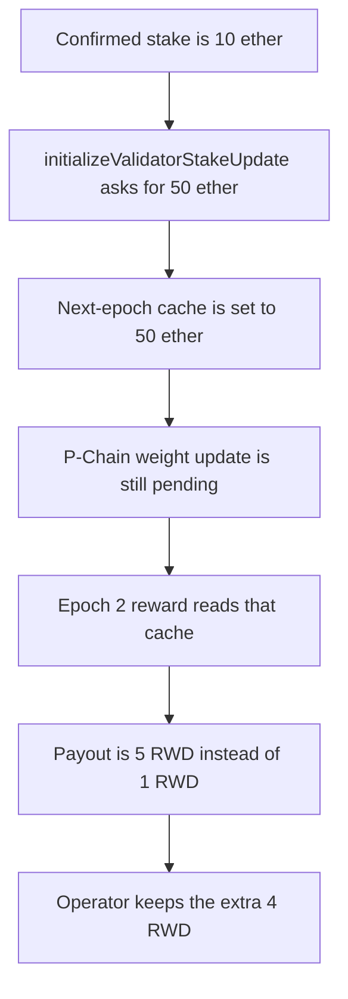

# Suzaku — stake cache pays rewards before P-Chain confirmation

> **Vulnerability classes:** vuln/logic/reward-calculation · vuln/logic/incorrect-state-transition

> **Reproduction:** a self-contained Foundry PoC that compiles and runs offline
> with only `forge-std` — no fork and no RPC. Trace: [output.txt](output.txt).
> PoC: [test/61236-immediate-stake-cache-updates-enable-reward-distribution-wit_exp.sol](test/61236-immediate-stake-cache-updates-enable-reward-distribution-wit_exp.sol).

<!-- non-defihacklabs -->
<!-- source-auditvault: https://github.com/Auditware/AuditVault/blob/main/findings/61236-immediate-stake-cache-updates-enable-reward-distribution-wit.md -->
<!-- date: 2025-07 -->

---

## Key info

| | |
|---|---|
| **Impact** | **HIGH** — the operator is paid **4 RWD extra**. Unconfirmed stake of 50 ether pays **5 RWD**; the confirmed stake of 10 ether pays **1 RWD** |
| **Protocol** | Suzaku Core `AvalancheL1Middleware` |
| **Vulnerable code** | `initializeValidatorStakeUpdate` writes `nodeStakeCache[currentEpoch + 1]` before the P-Chain confirms |
| **Bug class** | Reward uses a stake cache that was updated before confirmation |
| **Finding** | Cyfrin (0kage) — Suzaku Core, 7 July 2025 · id 61236 |
| **Report** | [2025-07-07-cyfrin-suzaku-core-v2.0.md](https://github.com/solodit/solodit_content/blob/main/reports/Cyfrin/2025-07-07-cyfrin-suzaku-core-v2.0.md) |
| **Source** | [AuditVault finding](https://github.com/Auditware/AuditVault/blob/main/findings/61236-immediate-stake-cache-updates-enable-reward-distribution-wit.md) |
| **Status** | Fixed in suzaku-core commit `5157351`. Reproduced here as a local synthetic. |
| **Compiler** | solc 0.8.27, cancun, via IR |

---

## TL;DR

`initializeValidatorStakeUpdate` writes the operator's next-epoch stake into `nodeStakeCache` as soon as the update is requested. The P-Chain weight update is still pending. Reward math reads that cache and does not check the pending flag.

With a confirmed stake of **10 ether** and a requested stake of **50 ether**, reward = stake / 10:

1. The cache for the next epoch becomes **50 ether** while `nodePendingUpdate` is still true.
2. The epoch counter moves to 2. The reward pays **5 RWD**.
3. The confirmed stake would have paid **1 RWD**. The operator keeps the **4 RWD** difference.

The real middleware derives the epoch from time. This replay is one block, so the same `getCurrentEpoch()` value is advanced between those steps instead of warping the timestamp.

## The vulnerable code

Pre-fix body of the cache write, reduced to one node and one asset class:

```solidity
function initializeValidatorStakeUpdate(uint256 newStake) external {
    uint48 currentEpoch = getCurrentEpoch();
    nodePendingUpdate[validationID] = true;
    // @> VULN: next-epoch stake is cached before the P-Chain confirms the weight update
    nodeStakeCache[currentEpoch + 1][validationID] = newStake;
}
```

`getOperatorUsedStakeCachedPerEpoch` then adds `nodeStakeCache[epoch][validationID]` into the stake used for rewards. The fixed contract stores the new stake in `pendingStake` and writes `nodeStakeCache` only inside `completeStakeUpdate`.

## Root cause

The cache is treated as confirmed stake. It is written at initialization, not at confirmation. `forceUpdateNodes` skips validators with a pending weight update, but the reward path has no such skip, so the two paths disagree about which stake is real.

## Preconditions

- The node already has a confirmed cached stake. Here that is **10 ether**.
- The operator calls `initializeValidatorStakeUpdate` with a larger stake. Here that is **50 ether**.
- The P-Chain has not confirmed the weight update.
- A reward is distributed for the epoch the cache was written into. Reward = stake / 10, so the inflated payout is **5 RWD** and the fair payout is **1 RWD**.

## Attack walkthrough

1. Seed the node at **10 ether** for epoch 1 and epoch 2. Mint **5 RWD** into the rewards contract.
2. Call `initializeValidatorStakeUpdate(50 ether)`. The cache for epoch 2 becomes **50 ether**. `nodePendingUpdate` stays true.
3. Advance the epoch counter to 2. No timestamp warp.
4. `distributeOperatorReward` reads the cache and transfers **5 RWD**.
5. The fair amount for the confirmed stake is **1 RWD**. The operator is sent the **4 RWD** surplus.

Control: `initializeValidatorStakeUpdate` stores the 50 ether as pending and does not touch the epoch-2 cache. The same distribution pays **1 RWD**. `completeStakeUpdate` writes 50 ether into the following epoch only, after confirmation.

## Diagrams



## Impact

The operator receives **4 RWD** that the confirmed stake did not earn. Any reward distributed in the window between `initializeValidatorStakeUpdate` and P-Chain confirmation uses the unconfirmed stake. A rejected or delayed P-Chain update leaves L1 rewards ahead of the stake the P-Chain actually validated.

## Remediation

Write `nodeStakeCache` only after `completeValidatorWeightUpdate` succeeds. Until then, keep the new stake in a pending slot that reward math does not read. Suzaku did this in commit `5157351` by storing `_pendingStake` and moving the cache write into the completion path.

## Sources

- [AuditVault finding 61236](https://github.com/Auditware/AuditVault/blob/main/findings/61236-immediate-stake-cache-updates-enable-reward-distribution-wit.md)
- [Cyfrin Suzaku Core report, 7 July 2025](https://github.com/solodit/solodit_content/blob/main/reports/Cyfrin/2025-07-07-cyfrin-suzaku-core-v2.0.md)
- Vulnerable file: [AvalancheL1Middleware.sol](https://github.com/suzaku-network/suzaku-core/blob/5157351d0e9a799679a74c33c6b69aa87d58ab51/src/contracts/middleware/AvalancheL1Middleware.sol) at fix commit `5157351` (the cache write moved out of initialization)
- Fix: [suzaku-core@5157351](https://github.com/suzaku-network/suzaku-core/commit/5157351d0e9a799679a74c33c6b69aa87d58ab51)

### Taxonomy

- `vuln/logic/reward-calculation`
- `vuln/logic/incorrect-state-transition`
