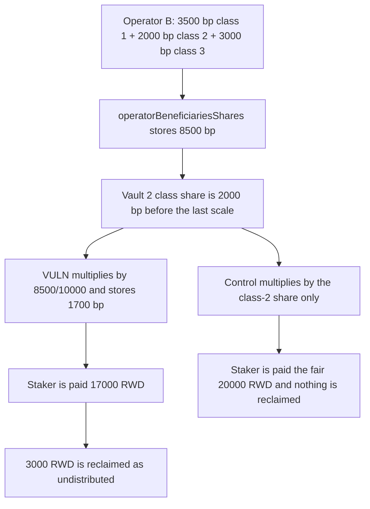

# Suzaku Core: vault rewards are scaled by the operator's cross-asset total

> **Vulnerability classes:** vuln/logic/reward-calculation · vuln/logic/state-update

<!-- non-defihacklabs -->
<!-- source-auditvault: https://github.com/Auditware/AuditVault/blob/main/findings/61237-vault-rewards-incorrectly-scaled-by-cross-asset-class-operat.md -->
<!-- date: 2025-07 -->

## Key info

| Field | Value |
|---|---|
| **Loss** | Vault 2 stakers paid 17,000 RWD instead of the fair 20,000 RWD. The 3,000 RWD gap is reclaimed as undistributed |
| **Vulnerable contract** | `Rewards._calculateAndStoreVaultShares` |
| **Attacker EOA** | `0x1111111111111111111111111111111111111111` (rewards distributor) |
| **Attack contract** | `Exploit` |
| **Attack tx** | `Exploit.run()` |
| **Chain / block / date** | Ethereum model · block 0 · 2025-07 |
| **Compiler** | solc 0.8.27, cancun, via IR |
| **Bug class** | A vault's share is multiplied by the operator's sum across every asset class |

## TL;DR

`_calculateOperatorShare` stores one number per operator: the sum of that operator's reward share in every asset class. `_calculateAndStoreVaultShares` then multiplies each vault, which belongs to one class, by that cross-asset total. Operator B's total is 8500 bp. Vault 2 is the whole of class 2 and should be paid the class share of 2000 bp, which is 20,000 of a 100,000 RWD epoch. The buggy scale pays 1700 bp, which is 17,000 RWD. The 3,000 RWD difference is transferred out as undistributed rewards. The control multiplies by the asset-class share only and pays 20,000 RWD, with nothing reclaimed.

## Background

Cyfrin reviewed Suzaku Core (report dated 2025-07-07). Rewards for an epoch are split across asset classes, then across the operators and vaults in each class. The audited `Rewards` contract folds every class into `operatorBeneficiariesShares[operator]` and reuses that total when it writes `vaultShares`. Suzaku fixed it in commit `f9bfdf7` by tracking a share per asset class.

## The vulnerable code

The operator loop adds each class into one total. The quoted assignment is the value the vault math later consumes.

```solidity
uint256 shareForClass = Math.mulDiv(
    Math.mulDiv(operatorStake, BASIS_POINTS_DENOMINATOR, totalStake),
    assetClassShare,
    BASIS_POINTS_DENOMINATOR
);
operatorClassShares[epoch][operator][assetClasses[i]] = shareForClass;
totalShare += shareForClass;
operatorBeneficiariesShares[epoch][operator] = totalShare;
```

The vault loop has already applied that vault's own asset-class weight. It then scales again by the cross-asset total:

```solidity
uint256 operatorShare = operatorBeneficiariesShares[epoch][operator];
uint256 vaultShare = Math.mulDiv(vaultStake, BASIS_POINTS_DENOMINATOR, operatorActiveStake);
vaultShare = Math.mulDiv(vaultShare, rewardsSharePerAssetClass[vaultAssetClass], BASIS_POINTS_DENOMINATOR);
// @> VULN: operatorShare is the cross-asset total, not this vault's asset-class share
vaultShares[epoch][vault] = Math.mulDiv(vaultShare, operatorShare, BASIS_POINTS_DENOMINATOR);
```

The control drops that third factor and multiplies by the stored per-class share instead:

```solidity
uint256 classShare = operatorClassShares[epoch][operator][vaultAssetClass];
vaultShare = Math.mulDiv(vaultShare, classShare, BASIS_POINTS_DENOMINATOR);
```

## Root cause

`operatorBeneficiariesShares` is a sum across classes. For operator B that sum is:

- class 1: 700/1000 of a 5000 bp class = 3500
- class 2: 100/100 of a 2000 bp class = 2000
- class 3: 100/100 of a 3000 bp class = 3000
- total = 8500 bp

Vault 2's stake is 100% of the operator's class-2 stake, so the first two multiplications already produce the 2000 bp class share. Multiplying by 8500/10000 dilutes it to 1700 bp. The same path writes vault 3 as 2550 bp instead of its 3000 bp class share. The extra basis points never reach the vaults. They are what the protocol later reclaims as undistributed rewards.

## Preconditions

- The operator has stake in more than one asset class, so the cross-asset total is larger than any single class share. Here the classes are 50%, 20%, and 30%.
- The vault's stake is denominated in one class. Vault 2 is class 2 only.
- Fees and uptime haircuts are zero, matching the report's simplified case. They are not what creates the gap.
- Distribution happens in the same transaction as the stake setup. The epoch delay in the original harness is not part of the scale bug.

## Attack walkthrough

Epoch rewards are 100,000 RWD.

1. Asset classes 1, 2, and 3 are registered at 5000, 2000, and 3000 bp.
2. Totals are 1000, 100, and 100. Operator B stakes 700, 100, and 100.
3. Vault 2 is class 2 with stake 100. Vault 3 is class 3 with stake 100.
4. `distribute` stores operator B's cross-asset total of 8500 bp.
5. Vault 2's share becomes 10000 × 2000/10000 × 8500/10000 = 1700 bp.
6. The staker is paid 17,000 RWD. The fair class-2 amount is 20,000 RWD.
7. 3,000 RWD is transferred to the undistributed reclaimer.
8. The control, using the class-2 share of 2000 bp, pays the staker 20,000 RWD and transfers nothing to the reclaimer. Vault 3 is 3000 bp on the control and 2550 bp on the buggy path.

## Diagrams



## Impact

Vault 2 stakers receive 17,000 RWD. The asset-class allocation says they should receive 20,000 RWD. The 3,000 RWD difference is paid to the undistributed-rewards balance instead of the vault. Vault 3 is short by the same mechanism: 25,500 RWD would be paid against a fair 30,000 RWD if that vault were settled on the same formula. Every epoch where an operator is active in more than one asset class repeats the dilution, and the shortfall is systematic rather than a rounding remainder.

## Remediation

Store `operatorBeneficiariesSharesPerAssetClass[epoch][operator][assetClass]` from the per-class `shareForClass` already computed in `_calculateOperatorShare`. When a vault is scored, scale it by that class share, not by the sum across classes. With vault 2's inputs the stored share is then 2000 bp and the payout is 20,000 RWD.

## How to reproduce

```bash
cd 61237-vault-rewards-incorrectly-scaled-by-cross-asset-class-operat_exp
forge test -vv
```

`test_exploit_cross_asset_scale` asserts the 8500 bp total, vault 2 at 1700 bp, vault 3 at 2550 bp, a payment of 17,000 RWD, a fair value of 20,000 RWD, and 3,000 RWD reclaimed. `test_control_uses_asset_class_share` asserts vault 2 at 2000 bp, vault 3 at 3000 bp, a payment of 20,000 RWD, and a reclaimed amount of 0. Captured output is `output.txt`.

## Sources

- AuditVault finding: https://github.com/Auditware/AuditVault/blob/main/findings/61237-vault-rewards-incorrectly-scaled-by-cross-asset-class-operat.md
- Cyfrin report (Suzaku Core, 2025-07-07): https://github.com/solodit/solodit_content/blob/main/reports/Cyfrin/2025-07-07-cyfrin-suzaku-core-v2.0.md
- Fix: https://github.com/suzaku-network/suzaku-core/pull/155/commits/f9bfdf7faa7023a0e662280a34cb41be145ba7ab
