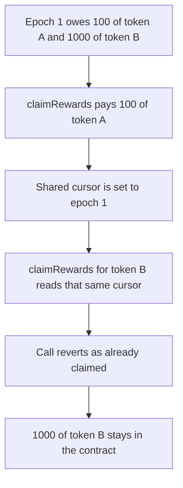

# Suzaku — claiming one reward token marks every token claimed

> **Vulnerability classes:** vuln/logic/reward-calculation · vuln/logic/missing-check

> **Reproduction:** a self-contained Foundry PoC that compiles and runs offline
> with only `forge-std` — no fork and no RPC. Trace: [output.txt](output.txt).
> PoC: [test/61238-not-all-reward-token-rewards-are-claimable-cyfrin-none-suzak_exp.sol](test/61238-not-all-reward-token-rewards-are-claimable-cyfrin-none-suzak_exp.sol).

<!-- non-defihacklabs -->
<!-- source-auditvault: https://github.com/Auditware/AuditVault/blob/main/findings/61238-not-all-reward-token-rewards-are-claimable-cyfrin-none-suzak.md -->
<!-- date: 2025-07 -->

---

## Key info

| | |
|---|---|
| **Impact** | **HIGH** — **1,000 of token B** stays in the rewards contract. **100 of token A** for the same epoch is paid |
| **Protocol** | Suzaku Core `Rewards` |
| **Vulnerable code** | `lastEpochClaimedStaker` is keyed by the staker and not by the reward token |
| **Bug class** | One claim cursor covers every reward token |
| **Finding** | Cyfrin (0kage) — Suzaku Core, 7 July 2025 · id 61238 |
| **Report** | [2025-07-07-cyfrin-suzaku-core-v2.0.md](https://github.com/solodit/solodit_content/blob/main/reports/Cyfrin/2025-07-07-cyfrin-suzaku-core-v2.0.md) |
| **Source** | [AuditVault finding](https://github.com/Auditware/AuditVault/blob/main/findings/61238-not-all-reward-token-rewards-are-claimable-cyfrin-none-suzak.md) |
| **Status** | Fixed by keying the claim cursor on the reward token. Reproduced here as a local synthetic. |
| **Compiler** | solc 0.8.27, cancun, via IR |

---

## TL;DR

`claimRewards` remembers the last epoch a staker claimed, but the memory slot is not keyed by the reward token. The first successful claim advances that slot to `currentEpoch - 1` for every token.

For epoch 1, with the epoch counter at 2:

1. Token A pays **100**. The shared cursor becomes **1**.
2. Token B for the same epoch is **1,000**. The second claim sees `lastClaimed >= currentEpoch - 1` and reverts `AlreadyClaimedForLatestEpoch`.
3. The rewards contract still holds **1,000 of token B**. The staker's token B balance is 0.

The same shape applies to `lastEpochClaimedCurator` and `lastEpochClaimedOperator`. This replay shows the staker path. The epoch comes from the middleware counter, set inside one transaction instead of warping time.

## The vulnerable code

Pre-fix staker claim, reduced to one epoch of precomputed rewards:

```solidity
mapping(address => uint48) public lastEpochClaimedStaker;

function claimRewards(address rewardsToken, address recipient) external {
    uint48 currentEpoch = middleware.getCurrentEpoch();
    uint48 lastClaimed = lastEpochClaimedStaker[msg.sender];
    if (lastClaimed >= currentEpoch - 1) {
        revert AlreadyClaimedForLatestEpoch(msg.sender, lastClaimed);
    }
    // sum rewardsOf[rewardsToken] from lastClaimed + 1 up to currentEpoch
    // @> VULN: one cursor covers every reward token, so claiming A marks B claimed
    lastEpochClaimedStaker[msg.sender] = currentEpoch - 1;
    Token(rewardsToken).transfer(recipient, totalRewards);
}
```

The fixed mapping is `lastEpochClaimedStaker[staker][rewardsToken]`. Claiming A leaves B's cursor at 0, and the second claim pays the 1,000.

## Root cause

A claim is a per-token transfer, but the cursor it writes is per-user. The next token reads that cursor and treats epochs the user has never been paid for as already claimed.

## Preconditions

- The staker is owed rewards in at least two tokens for the same epoch. Here epoch 1 owes **100 of token A** and **1,000 of token B**.
- `getCurrentEpoch()` is ahead of that epoch, so the claim loop can visit it. Here the counter is 2.
- The staker claims one token before the other.

## Attack walkthrough

1. Set the epoch counter to 2. Mint **100 of token A** and **1,000 of token B** into the rewards contract and record both as the staker's epoch-1 rewards.
2. `claimRewards(tokenA)` pays **100** and sets `lastEpochClaimedStaker` to **1**.
3. `claimRewards(tokenB)` reads that same slot, hits `AlreadyClaimedForLatestEpoch`, and transfers nothing.
4. The rewards contract still holds **1,000 of token B**.

Control: the cursor is `lastEpochClaimedStaker[staker][token]`. After the token A claim, token B's cursor is still 0. The second claim pays **1,000 of token B**. The rewards contract's token B balance ends at 0, and the staker holds both amounts.

## Diagrams



## Impact

The staker permanently loses access to **1,000 of token B** that was funded for epoch 1. Token A for that epoch was paid. Any later token the staker is owed for an epoch already covered by the shared cursor is stuck in the rewards contract the same way. Curator and operator fee claims that share this unkeyed cursor do the same.

## Remediation

Key `lastEpochClaimedStaker`, `lastEpochClaimedCurator`, and `lastEpochClaimedOperator` by the reward token as well as the user, and advance only the cursor for the token being claimed.

## Sources

- [AuditVault finding 61238](https://github.com/Auditware/AuditVault/blob/main/findings/61238-not-all-reward-token-rewards-are-claimable-cyfrin-none-suzak.md)
- [Cyfrin Suzaku Core report, 7 July 2025](https://github.com/solodit/solodit_content/blob/main/reports/Cyfrin/2025-07-07-cyfrin-suzaku-core-v2.0.md)
- Rewards contract in [suzaku-core](https://github.com/suzaku-network/suzaku-core) (`src/contracts/rewards/Rewards.sol`), the unkeyed `lastEpochClaimedStaker` described in the 7 July 2025 report

### Taxonomy

- `vuln/logic/reward-calculation`
- `vuln/logic/missing-check`
