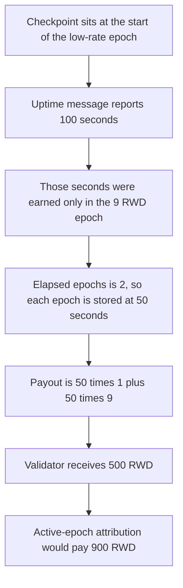

# Suzaku uptime — the split pays 500 instead of 900

> **Vulnerability classes:** vuln/logic/reward-calculation · vuln/logic/state-update

<!-- non-defihacklabs -->
<!-- source-auditvault: https://github.com/Auditware/AuditVault/blob/main/findings/61240-inaccurate-uptime-distribution-in-uptimetrackercomputevalida.md -->
<!-- date: 2025-07 -->

## Key info

| | |
|---|---|
| **Protocol** | Suzaku Core |
| **Finding** | Cyfrin, 7 July 2025, AuditVault 61240 |
| **Vulnerable code** | `UptimeTracker.computeValidatorUptime` |
| **Harm** | Validator is paid 500 RWD. The active-epoch attribution pays 900 RWD. |
| **Chain** | local synthetic |

**AuditVault taxonomy:** lang/solidity · sector/staking · sector/oracle · platform/cyfrin · severity/high · genome: reward-accounting · reward-calculation

## TL;DR

`computeValidatorUptime` takes the uptime since the last checkpoint and divides it by the number of epochs in between. It does not ask whether the validator was active in each of those epochs. Here the checkpoint is the start of a low-rate epoch, the validator was active only in the next epoch, and the message reports 100 seconds. Those 100 seconds are stored as 50 and 50. The low epoch pays 1 RWD per second and the active epoch pays 9. The payout is `50 * 1 + 50 * 9 = 500`. Fair attribution gives the active epoch all 100 seconds and pays `100 * 9 = 900`. The corrected tracker writes 0 and 100 and pays the 900.

## The vulnerable code

The split from the tracker. The uptime message is a local reader in place of the warp precompile. The epoch clock is `block.timestamp`, floored so a replay below two epochs still has a pair of epochs. Nothing warps inside `run`.

```solidity
uint256 uptimeToDistribute = recordedUptime - remainingUptime;
if (elapsedEpochs >= 1) {
    uint256 uptimePerEpoch = uptimeToDistribute / elapsedEpochs;
    for (uint48 i = 0; i < elapsedEpochs;) {
        uint48 epoch = lastUptimeEpoch + i;
        uptimeOf[epoch] = uptimePerEpoch; // @> VULN: even split stored, activity ignored
        unchecked {
            i++;
        }
    }
}
```

The control counts only the epoch the validator was active in, divides by that count, and writes 0 on every other epoch.

## Root cause

Elapsed epochs are `currentEpoch - lastCheckpointEpoch`. The seconds to distribute are spread evenly across that whole range. A validator who was offline for the first of those epochs still receives uptime there, and loses the same number of seconds from the epoch where the uptime was actually earned. When the rates differ, the payment is not the payment for the active epoch.

## Preconditions

Two epochs. The earlier one pays 1 RWD per second of credited uptime. The later one pays 9. The validator was active only in the later epoch. The uptime message says 100 seconds. The checkpoint timestamp is the start of the earlier epoch, so `elapsedEpochs` is 2. The rewards contract holds 900 RWD, which is the fair payment. No warp inside the attack.

## Attack walkthrough

1. Read the clock, seed the checkpoint at the start of the low epoch, and set the two rates.
2. Fund the rewards contract with 900 RWD.
3. `computeValidatorUptime` reads the message: 100 seconds.
4. `elapsedTime` is 200 seconds, so all 100 are distributed. `100 / 2 = 50`.
5. Both epochs are stored at 50 seconds.
6. `payout` pays `50 * 1 + 50 * 9 = 500` RWD. `fairAmount` for the active epoch is `100 * 9 = 900`. The validator receives 500. 400 stays in the rewards contract.

The control tracker, given the same checkpoint, message, and rates, stores 0 on the inactive epoch and 100 on the active epoch. `payout` transfers 900 and the rewards contract is left at 0.

## Diagrams



## Impact

The validator is paid 500 RWD for 100 seconds of work in an epoch priced at 9 RWD per second. The fair payment is 900 RWD. The 400 RWD difference stays in the rewards contract. The same inputs on the corrected tracker, which does not credit the inactive epoch, pay the 900.

## Remediation

When spreading `uptimeToDistribute`, skip epochs the validator was not active in and divide only by the active count. With one active epoch that count is 1, so the whole 100 seconds land on the 9 RWD epoch and the payout is 900. That is the control.

## How to reproduce

```bash
cd 61240-inaccurate-uptime-distribution-in-uptimetrackercomputevalida_exp
forge test -vv
```

## Sources

- AuditVault finding: https://github.com/Auditware/AuditVault/blob/main/findings/61240-inaccurate-uptime-distribution-in-uptimetrackercomputevalida.md
- Cyfrin report: https://github.com/solodit/solodit_content/blob/main/reports/Cyfrin/2025-07-07-cyfrin-suzaku-core-v2.0.md
- Tracker: https://github.com/suzaku-network/suzaku-core/blob/main/src/contracts/rewards/UptimeTracker.sol
