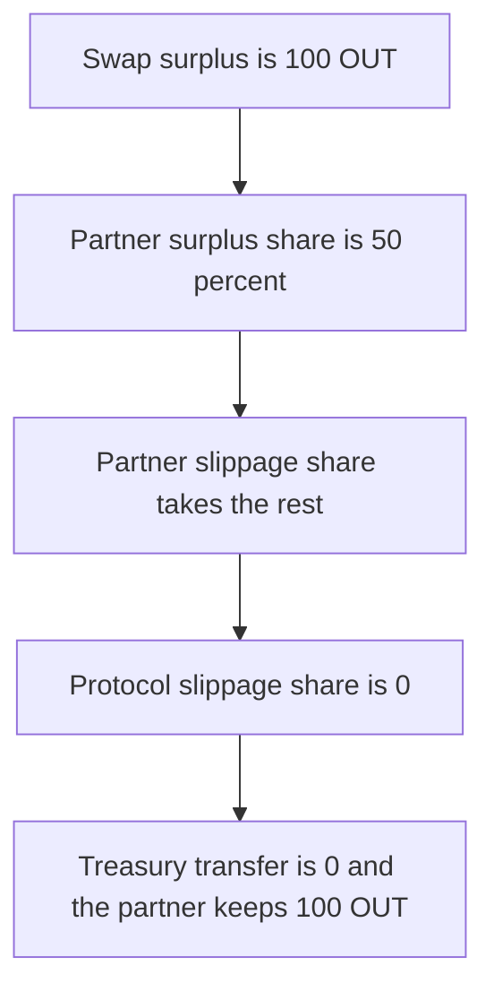

# GlueX V2: partner share consumes the whole surplus and the protocol is paid 0

> **Vulnerability classes:** `vuln/logic/fee-calculation` · `vuln/logic/missing-check`

<!-- non-defihacklabs -->
<!-- source-auditvault: https://github.com/Auditware/AuditVault/blob/main/findings/61337-h-01-protocol-can-receive-zero-shares-despite-surplus-shield.md -->
<!-- date: 2025-06 -->

## Key info

| Field | Value |
|---|---|
| **Loss** | 100 OUT of surplus paid to the partner; protocol treasury receives 0 |
| **Vulnerable contract** | `GluexRouter.swap` |
| **Attacker EOA** | `0x1111111111111111111111111111111111111111` |
| **Attack contract** | `Exploit` |
| **Attack tx** | `Exploit.run()` |
| **Chain / block / date** | Local synthetic · 2025-06 |
| **Compiler** | solc 0.8.27, cancun, via IR |
| **Bug class** | Partner surplus share plus partner slippage share can zero the protocol share |

## TL;DR

`swap` subtracts the partner's surplus share and the partner's slippage share from the surplus, and `protocolSlippageShare` has no minimum. With a 50% partner surplus share, a 25% partner slippage share, and a 0 protocol slippage share, a 100 OUT surplus is paid entirely to the partner. The treasury transfer is 0.

## The vulnerable code

```solidity
uint256 partnerSurplus = (surplus * partnerSurplusShare) / 10000;
uint256 partnerSlippage = (slippage * partnerSlippageShare) / 10000;
uint256 partnerShare = partnerSurplus + partnerSlippage;
uint256 protocolSurplus = surplus - partnerShare;
uint256 protocolSlippage = (slippage * protocolSlippageShare) / 10000;
protocolShare = protocolSurplus + protocolSlippage;
```

The audited router has the same subtraction. A minimum on `protocolSlippageShare` is what stops a configured partner from taking the whole surplus.

## Root cause

The protocol share is a remainder. Nothing requires that remainder to be positive, and the protocol's own slippage share can be zero.

## Preconditions

- A swap produces 100 OUT of surplus.
- Partner surplus share is 50 and partner slippage share is 25. Protocol slippage share is 0.

## Attack walkthrough

1. The router records a 100 OUT surplus.
2. Partner share is computed as the whole 100.
3. Protocol share is 0.
4. The partner is transferred 100 OUT. The treasury balance stays 0.

## Diagrams



## Impact

The protocol earns nothing on a swap that generated a real surplus. This run pays the entire 100 OUT to the partner.

## How to reproduce

```bash
cd 61337-h-01-protocol-can-receive-zero-shares-despite-surplus-shield_exp
forge test -vv
```

## Sources

- AuditVault finding: https://github.com/Auditware/AuditVault/blob/main/findings/61337-h-01-protocol-can-receive-zero-shares-despite-surplus-shield.md
- Shieldify review: https://github.com/shieldify-security/audits-portfolio-md/blob/main/GlueX-V2-Security-Review.md
