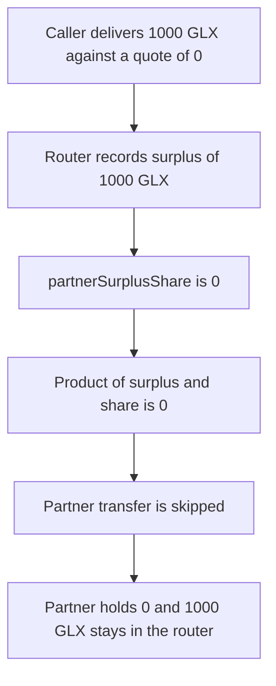

# GlueX V2 — a partner is paid 0 while 1000 GLX of surplus stays in the router

> **Vulnerability classes:** vuln/defi/fee-manipulation · vuln/logic/fee-calculation · vuln/logic/missing-check

> **Reproduction:** a self-contained Foundry PoC that compiles and runs offline
> with only `forge-std` — no fork and no RPC. Trace: [output.txt](output.txt).
> PoC: [test/61338-h-02-partner-can-receive-zero-share-despite-surplus-shieldif_exp.sol](test/61338-h-02-partner-can-receive-zero-share-despite-surplus-shieldif_exp.sol).

<!-- non-defihacklabs -->
<!-- source-auditvault: https://github.com/Auditware/AuditVault/blob/main/findings/61338-h-02-partner-can-receive-zero-share-despite-surplus-shieldif.md -->
<!-- date: 2025-06 -->

---

## Key info

| | |
|---|---|
| **Impact** | **HIGH** — partner share is 0, the partner receives **0 GLX**, and **1000 GLX** of surplus stays in the router |
| **Protocol** | GlueX V2 `GluexRouter` |
| **Vulnerable code** | `(surplus * desc.partnerSurplusShare) / 10000` with no floor |
| **Bug class** | A partner bps of 0 is accepted |
| **Finding** | Shieldify — GlueX V2, June 2025 · id 61338 / H-02 |
| **Report** | [GlueX-V2-Security-Review.md](https://github.com/shieldify-security/audits-portfolio-md/blob/main/GlueX-V2-Security-Review.md) |
| **Source** | [AuditVault finding](https://github.com/Auditware/AuditVault/blob/main/findings/61338-h-02-partner-can-receive-zero-share-despite-surplus-shieldif.md) |
| **Status** | Acknowledged by GlueX. Reproduced here as a local synthetic. |
| **Compiler** | solc 0.8.27, cancun, via IR |

---

## TL;DR

`swap` turns the amount delivered above the quote into `surplus`, then pays the partner `(surplus * partnerSurplusShare) / 10000`. Nothing stops `partnerSurplusShare` from being 0. A swap that delivers **1000 GLX** against a quote of 0 therefore computes a partner cut of 0, skips the partner transfer, and leaves the **1000 GLX** sitting in the router. The partner's balance stays 0.

The fixed router treats a share below 10000 bps as 10000. The same zero-share call pays the partner **1000 GLX** and the router balance ends at 0.

## Vulnerable code

From `router_v1/GluexRouter.sol` at the reviewed commit, lines 223-227:

```solidity
if (surplus > 0 || slippage > 0) {
    // @> VULN: partnerSurplusShare may be 0, so this product is 0 and the partner is skipped
    uint256 partnerSurplus = (surplus * desc.partnerSurplusShare) / 10000;
    uint256 partnerSlippage = (slippage * desc.partnerSlippageShare) / 10000;
    uint256 partnerShare = partnerSurplus + partnerSlippage;
}
```

Shieldify asked for a floor:

```diff
+ require(desc.partnerSurplusShare >= MIN_SHARE && desc.partnerSlippageShare >= MIN_SHARE, "partner share too low");
```

This reduction uses that floor as a payment, not only a revert: a share of 0 is lifted to 10000 bps, so the partner receives the whole surplus.

## Attack walkthrough

1. The caller mints **1000 GLX** and approves the router.
2. `swap` is called with `quoted = 0`, `delivered = 1000 GLX`, and both partner shares set to 0.
3. The router pulls 1000 GLX. `surplus = 1000 GLX`.
4. `partnerSurplus = (1000 * 0) / 10000 = 0`. `partnerSlippage` is 0. `partnerShare` is 0.
5. `if (partnerShare > 0)` is false, so the partner transfer does not run.
6. The partner's balance is 0. The router's balance is **1000 GLX**.

Control: `GluexRouterFixed` on the same inputs sets the bps to 10000, transfers **1000 GLX** to the partner, and leaves 0 in the router.

## Diagrams



## Impact

The partner who facilitated the route is paid **0 GLX**. The **1000 GLX** surplus remains in `GluexRouter` instead of being paid out. A caller can set the partner bps to 0 on every route and zero the partner's cut whenever surplus exists.

## Remediation

Reject a partner surplus or slippage share below the configured minimum before the product, which is what Shieldify recommended. Paying the partner requires the bps to be non-zero. In this reproduction the fixed router floors a 0 share to 10000 bps so the same call pays the partner the full surplus.

## Sources

- [AuditVault finding 61338](https://github.com/Auditware/AuditVault/blob/main/findings/61338-h-02-partner-can-receive-zero-share-despite-surplus-shieldif.md)
- [Shieldify GlueX V2 security review](https://github.com/shieldify-security/audits-portfolio-md/blob/main/GlueX-V2-Security-Review.md)
- Reviewed router: [gluex_router_contract@9c754a3 `router_v1/GluexRouter.sol`](https://github.com/gluexprotocol/gluex_router_contract/blob/9c754a3985fa32b72d847c88c83575f29a86bc01/router_v1/GluexRouter.sol)

### Taxonomy

- `severity/high`
- `vuln/defi/fee-manipulation` · `vuln/logic/fee-calculation` · `vuln/logic/missing-check`
