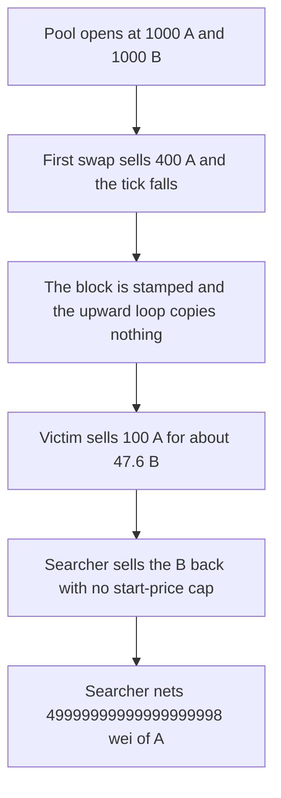

# Uniswap hooks — a falling first tick leaves the sandwich cap unset

> **Vulnerability classes:** vuln/defi/sandwich-attack · vuln/logic/state-update

> **Reproduction:** a self-contained Foundry PoC that compiles and runs offline
> with only `forge-std` — no fork and no RPC. Trace: [output.txt](output.txt).
> PoC: [test/61376-asymmetric-first-in-block-swap-initialization-leads-to-stale_exp.sol](test/61376-asymmetric-first-in-block-swap-initialization-leads-to-stale_exp.sol).

<!-- non-defihacklabs -->
<!-- source-auditvault: https://github.com/Auditware/AuditVault/blob/main/findings/61376-asymmetric-first-in-block-swap-initialization-leads-to-stale.md -->
<!-- date: 2025-05 -->

---

## Key info

| | |
|---|---|
| **Impact** | **HIGH** — the back-run nets **49999999999999999998 wei of A** because the start-of-block cap was never armed |
| **Protocol** | OpenZeppelin `AntiSandwichHook` |
| **Vulnerable code** | The tick-copy loop runs only while `tick < tickAfter` |
| **Bug class** | The first swap stamps the block without copying ticks |
| **Finding** | OpenZeppelin — Uniswap Hooks v1.1.0 RC 1, April–May 2025 · id 61376 |
| **Report** | [OpenZeppelin Uniswap Hooks audit](https://blog.openzeppelin.com/openzeppelin-uniswap-hooks-v1.1.0-rc-1-audit) |
| **Source** | [AuditVault finding](https://github.com/Auditware/AuditVault/blob/main/findings/61376-asymmetric-first-in-block-swap-initialization-leads-to-stale.md) |
| **Status** | Reproduced as a local constant-product pool with the same loop. |
| **Compiler** | solc 0.8.27, cancun, via IR |

---

## TL;DR

The hook is supposed to cap later swaps in a block at the opening quote. It copies tick state only in `_after` of the first swap, and only for ticks strictly above the opening tick. It stamps `blockNumber` even when that loop does not run.

The pool starts at **1000 A / 1000 B**. The first swap sells **400 A**, so the tick falls. The copy loop does not run. `ticksReady` stays false.

The victim then sells **100 A** and receives **47619047619047619047 wei of B** instead of the opening quote of about **90.9 B**. The searcher sells the B from the front-run back into the pool and nets **49999999999999999998 wei of A**.

The control copies reserves in `_before` of the new block. The same back-run receives less A than it spent.

## The vulnerable code

```solidity
blockNumber = block.number;
// @> VULN: ticks are copied only when the first swap moves the tick up
for (int24 t = slot0Tick; t < tickAfter; t += TICK_SPACING) {
    snapA = pool.reserveA();
    snapB = pool.reserveB();
    ticksReady = true;
}
```

## Preconditions

- This swap is the first one in the block, so the checkpoint block does not match yet.
- The swap sells A and the tick decreases.
- A later swap in the same block would have been capped if `ticksReady` were true.

## Attack walkthrough

1. Sell **400 A** for B. The tick falls. The loop copies nothing. The block is stamped.
2. The victim sells **100 A** and receives **47619047619047619047 wei of B**.
3. Sell the front-run B back for A.
4. A balance increases by **49999999999999999998 wei**.
5. `ticksReady` is still false.

Control: the opening reserves are snapshotted before the first swap. The back-run's A out is below the **400 A** it spent.

## Diagrams



## Impact

The searcher extracts **49999999999999999998 wei of A** from a round trip that the opening quote would have made unprofitable. The victim's **100 A** sells for **47619047619047619047 wei of B** instead of the opening **90909090909090909090 wei of B**.

## Remediation

Snapshot slot0, liquidity, and the ticks around the opening tick inside `_beforeSwap` when the block changes, before any swap mutates the pool. Do not mark the block initialized until that snapshot exists.

## Sources

- [AuditVault finding 61376](https://github.com/Auditware/AuditVault/blob/main/findings/61376-asymmetric-first-in-block-swap-initialization-leads-to-stale.md)
- [OpenZeppelin Uniswap Hooks v1.1.0 RC 1](https://blog.openzeppelin.com/openzeppelin-uniswap-hooks-v1.1.0-rc-1-audit)

### Taxonomy

- `severity/high`
- `vuln/defi/sandwich-attack` · `vuln/logic/missing-state-update`
