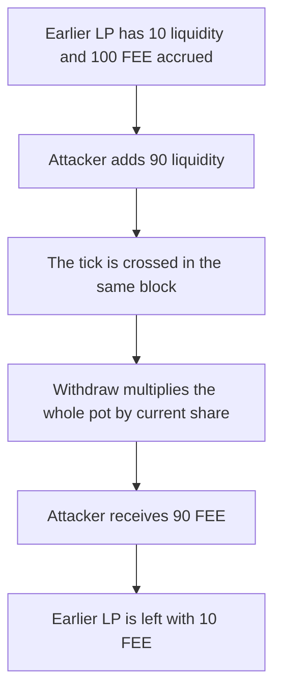

# Uniswap hooks — new limit-order liquidity takes 90 of 100 accrued FEE

> **Vulnerability classes:** vuln/defi/fee-manipulation · vuln/logic/reward-calculation

> **Reproduction:** a self-contained Foundry PoC that compiles and runs offline
> with only `forge-std` — no fork and no RPC. Trace: [output.txt](output.txt).
> PoC: [test/61378-accrued-limit-order-fees-can-be-stolen-openzeppelin-none-ope_exp.sol](test/61378-accrued-limit-order-fees-can-be-stolen-openzeppelin-none-ope_exp.sol).

<!-- non-defihacklabs -->
<!-- source-auditvault: https://github.com/Auditware/AuditVault/blob/main/findings/61378-accrued-limit-order-fees-can-be-stolen-openzeppelin-none-ope.md -->
<!-- date: 2025-05 -->

---

## Key info

| | |
|---|---|
| **Impact** | **HIGH** — liquidity added in the fill block takes **90 of 100 FEE** accrued before it existed |
| **Protocol** | OpenZeppelin `LimitOrderHook` |
| **Vulnerable code** | Withdrawal pays `fees * share / liquidity` with no deposit snapshot |
| **Bug class** | JIT liquidity claims historical fees |
| **Finding** | OpenZeppelin — Uniswap Hooks v1.1.0 RC 1, April–May 2025 · id 61378 |
| **Report** | [OpenZeppelin Uniswap Hooks audit](https://blog.openzeppelin.com/openzeppelin-uniswap-hooks-v1.1.0-rc-1-audit) |
| **Source** | [AuditVault finding](https://github.com/Auditware/AuditVault/blob/main/findings/61378-accrued-limit-order-fees-can-be-stolen-openzeppelin-none-ope.md) |
| **Status** | Reproduced as a local limit-order pot. |
| **Compiler** | solc 0.8.27, cancun, via IR |

---

## TL;DR

An earlier LP has **10** liquidity on an order that has already accrued **100 FEE**. The attacker places **90** liquidity, crosses the tick, and withdraws.

The payout is the full fee pot times the caller's share of current liquidity. The attacker receives **90 FEE**. The earlier LP receives the remaining **10 FEE**.

The control stores the fee index at deposit. Fees accrued before the attacker arrived pay **0** to the attacker and **100 FEE** to the earlier LP.

## The vulnerable code

```solidity
// @> VULN: fees accrued before this liquidity are split by current share
payout = fees * share / liquidity;
```

## Preconditions

- The order already has **10** liquidity and **100 FEE** accrued.
- The attacker can add liquidity and fill the order in the same block.
- Withdrawal does not snapshot fees at the time liquidity was added.

## Attack walkthrough

1. Attacker places **90** liquidity. Total liquidity becomes **100**.
2. `crossTick` marks the order filled.
3. Attacker withdraws. `100 * 90 / 100 = 90 FEE`.
4. The earlier LP withdraws the remaining **10 FEE**.

Control: the attacker's paid index equals the index after the **100 FEE** accrual, so their payout is **0**. The earlier LP, whose index was 0, receives **100 FEE**.

## Diagrams



## Impact

The earlier LP loses **90 FEE** of the **100 FEE** their liquidity accrued. The attacker receives that **90 FEE** after providing liquidity only for the fill.

## Remediation

Snapshot the fee index when liquidity is added, and pay only the fees accrued after that snapshot.

## Sources

- [AuditVault finding 61378](https://github.com/Auditware/AuditVault/blob/main/findings/61378-accrued-limit-order-fees-can-be-stolen-openzeppelin-none-ope.md)
- [OpenZeppelin Uniswap Hooks v1.1.0 RC 1](https://blog.openzeppelin.com/openzeppelin-uniswap-hooks-v1.1.0-rc-1-audit)

### Taxonomy

- `severity/high`
- `vuln/defi/fee-manipulation` · `vuln/logic/reward-calculation`
