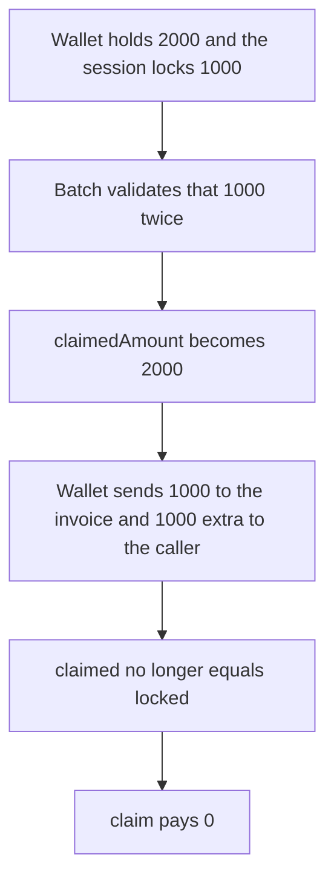

# Etherspot — a batch consumes `lockedAmount` twice

> **Vulnerability classes:** vuln/logic/missing-check · vuln/logic/state-update

> **Reproduction:** a self-contained Foundry PoC that compiles and runs offline
> with only `forge-std` — no fork and no RPC. Trace: [output.txt](output.txt).
> PoC: [test/61395-c-01-consumers-can-double-the-lockedamount-in-the-session-dr_exp.sol](test/61395-c-01-consumers-can-double-the-lockedamount-in-the-session-dr_exp.sol).

<!-- non-defihacklabs -->
<!-- source-auditvault: https://github.com/Auditware/AuditVault/blob/main/findings/61395-c-01-consumers-can-double-the-lockedamount-in-the-session-dr.md -->
<!-- date: 2025-07 -->

---

## Key info

| | |
|---|---|
| **Impact** | **HIGH** — the session takes **1,000 extra** tokens. The wallet loses **2,000** on a **1,000** lock, and `claim` pays **0** |
| **Protocol** | Etherspot `CredibleAccountModule` |
| **Vulnerable code** | `_validateTokenData` adds `claimedAmount` with no check that it is still zero |
| **Bug class** | A batch counts the same lock once per item |
| **Finding** | Shieldify — Credible Account Module mitigation review, July 2025 · C-01 · id 61395 |
| **Report** | [Etherspot-CredibleAccountModule-Mitigation-Security-Review.md](https://github.com/shieldify-security/audits-portfolio-md/blob/main/Etherspot-CredibleAccountModule-Mitigation-Security-Review.md) |
| **Source** | [AuditVault finding](https://github.com/Auditware/AuditVault/blob/main/findings/61395-c-01-consumers-can-double-the-lockedamount-in-the-session-dr.md) |
| **Status** | Fixed by requiring `claimedAmount == 0` before the increment. Reproduced here as a local synthetic. |
| **Compiler** | solc 0.8.27, cancun, via IR |

---

## TL;DR

`_validateBatchCall` calls `_validateTokenData` for every item. That function accepts an item when the wallet balance covers `amount` and `amount` equals `lockedAmount`, then does `claimedAmount += amount`. It never checks that `claimedAmount` is still zero.

A two-item batch, each for the **1,000** lock, against a wallet holding **2,000**:

1. Both validations pass. `claimedAmount` becomes **2,000**.
2. The wallet sends **1,000** to the invoice and **1,000** extra to the session caller.
3. `isSessionClaimed` is false because **1,000 != 2,000**. `claim` returns **0**.

## The vulnerable code

Pre-fix check, reduced to one locked token and a batch of two equal amounts:

```solidity
function _validateTokenData(address sessionKey, address wallet, uint256 amount, address token) internal returns (bool) {
    LockedToken[] storage tokens = _locks[sessionKey];
    for (uint256 i; i < tokens.length; ++i) {
        if (tokens[i].token == token) {
            if (_walletTokenBalance(wallet, token) >= amount && amount == tokens[i].lockedAmount) {
                // @> VULN: claimedAmount grows again with no check that this lock was already consumed
                tokens[i].claimedAmount += amount;
                return true;
            }
        }
    }
    return false;
}
```

The fixed condition also requires `tokens[i].claimedAmount == 0`. The second batch item then fails, only **1,000** moves, and `claim` pays the lock.

## Root cause

The balance check runs before any transfer, so every item in the batch still sees the full wallet balance. Equality with `lockedAmount` is not a one-time gate. Each passing item adds the whole lock to `claimedAmount`.

## Preconditions

- The session has one locked token. Here `lockedAmount` is **1,000**.
- The wallet holds at least twice that, here **2,000**, and has approved the module.
- The batch contains two items that each spend exactly `lockedAmount` of that token.

## Attack walkthrough

1. Mint **2,000** to the wallet and approve the module. Enable a session that locks **1,000**.
2. `executeBatch` validates the amount twice, then pulls **1,000** to the invoice and **1,000** to the caller.
3. `claimedAmount` is **2,000**. The caller holds the extra **1,000**. The wallet balance is 0.
4. `isSessionClaimed` returns false. `claim` returns **0**.

Control: the second validation fails because `claimedAmount` is no longer zero. `taken` is **1,000**, the caller receives nothing, the wallet keeps **1,000**, and `claim` pays **1,000**.

## Diagrams



## Impact

The smart wallet loses **1,000** tokens beyond the lock. The session caller keeps that extra. The settlement claim pays **0**, so the session cannot be closed as claimed. A longer batch of the same amount repeats the pull once per item, for as long as the wallet balance covers another `lockedAmount`.

## Remediation

Accept the token only when `claimedAmount` is still zero, then set it to `lockedAmount` once. Shieldify's fix adds `tokens[i].claimedAmount == 0` to the condition in `_validateTokenData`.

## Sources

- [AuditVault finding 61395](https://github.com/Auditware/AuditVault/blob/main/findings/61395-c-01-consumers-can-double-the-lockedamount-in-the-session-dr.md)
- [Shieldify mitigation review, July 2025](https://github.com/shieldify-security/audits-portfolio-md/blob/main/Etherspot-CredibleAccountModule-Mitigation-Security-Review.md)
- [CredibleAccountModule.sol @ cb0645c](https://github.com/etherspot/etherspot-modular-accounts/blob/cb0645c3e7ca2a5aa7a6b9ce0263a182fba24fd9/src/modules/validators/CredibleAccountModule.sol) lines 450-487 and `isSessionClaimed`

### Taxonomy

- `vuln/logic/missing-check`
- `vuln/logic/state-update`
