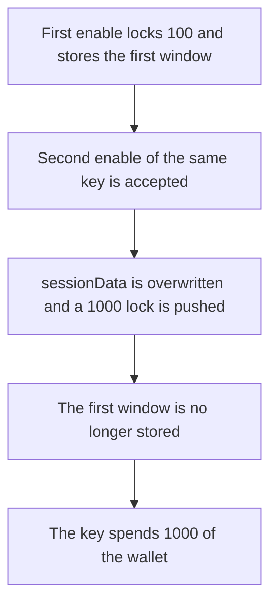

# Etherspot — a second session key overwrites the first

> **Vulnerability classes:** vuln/logic/missing-check · vuln/logic/incorrect-state-transition

> **Reproduction:** a self-contained Foundry PoC that compiles and runs offline
> with only `forge-std` — no fork and no RPC. Trace: [output.txt](output.txt).
> PoC: [test/61403-c-01-missing-session-key-uniqueness-validation-in-resourcelo_exp.sol](test/61403-c-01-missing-session-key-uniqueness-validation-in-resourcelo_exp.sol).

<!-- non-defihacklabs -->
<!-- source-auditvault: https://github.com/Auditware/AuditVault/blob/main/findings/61403-c-01-missing-session-key-uniqueness-validation-in-resourcelo.md -->
<!-- date: 2025-07 -->

---

## Key info

| | |
|---|---|
| **Impact** | **HIGH** — the session key spends **1,000** of the wallet. The first registration only locked **100**, and its `validUntil` is replaced |
| **Protocol** | Etherspot `CredibleAccountModule` |
| **Vulnerable code** | `enableSessionKey` assigns `sessionData` with no check that the key is already live |
| **Bug class** | Reusing a session key silently overwrites the first session |
| **Finding** | Shieldify — Credible Account Module, July 2025 · C-01 · id 61403 |
| **Report** | [Etherspot-CredibleAccountModule-Security-Review.md](https://github.com/shieldify-security/audits-portfolio-md/blob/main/Etherspot-CredibleAccountModule-Security-Review.md) |
| **Source** | [AuditVault finding](https://github.com/Auditware/AuditVault/blob/main/findings/61403-c-01-missing-session-key-uniqueness-validation-in-resourcelo.md) |
| **Status** | Fixed by reverting when `sessionData[sessionKey][wallet].live` is already true. Reproduced here as a local synthetic. |
| **Compiler** | solc 0.8.27, cancun, via IR |

---

## TL;DR

`enableSessionKey` writes `sessionData[sessionKey][msg.sender]` on every call. It never checks that this wallet already has that key live. A second call replaces `validUntil` and pushes another `lockedTokens` entry.

The wallet holds **1,000**:

1. The first enable locks **100** and stores the first `validUntil`.
2. The second enable of the same key stores a later `validUntil` and locks **1,000**.
3. `spend` matches the new lock and pulls **1,000** to the caller. The first window is gone.

## The vulnerable code

Pre-fix assignment from `enableSessionKey`, reduced to one token in the resource lock:

```solidity
if (sessionKey == address(0)) revert InvalidSessionKey();
if (validAfter == 0) revert InvalidValidAfter();
if (validUntil == 0 || validUntil <= validAfter) revert InvalidValidUntil();
// @> VULN: a second enable of this session key overwrites the first sessionData
sessionData[sessionKey][msg.sender] = SessionData(sessionKey, validAfter, validUntil, true);
if (amount > 0) {
    _locks[sessionKey].push(LockedToken(token, amount, 0));
}
```

The fixed function reverts with `SessionKeyAlreadyLive` when `sessionData[sessionKey][msg.sender].live` is already true. The **1,000** lock is never added, and `spend` of **1,000** reverts. The first `validUntil` stays.

## Root cause

The session record is a plain assignment keyed by `(sessionKey, wallet)`. A second write to that slot replaces the first session's terms. The lock list is append-only, so the new amount is spendable on top of the lost window.

## Preconditions

- The wallet enables a session key once, here with a lock of **100** and the first `validUntil`.
- The same wallet calls `enableSessionKey` again for that key, here with a lock of **1,000**, which is the wallet's whole balance.
- The key then calls `spend` for **1,000**. The wallet has approved the module.

## Attack walkthrough

1. Mint **1,000** to the wallet and approve the module.
2. Enable the key with `validUntil` = the first window and a lock of **100**.
3. Enable the same key again with a later `validUntil` and a lock of **1,000**. The stored `validUntil` is the second value.
4. `spend` finds the **1,000** lock and `transferFrom` sends it to the caller. The wallet balance is 0.

Control: the second `enableSessionKey` reverts `SessionKeyAlreadyLive`. `spend` of **1,000** reverts `NoMatchingLock`. The wallet still holds **1,000**, and `validUntil` is still the first window.

## Diagrams



## Impact

The wallet loses **1,000**, which the first session did not lock. The original `validUntil` is gone, so anything that depended on the first session's terms now sees the replacement. Repeated enables keep appending locks the key can spend.

## Remediation

Revert when `sessionData[sessionKey][msg.sender].live` is already true, before the assignment and before another lock is pushed. Shieldify's fix is that live check.

## Sources

- [AuditVault finding 61403](https://github.com/Auditware/AuditVault/blob/main/findings/61403-c-01-missing-session-key-uniqueness-validation-in-resourcelo.md)
- [Shieldify Credible Account Module review, July 2025](https://github.com/shieldify-security/audits-portfolio-md/blob/main/Etherspot-CredibleAccountModule-Security-Review.md)
- [CredibleAccountModule.sol @ d4774db](https://github.com/etherspot/etherspot-modular-accounts/blob/d4774db9f544cc6f69000c55e97627f93fe7242b/src/modules/validators/CredibleAccountModule.sol) `enableSessionKey` around line 136

### Taxonomy

- `vuln/logic/missing-check`
- `vuln/logic/incorrect-state-transition`
