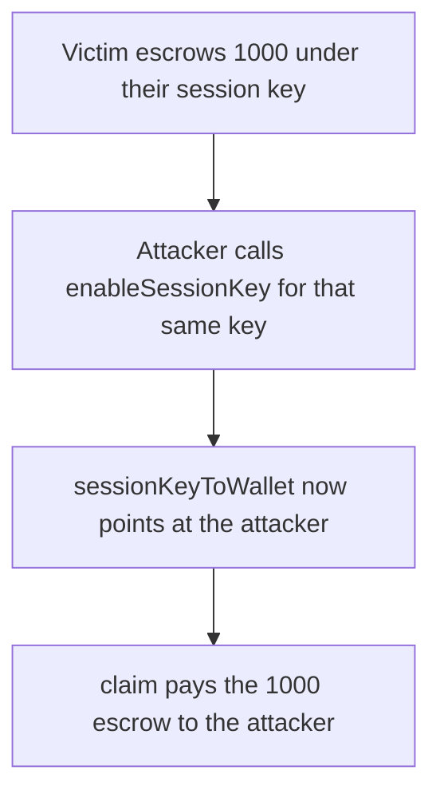

# Etherspot — an attacker installs their session key and claims the escrow

> **Vulnerability classes:** vuln/access-control/missing-owner-check · vuln/access-control/missing-auth

> **Reproduction:** a self-contained Foundry PoC that compiles and runs offline
> with only `forge-std` — no fork and no RPC. Trace: [output.txt](output.txt).
> PoC: [test/61404-c-02-unauthorized-session-key-takeover-via-missing-ownership_exp.sol](test/61404-c-02-unauthorized-session-key-takeover-via-missing-ownership_exp.sol).

<!-- non-defihacklabs -->
<!-- source-auditvault: https://github.com/Auditware/AuditVault/blob/main/findings/61404-c-02-unauthorized-session-key-takeover-via-missing-ownership.md -->
<!-- date: 2025-07 -->

---

## Key info

| | |
|---|---|
| **Impact** | **HIGH** — the attacker claims **1,000** the victim escrowed under a session key |
| **Protocol** | Etherspot `CredibleAccountModule` |
| **Vulnerable code** | `enableSessionKey` sets `sessionKeyToWallet[sessionKey] = msg.sender` with no existing-owner check |
| **Bug class** | Anyone can take over a live session key and claim its locked tokens |
| **Finding** | Shieldify — Credible Account Module, July 2025 · C-02 · id 61404 |
| **Report** | [Etherspot-CredibleAccountModule-Security-Review.md](https://github.com/shieldify-security/audits-portfolio-md/blob/main/Etherspot-CredibleAccountModule-Security-Review.md) |
| **Source** | [AuditVault finding](https://github.com/Auditware/AuditVault/blob/main/findings/61404-c-02-unauthorized-session-key-takeover-via-missing-ownership.md) |
| **Status** | Fixed by reverting when `sessionKeyToWallet[sessionKey]` is already set. Reproduced here as a local synthetic. |
| **Compiler** | solc 0.8.27, cancun, via IR |

---

## TL;DR

`enableSessionKey` ends with `sessionKeyToWallet[sessionKey] = msg.sender`. It does not check that another wallet already owns that key. Locks are stored by session key, and `claim` pays whoever that mapping names.

1. The victim enables the key and escrows **1,000**. The mapping points at the victim.
2. The attacker calls `enableSessionKey` for the same key with amount 0. The mapping now points at the attacker. The escrow stays.
3. `claim` sees the attacker as the owner and transfers **1,000** to them.

## The vulnerable code

Pre-fix tail of `enableSessionKey`:

```solidity
if (amount > 0) {
    Token(token).transferFrom(msg.sender, address(this), amount);
    _locks[sessionKey].push(LockedToken(token, amount, 0));
}
// @> VULN: any caller becomes the owner, even when another wallet already registered this key
sessionKeyToWallet[sessionKey] = msg.sender;
```

`claim` then requires only `msg.sender == sessionKeyToWallet[sessionKey]` and transfers the unpaid locks. The fixed enable reverts with `SessionKeyOwned` when the mapping is already non-zero. The attacker's call reverts, their `claim` reverts `NotOwner`, and the victim can still claim the **1,000**.

## Root cause

Ownership of a session key is a single slot overwritten by every successful enable. The escrow is keyed by the session key, not by the wallet that deposited it, so the new owner can claim the old deposit.

## Preconditions

- A victim has enabled a session key and the module holds their tokens. Here that is **1,000**.
- The attacker knows the session key address and calls `enableSessionKey` for it. They pass amount 0, so they do not need a balance.
- `claim` pays the address currently stored in `sessionKeyToWallet`.

## Attack walkthrough

1. Mint **1,000** to the victim. The victim approves the module and enables the key. The module's balance is **1,000** and the owner is the victim.
2. The attacker enables the same key with amount 0. `sessionKeyToWallet` becomes the attacker.
3. The attacker calls `claim`. The module transfers **1,000** to them. The victim's balance and the module's balance are both 0.

Control: the second `enableSessionKey` reverts `SessionKeyOwned`. The attacker's `claim` reverts `NotOwner`. The module still holds **1,000**. A claim from the victim pays the victim **1,000**.

## Diagrams



## Impact

The attacker takes **1,000** the victim locked. The victim is no longer the owner, so they cannot claim or recover the session through the module. Any later deposit recorded on that session key is payable to whoever overwrote the mapping.

## Remediation

Before the assignment, revert if `sessionKeyToWallet[sessionKey]` is already set. Shieldify's fix is that check. Do not let a second caller replace the wallet that deposited the locks.

## Sources

- [AuditVault finding 61404](https://github.com/Auditware/AuditVault/blob/main/findings/61404-c-02-unauthorized-session-key-takeover-via-missing-ownership.md)
- [Shieldify Credible Account Module review, July 2025](https://github.com/shieldify-security/audits-portfolio-md/blob/main/Etherspot-CredibleAccountModule-Security-Review.md)
- [CredibleAccountModule.sol @ d4774db](https://github.com/etherspot/etherspot-modular-accounts/blob/d4774db9f544cc6f69000c55e97627f93fe7242b/src/modules/validators/CredibleAccountModule.sol) `enableSessionKey` around line 144

### Taxonomy

- `vuln/access-control/missing-owner-check`
- `vuln/access-control/missing-auth`
