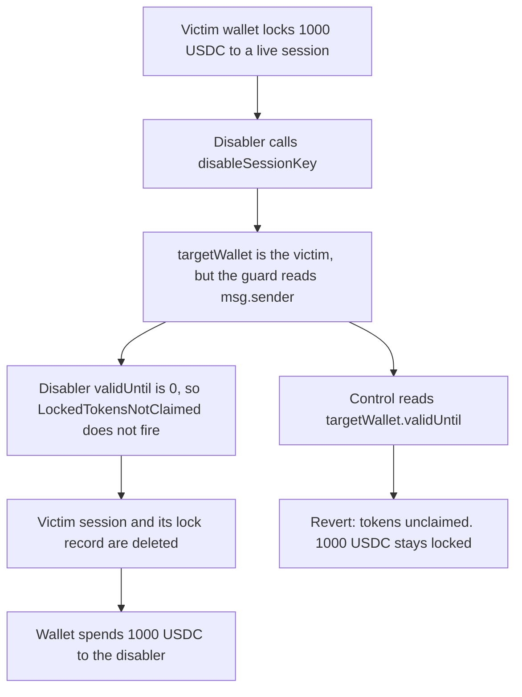

# Etherspot: `disableSessionKey` checks the disabler's wallet, not the session owner

> **Vulnerability classes:** vuln/logic/wrong-condition · vuln/access-control/broken-logic

<!-- non-defihacklabs -->
<!-- source-auditvault: https://github.com/Auditware/AuditVault/blob/main/findings/61405-c-03-wrong-wallet-validation-in-disablesessionkey-when-calle.md -->
<!-- date: 2025-06 -->

## Key info

| Field | Value |
|---|---|
| **Loss** | 1,000 USDC that was locked to a live session is spent to the disabler. Control keeps the 1,000 locked and unspent |
| **Vulnerable contract** | `CredibleAccountModule.disableSessionKey` |
| **Attacker EOA** | `0x1111111111111111111111111111111111111111` (SESSION_KEY_DISABLER) |
| **Attack contract** | `Exploit` |
| **Attack tx** | `Exploit.run()` |
| **Chain / block / date** | Ethereum model · block 0 · 2025-06 |
| **Compiler** | solc 0.8.27, cancun, via IR |
| **Bug class** | Lock check indexes `msg.sender` instead of `targetWallet` |

## TL;DR

`disableSessionKey` knows the session's wallet (`targetWallet`) but the locked-token guard reads `sessionData[sessionKey][msg.sender]`. A `SESSION_KEY_DISABLER` has no session, so that `validUntil` is 0 and `0 >= block.timestamp` is false. The `LockedTokensNotClaimed` revert never runs. The disabler deletes someone else's still-valid, unclaimed session and the wallet then spends the 1,000 USDC that the lock was holding. The control reads `sessionData[sessionKey][targetWallet]`, reverts, and the 1,000 stays locked. A spend of the same 1,000 reverts on the control.

## Background

Shieldify reviewed Etherspot's Credible Account Module at commit `d4774db9f544cc6f69000c55e97627f93fe7242b` (2025-06-09). Session keys lock ERC-20 balances until `validUntil` or until the locked amount is claimed. `batchDisableSessionKeys` already checks the target wallet and only removes a key that is expired or fully claimed. The single-key function does not.

## The vulnerable code

```solidity
address targetWallet = sessionOwner != address(0) ? sessionOwner : msg.sender;
if (sessionData[_sessionKey][targetWallet].validUntil == 0) {
    revert NoSession(_sessionKey);
}
// @> VULN: validUntil is read for msg.sender, not targetWallet, so a disabler's 0 skips the lock
if (sessionData[_sessionKey][msg.sender].validUntil >= block.timestamp && !isSessionClaimed(_sessionKey)) {
    revert LockedTokensNotClaimed(_sessionKey);
}
_removeSessionKey(_sessionKey, targetWallet);
```

The report's fix indexes the wallet the session actually belongs to:

```diff
- if (sessionData[_sessionKey][msg.sender].validUntil >= block.timestamp && !isSessionClaimed(_sessionKey)) {
+ if (sessionData[_sessionKey][targetWallet].validUntil >= block.timestamp && !isSessionClaimed(_sessionKey)) {
      revert LockedTokensNotClaimed(_sessionKey);
  }
```

## Root cause

The role check correctly allows either the session owner or a disabler to call. `targetWallet` is then set to the session owner. The very next guard ignores that variable and looks up `msg.sender`. For a disabler the lookup is an empty `SessionData`: `validUntil` is 0, the comparison with `block.timestamp` is false, and `isSessionClaimed` is never required to be true. `_removeSessionKey` still runs against `targetWallet`, so the victim's live session and its locked-token record are deleted.

## Preconditions

- A wallet has enabled a session whose `validUntil` is still in the future and whose locked tokens are not fully claimed. Here `validUntil` is `uint48` max, `lockedAmount` is 1,000, and `claimedAmount` is 0.
- The caller has `SESSION_KEY_DISABLER` and is not that wallet. The caller's own `sessionData` slot is empty.
- `block.timestamp` is greater than 0, which is true for the forge default and for the playground block. Then `0 >= block.timestamp` is false.
- The wallet's `spend` refuses to transfer more than `balance - lockedOf`. After the lock record is deleted, `lockedOf` is 0 and the 1,000 can move.

## Attack walkthrough

1. The victim wallet is minted 1,000 USDC.
2. The wallet enables session `0x5e55` with `validUntil = type(uint48).max` and locks the 1,000. `lockedOf` is 1,000.
3. The disabler calls `disableSessionKey`. `targetWallet` is the victim. `checkedWallet` is the disabler and `checkedUntil` is 0.
4. The guard does not revert. `_removeSessionKey` deletes the victim's session. `lockedOf` is 0.
5. `spend` transfers 1,000 USDC from the wallet to the disabler.
6. The control module evaluates `sessionData[key][targetWallet].validUntil`, which is still `uint48` max, and reverts `LockedTokensNotClaimed`. The session stays live, `spend` reverts, and the wallet still holds 1,000 USDC.

## Diagrams



## Impact

The disabler closes a session that is still inside its validity window and still has unclaimed locked tokens. The wallet then spends 1,000 USDC that `lockedOf` had been refusing to release. On the fixed check the same disable reverts and a spend of that 1,000 does not move. `batchDisableSessionKeys` in the same module already applies the target-wallet test; this function does not, so any disabler can clear any live unclaimed session.

## Remediation

Compare `sessionData[_sessionKey][targetWallet].validUntil`, not `msg.sender`, and keep the `!isSessionClaimed` conjunct. A disabler can still remove a session that has expired or whose locked tokens are fully claimed, which is what `batchDisableSessionKeys` already does.

## How to reproduce

```bash
cd 61405-c-03-wrong-wallet-validation-in-disablesessionkey-when-calle_exp
forge test -vv
```

`test_exploit_disabler_clears_victim_lock` asserts the disabler receives 1,000 USDC, the checked wallet is the disabler, `validUntil` read is 0, and the victim wallet is emptied. `test_control_checks_target_wallet` asserts the disable reverts, the session `validUntil` is still `uint48` max, `spend` does not move tokens, and the wallet balance stays 1,000 USDC. Captured output is `output.txt`.

## Sources

- AuditVault finding: https://github.com/Auditware/AuditVault/blob/main/findings/61405-c-03-wrong-wallet-validation-in-disablesessionkey-when-calle.md
- Shieldify report: https://github.com/shieldify-security/audits-portfolio-md/blob/main/Etherspot-CredibleAccountModule-Security-Review.md
- Vulnerable source: https://github.com/etherspot/etherspot-modular-accounts/blob/d4774db9f544cc6f69000c55e97627f93fe7242b/src/modules/validators/CredibleAccountModule.sol#L159
