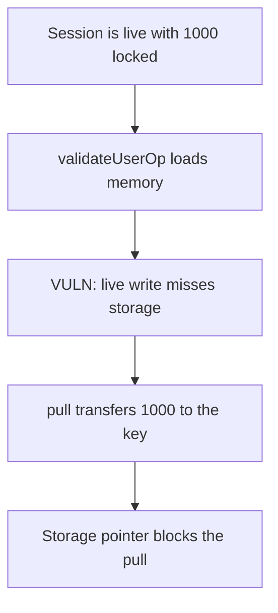

# CredibleAccountModule — validateUserOp clears live on a memory copy

> **Vulnerability classes:** `vuln/logic/state-update` · `vuln/access-control/broken-logic`

<!-- non-defihacklabs -->
<!-- source-auditvault: https://github.com/Auditware/AuditVault/blob/main/findings/61406-c-04-memory-vs-storage-mismatch-renders-session-state-update.md -->
<!-- date: 2025-06 -->

## Key info

| | |
|---|---|
| **Protocol** | Etherspot CredibleAccountModule |
| **Finding** | Shieldify C-04, AuditVault 61406 |
| **Vulnerable code** | `validateUserOp` loads `SessionData memory` |
| **Harm** | The session key pulls 1000 after validation. The storage-pointer control blocks the pull. |
| **Chain** | local synthetic |

## TL;DR

`validateUserOp` is supposed to retire a session by setting `live` to false. It loads `SessionData` into memory, so the write never reaches storage. The module still treats the session as live, the same way `_isSessionKeyExpired` and `getLiveSessionKeysForWallet` do, and `pull` transfers the locked 1000 to the session key. Loading the struct as `storage` clears `live`, and the second pull reverts.

## The vulnerable code

```solidity
SessionData memory sd = sessionData[sessionKeySigner][msg.sender];
sd.live = false;
```

The report's fix is `SessionData storage sd`.

## Root cause

A memory copy of a storage struct does not alias the slot. Assigning `sd.live` updates the copy. Every later read of `sessionData[...][...].live` still sees true.

## Preconditions

The wallet has enabled the session key with `live` true and 1000 tokens locked in the module. `pull` transfers that locked amount only while storage `live` is true. The wallet calls `validateUserOp` before the pull.

## Attack walkthrough

1. The wallet calls `validateUserOp` for the session key.
2. The function copies `SessionData` into memory and sets `live` false on that copy.
3. A storage read after the call still returns `live == true`.
4. `pull` sees `live`, transfers 1000 to the key, and the key's balance increases by 1000.
5. The control module uses a storage pointer. After validation, `live` is false, `pull` reverts, and the 1000 stays in the module.

## Diagrams



## Impact

A session that validation was supposed to retire can still move its locked balance. The key receives 1000. The control path leaves that 1000 in the module.

## Remediation

Declare `sd` as `SessionData storage` before assigning `sd.live = false`.

## How to reproduce

```bash
cd 61406-c-04-memory-vs-storage-mismatch-renders-session-state-update_exp
forge test -vv
```

## Sources

- AuditVault finding: https://github.com/Auditware/AuditVault/blob/main/findings/61406-c-04-memory-vs-storage-mismatch-renders-session-state-update.md
- Shieldify report: https://github.com/shieldify-security/audits-portfolio-md/blob/main/Etherspot-CredibleAccountModule-Security-Review.md
- Reviewed tree: https://github.com/etherspot/etherspot-modular-accounts/blob/d4774db9f544cc6f69000c55e97627f93fe7242b/src/modules/validators/CredibleAccountModule.sol
