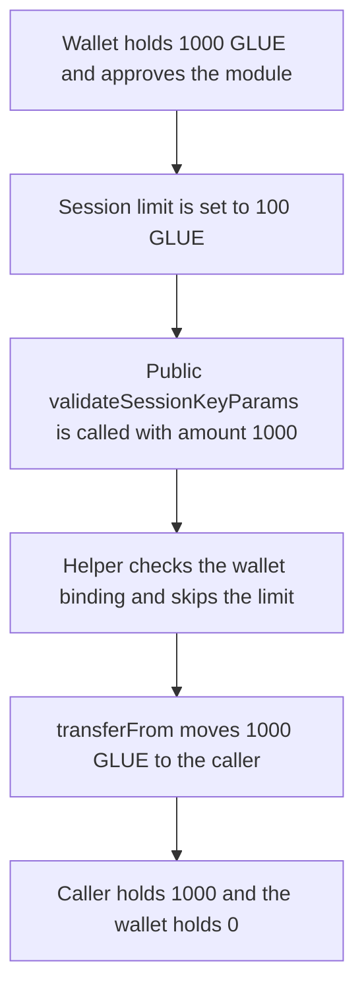

# Etherspot — a session key spends 1000 GLUE past a 100 GLUE limit

> **Vulnerability classes:** vuln/access-control/missing-auth · vuln/logic/missing-check · vuln/access-control/missing-modifier

> **Reproduction:** a self-contained Foundry PoC that compiles and runs offline
> with only `forge-std` — no fork and no RPC. Trace: [output.txt](output.txt).
> PoC: [test/61407-c-05-in-credibleaccountmodule-the-validatesessionkeyparams-f_exp.sol](test/61407-c-05-in-credibleaccountmodule-the-validatesessionkeyparams-f_exp.sol).

<!-- non-defihacklabs -->
<!-- source-auditvault: https://github.com/Auditware/AuditVault/blob/main/findings/61407-c-05-in-credibleaccountmodule-the-validatesessionkeyparams-f.md -->
<!-- date: 2025-07 -->

---

## Key info

| | |
|---|---|
| **Impact** | **HIGH** — a session limited to **100 GLUE** spends **1000 GLUE** out of the wallet |
| **Protocol** | Etherspot `CredibleAccountModule` |
| **Vulnerable code** | public `validateSessionKeyParams` / `_validateSingleCall` |
| **Bug class** | Session parameters are not checked against the spend limit |
| **Finding** | Shieldify — Credible Account Module, July 2025 · id 61407 / C-05 |
| **Report** | [Etherspot-CredibleAccountModule-Security-Review.md](https://github.com/shieldify-security/audits-portfolio-md/blob/main/Etherspot-CredibleAccountModule-Security-Review.md) |
| **Source** | [AuditVault finding](https://github.com/Auditware/AuditVault/blob/main/findings/61407-c-05-in-credibleaccountmodule-the-validatesessionkeyparams-f.md) |
| **Status** | Fixed by Etherspot. Reproduced here as a local synthetic. |
| **Compiler** | solc 0.8.27, cancun, via IR |

---

## TL;DR

`validateSessionKeyParams` is public. It forwards the userOp into `_validateSingleCall`, and that helper transfers `amount` out of the wallet after checking only that the session key is bound to that wallet. It never compares `amount` to `sessionLimit`. A key whose limit is **100 GLUE** therefore spends **N = 1000 GLUE**. The caller receives 1000 GLUE and the wallet balance goes to 0.

The fixed module reverts `SessionParamsRejected` on the same userOp. The 1000 GLUE stays in the wallet.

## Vulnerable code

The reviewed function is public and does not validate the spend. Reduced to the single-call path the report names:

```solidity
function validateSessionKeyParams(address _sessionKey, PackedUserOperation calldata userOp) public returns (bool) {
    if (isSessionClaimed[_sessionKey]) return false;
    return _validateSingleCall(_sessionKey, userOp.sender, userOp.amount);
}

function _validateSingleCall(address sessionKey, address sender, uint256 amount) internal returns (bool) {
    require(sessionWallet[sessionKey] == sender, "wallet");
    // @> VULN: amount is not checked against sessionLimit, so the key spends past it
    token.transferFrom(sender, msg.sender, amount);
    sessionSpent[sessionKey] = amount;
    isSessionClaimed[sessionKey] = true;
    return true;
}
```

The fix rejects the params before the transfer:

```diff
 function _validateSingleCall(address sessionKey, address sender, uint256 amount) internal returns (bool) {
     require(sessionWallet[sessionKey] == sender, "wallet");
+    if (amount > sessionLimit[sessionKey]) revert SessionParamsRejected();
     token.transferFrom(sender, msg.sender, amount);
```

Shieldify also asked for the function to be `internal`. The control keeps it callable and rejects an over-limit amount, which is the harm this reproduction measures.

## Attack walkthrough

1. The wallet is minted **1000 GLUE** and approves the module for 1000.
2. `enableSession` binds the key to the wallet with `sessionLimit = 100 GLUE`.
3. The caller, who is not the wallet, calls the public `validateSessionKeyParams` with `amount = 1000`.
4. The helper checks `sessionWallet[key] == sender` and then `transferFrom`s 1000 GLUE to the caller.
5. `sessionSpent` is 1000. The wallet balance is 0. The caller holds **1000 GLUE**, which is 900 above the limit.

Control: the same enable and the same userOp revert `SessionParamsRejected`. The wallet still holds 1000 GLUE. The caller holds 0.

## Diagrams



## Impact

The session key spends **1000 GLUE** from the wallet even though its limit is **100 GLUE**. Because the validator is public, the caller does not have to be the wallet. The wallet loses the full 1000 GLUE.

## Remediation

Compare `amount` to `sessionLimit` inside `_validateSingleCall` and revert when the spend is above the limit. Making `validateSessionKeyParams` internal, which is the report's recommendation, stops an arbitrary caller from invoking it. Both are required: an internal function that still ignores the limit would overspend when the wallet itself calls it.

## Sources

- [AuditVault finding 61407](https://github.com/Auditware/AuditVault/blob/main/findings/61407-c-05-in-credibleaccountmodule-the-validatesessionkeyparams-f.md)
- [Shieldify Etherspot Credible Account Module review](https://github.com/shieldify-security/audits-portfolio-md/blob/main/Etherspot-CredibleAccountModule-Security-Review.md)
- Reviewed module: [etherspot-modular-accounts@d4774db `src/modules/validators/CredibleAccountModule.sol`](https://github.com/etherspot/etherspot-modular-accounts/blob/d4774db9f544cc6f69000c55e97627f93fe7242b/src/modules/validators/CredibleAccountModule.sol)

### Taxonomy

- `severity/high`
- `vuln/access-control/missing-auth` · `vuln/logic/missing-check` · `vuln/access-control/missing-modifier`
