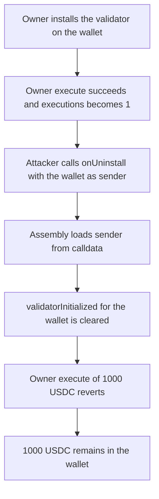

# Etherspot CredibleAccountModule — anyone can uninstall a wallet's validator

> **Vulnerability classes:** vuln/access-control/missing-auth · vuln/dos/frozen-funds

<!-- non-defihacklabs -->
<!-- source-auditvault: https://github.com/Auditware/AuditVault/blob/main/findings/61408-c-06-anyone-can-uninstall-the-validator-module-from-any-wall.md -->
<!-- date: 2025-06 -->

## Key info

| Field | Value |
|---|---|
| **Loss** | 1,000.000000 USDC stuck in the victim wallet. Owner `execute` succeeds once, then reverts after the attacker clears `validatorInitialized` |
| **Vulnerable contract** | `CredibleAccountModule.onUninstall` |
| **Attacker EOA** | `0x1111111111111111111111111111111111111111` |
| **Attack contract** | `Exploit` |
| **Attack tx** | `Exploit.run()` |
| **Chain / block / date** | Ethereum model · block 0 · 2025-06 |
| **Compiler** | solc 0.8.27, cancun, via IR |
| **Bug class** | Calldata `sender` is trusted in place of `msg.sender` |

## TL;DR

`onUninstall` loads the wallet address from the second calldata word and never checks that it equals `msg.sender`. An attacker passes the victim wallet. The module clears `validatorInitialized` for that wallet. The wallet's `execute` requires the validator to still be installed, so the owner's withdrawal of the 1,000 USDC reverts and the balance stays in the wallet. A fixed module that reverts unless `sender == msg.sender` leaves the validator installed, and the same withdrawal pays the owner 1,000 USDC.

## Background

Shieldify reviewed Etherspot's Credible Account Module (C-06, critical) against commit `d4774db9f544cc6f69000c55e97627f93fe7242b` (2025-06-09). The module is an ERC-7579 validator and hook. Installing it as a validator requires the account's active hook to be the `HookMultiPlexer` and the module to be registered on that multiplexer. Uninstall is supposed to be the account itself calling back into the module. The implementation instead treats a caller-supplied address as the account.

## The vulnerable code

```solidity
function onUninstall(bytes calldata data) external {
    uint256 moduleType;
    address sender;
    assembly {
        moduleType := calldataload(data.offset)
    }
    assembly {
        // @> VULN: sender is taken from calldata and never compared to msg.sender
        sender := calldataload(add(data.offset, 32))
    }
    moduleInitialized[sender].validatorInitialized = false;
}
```

The recommended fix is to reject the call unless the decoded account is the caller:

```diff
         sender := calldataload(add(data.offset, 32))
     }
+    if (sender != msg.sender) revert SenderMismatch(msg.sender, sender);
     if (moduleType == MODULE_TYPE_VALIDATOR) {
```

## Root cause

ERC-7579 `onUninstall` is invoked by the account, so `msg.sender` is the account being modified. This function ignores `msg.sender` and writes `moduleInitialized[sender]`, where `sender` is `calldataload(data.offset + 32)`. The hook checks that follow (`getActiveHook`, `hasHook`) are evaluated against that spoofed account, not against the caller. With the multiplexer installed on the victim, those checks pass for any external caller.

## Preconditions

- The victim wallet has installed `CredibleAccountModule` as a validator, so `getActiveHook()` is the multiplexer and `hasHook` is true.
- The attacker has no live session keys of their own. `getSessionKeysByWallet()` reads `msg.sender`, so the locked-token loop is empty and does not revert.
- The wallet's `execute` refuses to run once `isInitialized` is false. That is the account-side consequence of removing the only validator.

## Attack walkthrough

1. The exploit funds the victim wallet with 1,000 USDC.
2. The owner installs the validator. `validatorInitialized` becomes true.
3. The owner calls `execute` with amount 0. `executions` becomes 1. The validator is live.
4. The attacker calls `onUninstall(abi.encode(MODULE_TYPE_VALIDATOR, wallet))`.
5. The assembly word at `data.offset + 32` is the wallet, not the attacker.
6. `validatorInitialized` for the wallet is set to false and `uninstalledFrom` records the wallet.
7. The owner calls `execute` for the full 1,000 USDC. The wallet reverts with `validator uninstalled`.
8. The wallet still holds 1,000 USDC. The owner holds 0.

## Diagrams



## Impact

The owner could move funds before the uninstall and cannot move them after. 1,000.000000 USDC stays in the wallet, `executions` stays 1, and `isInitialized(wallet)` is false. The control module reverts `SenderMismatch` for the same payload, `isInitialized` stays true, and `execute` transfers the 1,000 USDC to the owner.

## PoC

```bash
cd 61408-c-06-anyone-can-uninstall-the-validator-module-from-any-wall_exp
forge test -vv
```

`test_exploit_uninstall_bricks_owner_execute` asserts the stuck balance is 1,000e6, the post-uninstall execute reverted, and only the pre-uninstall execute ran. `test_control_sender_must_equal_caller` asserts the fixed module rejects the attacker and then pays the owner 1,000e6.

## Sources

- AuditVault finding: https://github.com/Auditware/AuditVault/blob/main/findings/61408-c-06-anyone-can-uninstall-the-validator-module-from-any-wall.md
- Shieldify report: https://github.com/shieldify-security/audits-portfolio-md/blob/main/Etherspot-CredibleAccountModule-Security-Review.md
- Reviewed source: https://github.com/etherspot/etherspot-modular-accounts/blob/d4774db9f544cc6f69000c55e97627f93fe7242b/src/modules/validators/CredibleAccountModule.sol
