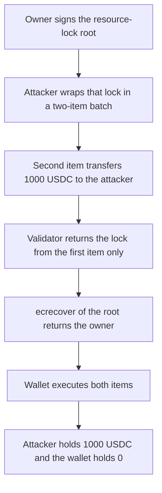

# Etherspot ResourceLockValidator — a lock signature authorizes a different batch

> **Vulnerability classes:** vuln/auth/signature-validation · vuln/logic/missing-check

<!-- non-defihacklabs -->
<!-- source-auditvault: https://github.com/Auditware/AuditVault/blob/main/findings/61410-c-08-in-resourcelockvalidator-the-validateuserop-function-la.md -->
<!-- date: 2025-06 -->

## Key info

| Field | Value |
|---|---|
| **Loss** | 1,000.000000 USDC leaves the modular wallet and arrives at the attacker |
| **Vulnerable contract** | `ResourceLockValidator.validateUserOp` |
| **Attacker EOA** | `0x1111111111111111111111111111111111111111` |
| **Attack contract** | `Exploit` |
| **Attack tx** | `Exploit.run()` |
| **Chain / block / date** | Ethereum model · block 0 · 2025-06 |
| **Compiler** | solc 0.8.27, cancun, via IR |
| **Bug class** | Signature covers the ResourceLock root, not the executed batch |

## TL;DR

`validateUserOp` recovers the wallet owner over the merkle root of a `ResourceLock` parsed from the first `enableSessionKey` execution. A batch is not required to have length 1, and the loop returns on that first execution. The owner signature therefore authorizes a second execution the owner never signed: `USDC.transfer` of 1,000 USDC to the attacker. The wallet runs both calls. A fixed validator that returns failure unless the batch length is 1 rejects the same userOp, and the 1,000 USDC stays in the wallet.

## Background

Shieldify's review of Etherspot's Credible Account Module (C-08, critical) covered `ResourceLockValidator` at commit `d4774db9f544cc6f69000c55e97627f93fe7242b` (2025-06-09). The validator is meant to authorize session-key setup. In the merkle path the signed message is the resource-lock root. The batch decoder is documented as expecting a single execution, but it returns as soon as it sees selector `0x495079a0` (`enableSessionKey(bytes)`).

## The vulnerable code

```solidity
Execution[] calldata batchExecs = ExecutionLib.decodeBatch(callData[100:]);
for (uint256 i; i < batchExecs.length; ++i) {
    if (bytes4(batchExecs[i].callData[:4]) == ENABLE_SELECTOR) {
        return _lockFromEnable(batchExecs[i].callData);
    }
}
// later, in validateUserOp
// @> VULN: the owner signature is recovered over the resource-lock root, not the userOp
if (walletOwner == ECDSA.recover(root, ecdsaSignature)) {
    return SIG_VALIDATION_SUCCESS;
}
```

The length fix from the report, which is what the control implements:

```diff
 Execution[] calldata batchExecs = ExecutionLib.decodeBatch(callData[100:]);
+if (batchExecs.length != 1) return SIG_VALIDATION_FAILED;
```

## Root cause

The recovered signer is compared to `ECDSA.recover(root, signature)`, and `root` is the hash of the `ResourceLock` fields only (`chainId`, wallet, session key, validity, bid hash, token data). `userOp.callData`'s execution list is not in that hash. Because `_getResourceLock` returns inside the loop, a later `Execution` is never read during validation and is still performed by the wallet after validation succeeds.

## Preconditions

- The modular wallet has installed the validator with `owner = 0x7E5F4552091A69125d5DfCb7b8C2659029395Bdf` (private key `0x1`).
- The owner has signed the raw resource-lock root. The proof is empty, so the root equals the leaf. The signature is 97 bytes: `r || s || v || root`.
- The wallet holds 1,000 USDC and will execute every item in a batch once validation returns 0.

## Attack walkthrough

1. The wallet installs the validator for the owner.
2. The exploit builds a two-item batch. Item 0 is `enableSessionKey` with the signed lock. Item 1 is `USDC.transfer(attacker, 1000e6)`.
3. `decodeBatch` exposes both items. The loop returns the lock from item 0.
4. `ecrecover` of the root returns the owner. Validation returns success.
5. The wallet calls both targets. The transfer debits the wallet and credits the attacker 1,000 USDC.
6. `executions` is 2 and the wallet balance is 0.

## Diagrams



## Impact

1,000.000000 USDC moves from the modular wallet to the attacker in one userOp. The control validator returns `SIG_VALIDATION_FAILED` for that same batch, `handleOp` reverts, and the wallet still holds 1,000 USDC. A length-1 batch that only calls `enableSessionKey` is accepted and does not move USDC.

## PoC

```bash
cd 61410-c-08-in-resourcelockvalidator-the-validateuserop-function-la_exp
forge test -vv
```

`test_exploit_batch_drains_1000_usdc` checks the hardcoded signature against `vm.sign` of the lock root and then asserts the attacker balance is 1,000e6. `test_control_length_check_rejects_userop` asserts the two-item userOp reverts on the fixed wallet and the balance stays 1,000e6.

## Sources

- AuditVault finding: https://github.com/Auditware/AuditVault/blob/main/findings/61410-c-08-in-resourcelockvalidator-the-validateuserop-function-la.md
- Shieldify report: https://github.com/shieldify-security/audits-portfolio-md/blob/main/Etherspot-CredibleAccountModule-Security-Review.md
- Reviewed source: https://github.com/etherspot/etherspot-modular-accounts/blob/d4774db9f544cc6f69000c55e97627f93fe7242b/src/modules/validators/ResourceLockValidator.sol
