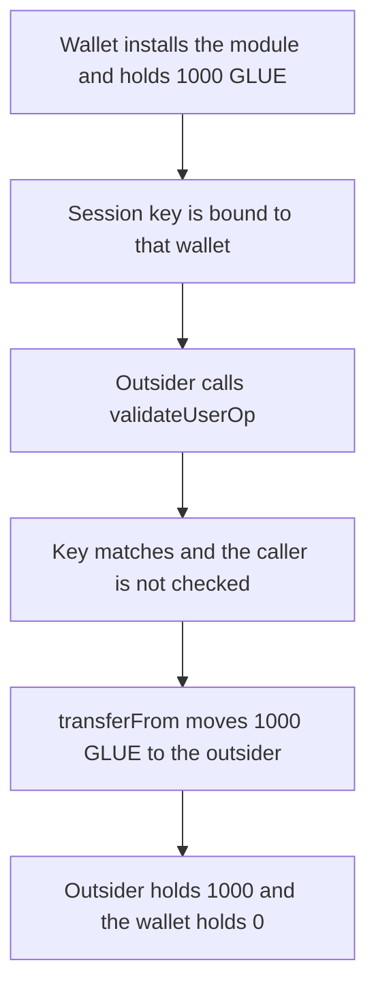

# Etherspot — an outsider userOp moves 1000 GLUE

> **Vulnerability classes:** vuln/access-control/missing-auth · vuln/access-control/missing-check · vuln/logic/missing-check

> **Reproduction:** a self-contained Foundry PoC that compiles and runs offline
> with only `forge-std` — no fork and no RPC. Trace: [output.txt](output.txt).
> PoC: [test/61412-h-02-in-credibleaccountmodule-the-validateuserop-function-is_exp.sol](test/61412-h-02-in-credibleaccountmodule-the-validateuserop-function-is_exp.sol).

<!-- non-defihacklabs -->
<!-- source-auditvault: https://github.com/Auditware/AuditVault/blob/main/findings/61412-h-02-in-credibleaccountmodule-the-validateuserop-function-is.md -->
<!-- date: 2025-07 -->

---

## Key info

| | |
|---|---|
| **Impact** | **HIGH** — a caller who never installed the module moves **1000 GLUE** out of a wallet that did |
| **Protocol** | Etherspot `CredibleAccountModule` |
| **Vulnerable code** | `validateUserOp` |
| **Bug class** | The validator does not authenticate its caller |
| **Finding** | Shieldify — Credible Account Module, July 2025 · id 61412 / H-02 |
| **Report** | [Etherspot-CredibleAccountModule-Security-Review.md](https://github.com/shieldify-security/audits-portfolio-md/blob/main/Etherspot-CredibleAccountModule-Security-Review.md) |
| **Source** | [AuditVault finding](https://github.com/Auditware/AuditVault/blob/main/findings/61412-h-02-in-credibleaccountmodule-the-validateuserop-function-is.md) |
| **Status** | Fixed by Etherspot. Reproduced here as a local synthetic. |
| **Compiler** | solc 0.8.27, cancun, via IR |

---

## TL;DR

`onInstall` sets `validatorInitialized[msg.sender]` when a wallet installs the module as a validator. `validateUserOp` never reads that flag. It checks the signature length, recovers the session key from the first 20 bytes, checks that the key is bound to the userOp wallet, and then `transferFrom`s the amount. An outsider who did not install the module submits that userOp and receives **1000 GLUE**. The wallet's installed flag stays true. The caller's flag stays false.

The fixed function reverts `CredibleAccountModule_ModuleNotInstalled` when `validatorInitialized[msg.sender]` is false. The same userOp moves 0 and the wallet still holds 1000 GLUE.

## Vulnerable code

```solidity
function validateUserOp(address wallet, uint256 amount, bytes calldata signature) external returns (uint256) {
    if (signature.length < 65) return 1;
    address sessionKey = address(bytes20(signature));
    if (sessionWallet[sessionKey] != wallet) return 1;
    // @> VULN: the caller is not required to be a wallet that installed this validator
    token.transferFrom(wallet, msg.sender, amount);
    live[sessionKey] = false;
    return 0;
}
```

The check Etherspot added:

```diff
 function validateUserOp(address wallet, uint256 amount, bytes calldata signature) external returns (uint256) {
+    if (!validatorInitialized[msg.sender]) revert CredibleAccountModule_ModuleNotInstalled(msg.sender);
     if (signature.length < 65) return 1;
```

## Attack walkthrough

1. The wallet is minted **1000 GLUE** and approves the module.
2. The wallet calls `onInstall`. `validatorInitialized[wallet]` becomes true.
3. A session key is bound to that wallet.
4. The outsider calls `validateUserOp(wallet, 1000 ether, signature)`. The signature is 65 bytes and starts with the bound key. `validatorInitialized[outsider]` is false and is not consulted.
5. `transferFrom` moves **1000 GLUE** to the outsider. The call returns 0.
6. The wallet balance is 0. The outsider balance is 1000 GLUE.

Control: the wallet still installs the module, and the same userOp is sent by a caller who did not. The call reverts `ModuleNotInstalled`. The wallet still holds 1000 GLUE.

## Diagrams



## Impact

Any caller can settle a userOp against a wallet that installed the module. Here that moves **1000 GLUE** from the wallet to the outsider. The installation flag that is supposed to restrict `validateUserOp` to the installing wallet is never read.

## Remediation

At the start of `validateUserOp`, require `validatorInitialized[msg.sender]` and revert `CredibleAccountModule_ModuleNotInstalled` otherwise. Only a wallet that installed the module as a validator may change its session state or move its tokens through this function.

## Sources

- [AuditVault finding 61412](https://github.com/Auditware/AuditVault/blob/main/findings/61412-h-02-in-credibleaccountmodule-the-validateuserop-function-is.md)
- [Shieldify Etherspot Credible Account Module review](https://github.com/shieldify-security/audits-portfolio-md/blob/main/Etherspot-CredibleAccountModule-Security-Review.md)
- Reviewed module: [etherspot-modular-accounts@d4774db `src/modules/validators/CredibleAccountModule.sol`](https://github.com/etherspot/etherspot-modular-accounts/blob/d4774db9f544cc6f69000c55e97627f93fe7242b/src/modules/validators/CredibleAccountModule.sol)

### Taxonomy

- `severity/high`
- `vuln/access-control/missing-auth` · `vuln/access-control/missing-check` · `vuln/logic/missing-check`
