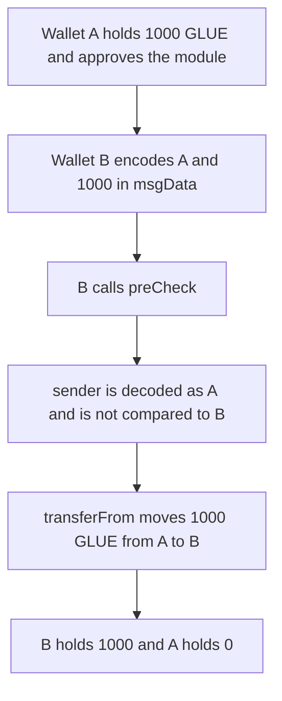

# Etherspot — wallet B spends 1000 GLUE from wallet A

> **Vulnerability classes:** vuln/access-control/fake-account-substitution · vuln/access-control/missing-check · vuln/logic/missing-check

> **Reproduction:** a self-contained Foundry PoC that compiles and runs offline
> with only `forge-std` — no fork and no RPC. Trace: [output.txt](output.txt).
> PoC: [test/61413-h-03-the-prepostcheck-is-not-authorizing-the-wallet-paramete_exp.sol](test/61413-h-03-the-prepostcheck-is-not-authorizing-the-wallet-paramete_exp.sol).

<!-- non-defihacklabs -->
<!-- source-auditvault: https://github.com/Auditware/AuditVault/blob/main/findings/61413-h-03-the-prepostcheck-is-not-authorizing-the-wallet-paramete.md -->
<!-- date: 2025-07 -->

---

## Key info

| | |
|---|---|
| **Impact** | **HIGH** — wallet B calls `preCheck` with wallet A's address and takes **1000 GLUE** from A |
| **Protocol** | Etherspot `CredibleAccountModule` |
| **Vulnerable code** | `preCheck` |
| **Bug class** | The hook wallet is not `msg.sender` |
| **Finding** | Shieldify — Credible Account Module, July 2025 · id 61413 / H-03 |
| **Report** | [Etherspot-CredibleAccountModule-Security-Review.md](https://github.com/shieldify-security/audits-portfolio-md/blob/main/Etherspot-CredibleAccountModule-Security-Review.md) |
| **Source** | [AuditVault finding](https://github.com/Auditware/AuditVault/blob/main/findings/61413-h-03-the-prepostcheck-is-not-authorizing-the-wallet-paramete.md) |
| **Status** | Fixed by Etherspot. Reproduced here as a local synthetic. |
| **Compiler** | solc 0.8.27, cancun, via IR |

---

## TL;DR

When the module is installed as a hook, the wallet calls `preCheck` before execution. The function decodes the wallet from `msgData` and uses that address as the session owner. It never checks that the decoded wallet is `msg.sender`. Wallet B encodes wallet A and **1000 GLUE**. `preCheck` pulls 1000 GLUE from A to B and adds 1000 to A's locked total. A did not call. B is not A.

The fixed `preCheck` reverts `WalletMismatch` unless `msg.sender == sender`. The same payload from B moves 0, and A still holds 1000 GLUE.

## Vulnerable code

The report's body is the decode. This reduction keeps that decode and shows the transfer it authorizes:

```solidity
function preCheck(address, uint256, bytes calldata msgData) external returns (bytes memory hookData) {
    (address sender, uint256 amount) = abi.decode(msgData, (address, uint256));
    // @> VULN: sender is taken from the payload and is not checked against msg.sender
    token.transferFrom(sender, msg.sender, amount);
    locked[sender] += amount;
    hookData = abi.encode(sender, locked[sender]);
}
```

```diff
 (address sender, uint256 amount) = abi.decode(msgData, (address, uint256));
+if (msg.sender != sender) revert WalletMismatch(msg.sender, sender);
 token.transferFrom(sender, msg.sender, amount);
```

## Attack walkthrough

1. Wallet A is minted **1000 GLUE** and approves the module.
2. Wallet B builds `abi.encode(wallet A, 1000 ether)`.
3. B calls `preCheck(B, 0, payload)`. `msg.sender` is B. The decoded sender is A.
4. `transferFrom` moves **1000 GLUE** from A to B. `locked[A]` becomes 1000.
5. The hook return value names A. B's address is not A's. B's balance is 1000 GLUE and A's is 0.

Control: B sends the same payload to the fixed module. The call reverts `WalletMismatch`. A still holds 1000 GLUE. B holds 0.

## Diagrams



## Impact

Any wallet that installed the hook can name another wallet in `preCheck` and move that wallet's approved balance. Here B takes **1000 GLUE** from A and the module records the charge against A.

## Remediation

Require `msg.sender == sender` at the start of `preCheck` and `postCheck` before any balance or session write. A hook call may only account the wallet that actually called.

## Sources

- [AuditVault finding 61413](https://github.com/Auditware/AuditVault/blob/main/findings/61413-h-03-the-prepostcheck-is-not-authorizing-the-wallet-paramete.md)
- [Shieldify Etherspot Credible Account Module review](https://github.com/shieldify-security/audits-portfolio-md/blob/main/Etherspot-CredibleAccountModule-Security-Review.md)
- Reviewed module: [etherspot-modular-accounts@d4774db `src/modules/validators/CredibleAccountModule.sol`](https://github.com/etherspot/etherspot-modular-accounts/blob/d4774db9f544cc6f69000c55e97627f93fe7242b/src/modules/validators/CredibleAccountModule.sol)

### Taxonomy

- `severity/high`
- `vuln/access-control/fake-account-substitution` · `vuln/access-control/missing-check` · `vuln/logic/missing-check`
