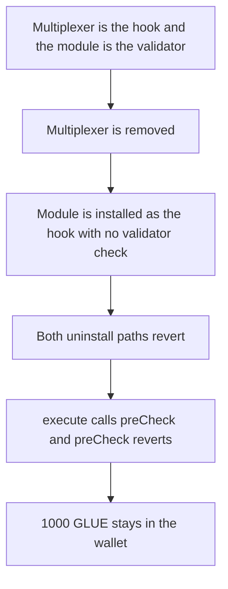

# Etherspot — execute reverts and 1000 GLUE stays in the wallet

> **Vulnerability classes:** vuln/dos/frozen-funds · vuln/logic/missing-check · vuln/logic/incorrect-state-transition

> **Reproduction:** a self-contained Foundry PoC that compiles and runs offline
> with only `forge-std` — no fork and no RPC. Trace: [output.txt](output.txt).
> PoC: [test/61414-h-04-modularetherspotwallet-can-get-dosed-from-uninstalling_exp.sol](test/61414-h-04-modularetherspotwallet-can-get-dosed-from-uninstalling_exp.sol).

<!-- non-defihacklabs -->
<!-- source-auditvault: https://github.com/Auditware/AuditVault/blob/main/findings/61414-h-04-modularetherspotwallet-can-get-dosed-from-uninstalling.md -->
<!-- date: 2025-07 -->

---

## Key info

| | |
|---|---|
| **Impact** | **HIGH** — after the hook install, `execute` reverts and **1000 GLUE** stays in the wallet |
| **Protocol** | Etherspot `CredibleAccountModule` / `ModularEtherspotWallet` |
| **Vulnerable code** | `onInstall` for the hook module type |
| **Bug class** | A hook install is allowed on top of an existing validator |
| **Finding** | Shieldify — Credible Account Module, July 2025 · id 61414 / H-04 |
| **Report** | [Etherspot-CredibleAccountModule-Security-Review.md](https://github.com/shieldify-security/audits-portfolio-md/blob/main/Etherspot-CredibleAccountModule-Security-Review.md) |
| **Source** | [AuditVault finding](https://github.com/Auditware/AuditVault/blob/main/findings/61414-h-04-modularetherspotwallet-can-get-dosed-from-uninstalling.md) |
| **Status** | Fixed by Etherspot. Reproduced here as a local synthetic. |
| **Compiler** | solc 0.8.27, cancun, via IR |

---

## TL;DR

Installing the module as a validator requires the hook multiplexer to be the active hook. Installing it as a hook has no matching check. Uninstalling the validator again requires the multiplexer. Uninstalling the hook requires the validator to be gone.

The wallet sets the multiplexer, installs the module as the validator, clears the multiplexer, and installs the module as the hook. Both uninstall calls then revert. `execute` calls `preCheck`, which reverts because the wallet is both hook and validator and the multiplexer is not the active hook. The transfer of **1000 GLUE** does not run. The wallet still holds 1000 GLUE.

The fixed `onInstall` reverts `AlreadyValidator` on the hook install. The validator can then be uninstalled while the multiplexer is still the hook, and `execute` pays the 1000 GLUE.

## Vulnerable code

```solidity
function onInstall(address wallet, uint256 moduleType) external {
    if (moduleType == 1) {
        require(activeHook[wallet] == multiplexer, "mux");
        validatorInitialized[wallet] = true;
    } else if (moduleType == 2) {
        hookInitialized[wallet] = true;
        // @> VULN: hook install does not care that this wallet is already a validator
        activeHook[wallet] = address(this);
    }
}
```

```diff
 } else if (moduleType == 2) {
+    if (validatorInitialized[wallet]) revert AlreadyValidator();
     hookInitialized[wallet] = true;
```

## Attack walkthrough

1. The wallet is minted **1000 GLUE**. The multiplexer is set as its active hook.
2. `onInstall(wallet, 1)` sets `validatorInitialized`. The multiplexer check passes.
3. The active hook is cleared. The validator uninstall path now fails, because it still demands the multiplexer.
4. `onInstall(wallet, 2)` sets `hookInitialized` and points the active hook at the module. There is no "already a validator" check.
5. `onUninstall(wallet, 1)` reverts on the multiplexer check. `onUninstall(wallet, 2)` reverts because the validator flag is still true.
6. `wallet.execute(caller, 1000 ether)` calls `preCheck`. The wallet is both hook and validator and the active hook is not the multiplexer, so `preCheck` reverts. `execute` returns false.
7. The wallet still holds **1000 GLUE**. The caller holds 0.

Control: the same validator install, then a hook install, reverts `AlreadyValidator`. `onUninstall(wallet, 1)` succeeds while the multiplexer is still the hook. `execute` transfers **1000 GLUE** to the caller and the wallet balance is 0.

## Diagrams



## Impact

The wallet cannot uninstall the module as a validator or as a hook. The next `execute` reverts in `preCheck`, so the **1000 GLUE** in the wallet cannot be transferred. The fixed install order lets the owner uninstall the validator and `execute` pays that 1000 GLUE.

## Remediation

In `onInstall`, reject module type hook when `validatorInitialized[wallet]` is already true. That is the state the report describes: do not allow the module to become both the hook and the validator after the multiplexer has been removed.

## Sources

- [AuditVault finding 61414](https://github.com/Auditware/AuditVault/blob/main/findings/61414-h-04-modularetherspotwallet-can-get-dosed-from-uninstalling.md)
- [Shieldify Etherspot Credible Account Module review](https://github.com/shieldify-security/audits-portfolio-md/blob/main/Etherspot-CredibleAccountModule-Security-Review.md)
- Reviewed module: [etherspot-modular-accounts@d4774db `src/modules/validators/CredibleAccountModule.sol`](https://github.com/etherspot/etherspot-modular-accounts/blob/d4774db9f544cc6f69000c55e97627f93fe7242b/src/modules/validators/CredibleAccountModule.sol)

### Taxonomy

- `severity/high`
- `vuln/dos/frozen-funds` · `vuln/logic/missing-check` · `vuln/logic/incorrect-state-transition`
