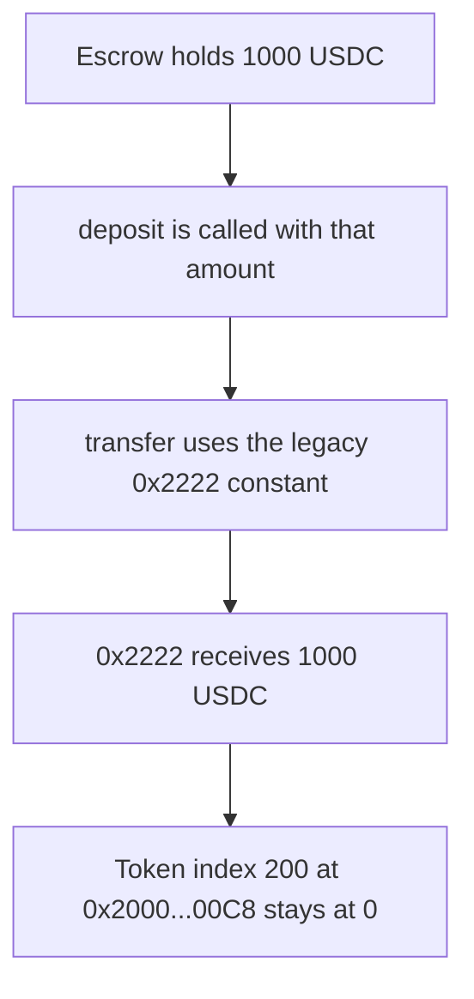

# Blueberry — 1000 USDC is bridged to the legacy Hyperliquid address

> **Vulnerability classes:** vuln/bridge/missing-validation · vuln/logic/wrong-condition

> **Reproduction:** a self-contained Foundry PoC that compiles and runs offline
> with only `forge-std` — no fork and no RPC. Trace: [output.txt](output.txt).
> PoC: [test/61456-h-03-incorrect-erc20-transfer-implementation-between-evm-and_exp.sol](test/61456-h-03-incorrect-erc20-transfer-implementation-between-evm-and_exp.sol).

<!-- non-defihacklabs -->
<!-- source-auditvault: https://github.com/Auditware/AuditVault/blob/main/findings/61456-h-03-incorrect-erc20-transfer-implementation-between-evm-and.md -->
<!-- date: 2025-03 -->

---

## Key info

| | |
|---|---|
| **Impact** | **HIGH** — `deposit` sends **1000 USDC** to `0x2222...2222`. Token index 200's system address receives **0** |
| **Protocol** | Blueberry `VaultEscrow` |
| **Vulnerable code** | `deposit` transfers to `HYPERLIQUID_SPOT_BRIDGE` |
| **Bug class** | Cross-VM transfer uses a retired recipient |
| **Finding** | Pashov Audit Group — Blueberry, 12 March 2025 · id 61456 / H-03 |
| **Report** | [Blueberry-security-review_2025-03-12.md](https://github.com/pashov/audits/blob/master/team/md/Blueberry-security-review_2025-03-12.md) |
| **Source** | [AuditVault finding](https://github.com/Auditware/AuditVault/blob/main/findings/61456-h-03-incorrect-erc20-transfer-implementation-between-evm-and.md) |
| **Status** | Reported against the legacy spot bridge constant. Reproduced here as a local synthetic. |
| **Compiler** | solc 0.8.27, cancun, via IR |

---

## TL;DR

`VaultEscrow.deposit` is how a vault moves USDC from the EVM side onto HyperCore. It transfers the amount to the constant `0x2222222222222222222222222222222222222222`. Hyperliquid replaced that single spot bridge with a per-token system address: first byte `0x20`, and the token index in the low bytes. For token index 200 that address is `0x20000000000000000000000000000000000000C8`.

A deposit of **N = 1000 USDC** (1_000_000_000 base units, 6 decimals) credits the legacy address with 1000 USDC. The index-200 address stays at 0. The escrow balance goes to 0, so the tokens have left the vault and landed on the wrong side of the bridge.

The fixed `deposit` computes `address(uint160((uint256(0x20) << 152) | 200))` and transfers the same 1000 USDC there. The legacy address receives 0.

## Vulnerable code

```solidity
/// @notice The address of the hyperliquid spot bridge, used for sending tokens to L1.
address public constant HYPERLIQUID_SPOT_BRIDGE = 0x2222222222222222222222222222222222222222;

function deposit(uint64 amount) external {
    // @> VULN: legacy bridge, not the token-index system address 0x2000...00c8
    token.transfer(HYPERLIQUID_SPOT_BRIDGE, amount);
}
```

The replacement used by the control:

```solidity
function systemAddress(uint64 tokenIndex) public pure returns (address) {
    return address(uint160((uint256(0x20) << 152) | uint256(tokenIndex)));
}

function deposit(uint64 amount) external {
    token.transfer(systemAddress(200), amount);
}
```

`systemAddress(200)` equals `0x20000000000000000000000000000000000000C8`. The other side of the bridge is modeled as that address's ERC-20 balance. No live HyperCore node is required.

## Attack walkthrough

1. The escrow is minted **1000 USDC**.
2. `deposit(1_000_000_000)` runs.
3. `transfer` sends the full amount to `HYPERLIQUID_SPOT_BRIDGE`.
4. `balanceOf(0x2222...2222)` is 1000 USDC.
5. `balanceOf(0x2000...00C8)` is 0.
6. The escrow balance is 0.

Control: the same mint and `deposit` credit `0x2000...00C8` with 1000 USDC and leave the legacy address at 0.

## Diagrams



## Impact

**1000 USDC** leaves the escrow and is credited to the retired spot bridge. The HyperCore system address for token index 200 receives nothing, so the cross-VM deposit does not arrive on the account the current docs name. The fixed function delivers that same 1000 USDC to `0x2000...00C8`.

## Remediation

Stop using `0x2222222222222222222222222222222222222222`. Transfer each token to the system address whose first byte is `0x20` and whose remaining bytes encode that token's index, which for index 200 is `0x20000000000000000000000000000000000000C8`.

## Sources

- [AuditVault finding 61456](https://github.com/Auditware/AuditVault/blob/main/findings/61456-h-03-incorrect-erc20-transfer-implementation-between-evm-and.md)
- [Pashov Blueberry security review, 12 March 2025](https://github.com/pashov/audits/blob/master/team/md/Blueberry-security-review_2025-03-12.md)
- HyperCore system-address rule, as cited by the finding: first byte `0x20`, token index in the low bytes. Index 200 is `0x20000000000000000000000000000000000000C8`.

### Taxonomy

- `severity/high`
- `vuln/bridge/missing-validation` · `vuln/logic/wrong-condition`
