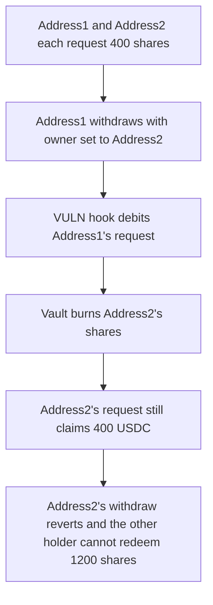

# Blueberry: an approved withdraw burns the owner's shares and leaves their request open

> **Vulnerability classes:** `vuln/access-control/missing-auth` · `vuln/logic/incorrect-state-transition`

<!-- non-defihacklabs -->
<!-- source-auditvault: https://github.com/Auditware/AuditVault/blob/main/findings/61458-h-05-user-can-drain-escrow-via-approved-withdrawals-pashov-a.md -->
<!-- date: 2025-03 -->

## Key info

| Field | Value |
|---|---|
| **Loss** | 400 USDC stays in the deposit escrow. The remaining holder's 1200-share redeem reverts |
| **Vulnerable contract** | `Vault._beforeWithdraw` |
| **Attacker EOA** | `0x1111111111111111111111111111111111111111` |
| **Attack contract** | `Exploit` |
| **Attack tx** | `Exploit.run()` |
| **Chain / block / date** | Ethereum model · block 0 · 2025-03 |
| **Compiler** | solc 0.8.27, cancun, via IR |
| **Bug class** | redeem request is debited from msg.sender |

## TL;DR

Redeem requests are stored per user. `withdraw` lets an approved spender burn the owner's shares, but `_beforeWithdraw` reads `requests[msg.sender]`. Address1 and Address2 each request 400 shares, and Address2 approves Address1. Address1 withdraws 400 with `owner` set to Address2. Address1's request is cleared and Address2's shares are burned. Address2's request still says 400 assets. Address1 then requests and withdraws its own 400, so it receives 800 USDC, the fair amount for the two addresses it controls. Address2 can no longer withdraw, because its share balance is 0. The innocent holder of the other 1200 shares cannot redeem them: the redeem escrow only has 800 left, and 400 sits in the deposit escrow against the dead request.

## The vulnerable code

```solidity
function _beforeWithdraw(uint256 assets_, uint256 shares_) internal {
    Request storage request = requests[msg.sender]; // @> VULN: approved withdraw debits the caller and burns the owner's shares
    require(request.assets >= assets_, "assets");
    require(request.shares >= shares_, "shares");
    request.assets -= assets_;
    request.shares -= shares_;
}
```

The fix passes `owner` into the hook and debits `requests[owner]`.

## Root cause

The ERC-4626 withdraw path separates the caller from the share owner. The request accounting does not. A caller with their own request can spend it to burn someone else's shares, and the owner's request is left pointing at assets that can never be released.

## Preconditions

- Redeem escrow holds 2000 USDC. Share price is 1.
- Address1 and Address2 each hold 400 shares. Another holder has 1200.
- Address2 has approved Address1. Both have an open 400-asset redeem request.

## Attack walkthrough

1. Address2 approves Address1. Both call `requestRedeem(400)`. Redeem escrow is 1200. Deposit escrow is 800.
2. Address1 calls `withdraw(400, address1, address2)`. The hook debits Address1. The vault burns Address2.
3. Address1 requests its remaining 400 shares and withdraws them. It now holds 800 USDC.
4. Address2's request is still 400 assets and 400 shares, and its balance is 0. `withdraw` reverts on the burn.
5. The innocent holder's `requestRedeem(1200)` reverts. Deposit escrow still holds 400. Redeem escrow holds 800.

## Diagrams



## Impact

400 USDC cannot be paid to anyone. The holder of the remaining 1200 shares cannot exit. Address2's claim is permanently unusable because the shares it would burn are already gone.

## Remediation

Debit `requests[owner]`, and require the owner to be the user whose shares are burned.

## How to reproduce

```bash
cd 61458-h-05-user-can-drain-escrow-via-approved-withdrawals-pashov-a_exp
forge test -vv
```

## Sources

- AuditVault finding: https://github.com/Auditware/AuditVault/blob/main/findings/61458-h-05-user-can-drain-escrow-via-approved-withdrawals-pashov-a.md
- Pashov review: https://github.com/pashov/audits/blob/master/team/md/Blueberry-security-review_2025-03-12.md
