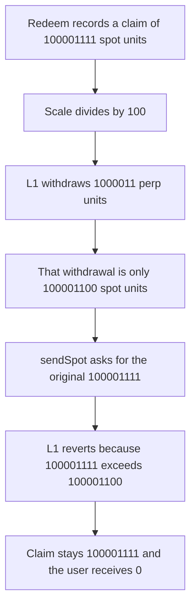

# Blueberry VaultEscrow — precision loss makes the L1 bridge revert

> **Vulnerability classes:** vuln/arithmetic/precision-loss · vuln/dos/frozen-funds

<!-- non-defihacklabs -->
<!-- source-auditvault: https://github.com/Auditware/AuditVault/blob/main/findings/61471-h-03-precision-loss-in-withdrawfroml1vault-can-cause-asset.md -->
<!-- date: 2025-03 -->

## Key info

| Field | Value |
|---|---|
| **Loss** | 100001111 spot units stay locked. The user receives 0. The fair bridgeable amount is 100001100 |
| **Vulnerable contract** | `VaultEscrow._withdrawFromL1Vault` |
| **Attacker EOA** | `0x1111111111111111111111111111111111111111` |
| **Attack contract** | `Exploit` |
| **Attack tx** | `Exploit.run()` |
| **Chain / block / date** | Ethereum model · block 0 · 2025-03 |
| **Compiler** | solc 0.8.27, cancun, via IR |
| **Bug class** | Spot amount is not the inverse of the perp-decimal scale |

## TL;DR

`_withdrawFromL1Vault` converts `assets_` from 8 spot decimals to 6 perp decimals by integer division, withdraws that smaller perp amount, then calls `sendSpot` with the original `assets_`. For `assets_ = 100001111`, the perp amount is `1000011` and the spot value of that withdrawal is `100001100`. `sendSpot(100001111)` reverts. The redeem claim stays at 100001111 and the user is paid 0. Bridging `_scaleToSpotDecimals(amountPerp)` instead pays 100001100 and leaves 11 units of dust.

## Background

Pashov Audit Group reviewed Blueberry on 2025-03-26 (H-03, high). `VaultEscrow` moves a Hyperliquid vault withdrawal back to the EVM spot balance. The worked example in the report is perp decimals 6, EVM spot decimals 8, and `assets_ = 100001111`. The EVM redeem has already succeeded when the L1 bridge reverts, so the assets are not returned to the escrow's user.

## The vulnerable code

```solidity
function _withdrawFromL1Vault(uint64 assets_, address user) internal {
    uint256 amountPerp = _scaleToPerpDecimals(assets_);
    l1.sendVaultTransfer(address(this), false, uint64(amountPerp));
    l1.sendUsdClassTransfer(uint64(amountPerp), false);
    // @> VULN: bridges assets_ even though only the rounded perp amount was withdrawn
    l1.sendSpot(user, 0, assets_);
}
```

```diff
-    l1.sendSpot(user, 0, assets_);
+    l1.sendSpot(user, 0, uint64(_scaleToSpotDecimals(amountPerp)));
```

## Root cause

`_scaleToPerpDecimals` is `assets_ / 10^(spotDecimals - perpDecimals)`. With the exponent equal to 2, `100001111 / 100 = 1000011`. Scaling that back is `1000011 * 100 = 100001100`, which is 11 units short of `assets_`. `sendSpot` spends the original spot amount against a balance that only received the rounded amount, so the L1 transfer reverts after the redeem claim has been recorded.

## Preconditions

- `_perpDecimals` is 6 and `_evmSpotDecimals` is 8.
- `assets_` is not divisible by `10^(spotDecimals - perpDecimals)`. The report's value 100001111 is not divisible by 100.
- The redeem is stored before the L1 pull. A reverting pull must not clear the claim.

## Attack walkthrough

1. L1 is funded with 100001111 spot units.
2. The user requests a redeem of 100001111. `claimOf` stores that amount.
3. Settlement scales the amount to 1000011 perp units and credits 100001100 spot units.
4. `sendSpot` is called with 100001111. L1 reverts `spot shortfall`.
5. The claim is still 100001111. The user's balance is 0. L1 still holds 100001111.

## Diagrams



## Impact

The user cannot complete the withdrawal. 100001111 spot units remain on L1 and the claim stays open. The control sends the scaled amount 100001100, the user receives 100001100, and 11 units of rounding dust remain on L1.

## PoC

```bash
cd 61471-h-03-precision-loss-in-withdrawfroml1vault-can-cause-asset_exp
forge test -vv
```

`test_exploit_sendSpot_reverts_and_locks_claim` asserts the user balance is 0 and L1 still holds 100001111. `test_control_scaled_spot_pays_fair_amount` asserts the user receives 100001100 and L1 keeps 11.

## Sources

- AuditVault finding: https://github.com/Auditware/AuditVault/blob/main/findings/61471-h-03-precision-loss-in-withdrawfroml1vault-can-cause-asset.md
- Pashov report: https://github.com/pashov/audits/blob/master/team/md/Blueberry-security-review_2025-03-26.md
- Quoted function: `VaultEscrow._withdrawFromL1Vault` in that review
