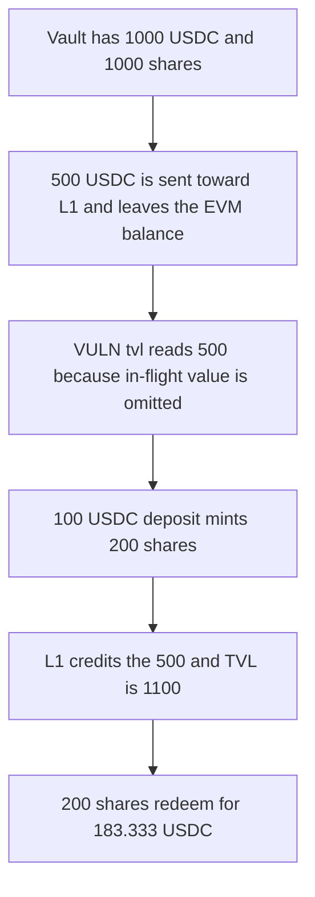

# Blueberry: a deposit during the L1 pre-credit mints extra shares

> **Vulnerability classes:** `vuln/arithmetic/rounding` · `vuln/logic/price-calculation`

<!-- non-defihacklabs -->
<!-- source-auditvault: https://github.com/Auditware/AuditVault/blob/main/findings/61480-h-03-users-can-exploit-tvl-during-evm-to-l1-transfer-causing.md -->
<!-- date: 2025-04 -->

## Key info

| Field | Value |
|---|---|
| **Loss** | Depositor turns 100 USDC into 183.333 USDC. Profit is 83.333 USDC |
| **Vulnerable contract** | `EscrowVault.tvl` |
| **Attacker EOA** | `0x1111111111111111111111111111111111111111` |
| **Attack contract** | `Exploit` |
| **Attack tx** | `Exploit.run()` |
| **Chain / block / date** | Ethereum model · block 0 · 2025-04 |
| **Compiler** | solc 0.8.27, cancun, via IR |
| **Bug class** | TVL omits tokens that have left the EVM and are not yet on L1 |

## TL;DR

The vault starts with 1000 USDC and 1000 shares. `transferToL1(500)` debits the EVM balance immediately and does not credit L1 until `creditL1`. `tvl` sums the contract balance and the L1 spot balance, so it reports 500 while 500 is in flight. A 100 USDC deposit mints `100 * 1000 / 500 = 200` shares. After the credit, TVL is 1100 and supply is 1200. Redeeming 200 shares pays `200/1200 * 1100 = 183.333` USDC. Profit is 83.333 USDC, taken from the other shareholders.

## The vulnerable code

```solidity
function tvl() public view returns (uint256 tvl_) {
    tvl_ = l1Spot;
    tvl_ += usdc.balanceOf(address(this)); // @> VULN: USDC that already left for L1 is not counted until creditL1
}
```

The report's fixes are to count in-flight balances, or to pause deposits until L1 credits them.

## Root cause

The EVM debit and the L1 credit are not the same moment. `tvl` only reads the two balances that are zero during the gap. Share price is `tvl / supply`, so the gap mints too many shares. When the missing USDC reappears, those shares are a claim on assets the depositor did not bring.

## Preconditions

- Vault holds 1000 USDC against 1000 shares.
- An admin transfer of 500 USDC to L1 has been started and not yet credited.
- Deposits are still open. The attacker has 100 USDC.

## Attack walkthrough

1. `transferToL1(500)`. Contract balance is 500. `inFlight` is 500. `tvl` is 500.
2. Deposit 100. Shares minted are 200.
3. `creditL1`. L1 spot is 500. Contract balance is 600. `tvl` is 1100. Supply is 1200.
4. Redeem 200 shares. Payout is 183.333 USDC.
5. Attacker USDC is 83.333 above the starting 100.

## Diagrams



## Impact

Existing shareholders are diluted by 83.333 USDC on this deposit. The same window works for any size up to the understated TVL. Counting `inFlight` in `tvl` would have priced the deposit at 1 USDC per share.

## Remediation

Add the in-flight amount to `tvl` until `creditL1`, or reject deposits and redemptions while `inFlight` is non-zero.

## How to reproduce

```bash
cd 61480-h-03-users-can-exploit-tvl-during-evm-to-l1-transfer-causing_exp
forge test -vv
```

## Sources

- AuditVault finding: https://github.com/Auditware/AuditVault/blob/main/findings/61480-h-03-users-can-exploit-tvl-during-evm-to-l1-transfer-causing.md
- Pashov review: https://github.com/pashov/audits/blob/master/team/md/Blueberry-security-review_2025-04-30.md
