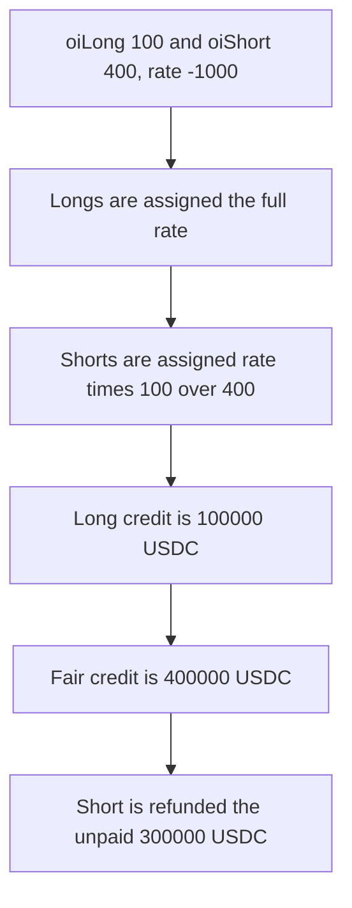

# Ostium — shorts keep 300000 USDC when the funding rate is negative

> **Vulnerability classes:** vuln/logic/fee-calculation · vuln/arithmetic/precision-loss

> **Reproduction:** a self-contained Foundry PoC that compiles and runs offline
> with only `forge-std` — no fork and no RPC. Trace: [output.txt](output.txt).
> PoC: [test/61508-h-01-undervalued-funding-fee-when-accfundingrate-is-negative_exp.sol](test/61508-h-01-undervalued-funding-fee-when-accfundingrate-is-negative_exp.sol).

<!-- non-defihacklabs -->
<!-- source-auditvault: https://github.com/Auditware/AuditVault/blob/main/findings/61508-h-01-undervalued-funding-fee-when-accfundingrate-is-negative.md -->
<!-- date: 2025-01 -->

---

## Key info

| | |
|---|---|
| **Impact** | **HIGH** — longs are paid **100000 USDC** instead of **400000**, and the short keeps the **300000** difference |
| **Protocol** | Ostium funding |
| **Vulnerable code** | A negative `accFundingRate` is still scaled by `oiLong / oiShort` onto the short side |
| **Bug class** | Funding is undervalued when oiDelta is negative |
| **Finding** | Pashov Audit Group — Ostium, 21 January 2025 · id 61508 |
| **Report** | [Pashov Ostium review](https://github.com/pashov/audits/blob/master/team/md/Ostium-security-review_2025-01-21.md) |
| **Source** | [AuditVault finding](https://github.com/Auditware/AuditVault/blob/main/findings/61508-h-01-undervalued-funding-fee-when-accfundingrate-is-negative.md) |
| **Status** | Reproduced as a local settle of one negative rate. |
| **Compiler** | solc 0.8.27, cancun, via IR |

---

## TL;DR

Open interest is **100** long and **400** short, so oiDelta is negative. `accFundingRate` is **-1000**. Shorts should pay the full rate. Longs should receive that rate scaled by `oiShort / oiLong`.

The settle always writes the full rate onto longs and the rate scaled by `oiLong / oiShort` onto shorts. Longs are credited **100000 USDC**. The fair credit is **400000 USDC**. The escrow was funded with the fair **400000**, so the unpaid **300000** is returned to the short.

The control sets `valueLong = rate * oiShort / oiLong` and pays longs **400000 USDC**. The short receives nothing back.

## The vulnerable code

```solidity
valueLong = accFundingRate;
// @> VULN: negative rate is still scaled only onto the short side
valueShort = accFundingRate * int256(oiLong) / int256(oiShort);
```

## Preconditions

- `oiLong = 100` and `oiShort = 400`.
- `accFundingRate = -1000`.
- The vault holds **400000 USDC**, which is the amount shorts should pay.

## Attack walkthrough

1. Settle the negative rate.
2. `valueLong` is **-1000**. `valueShort` is **-250**.
3. The long credit is `1000 * 100 = 100000 USDC`.
4. That **100000** is transferred to the long trader.
5. The remaining **300000 USDC** is transferred to the short.

Control: the long credit is `1000 * 400 = 400000 USDC`, and the short balance stays 0.

## Diagrams



## Impact

Longs who should receive **400000 USDC** of funding receive **100000 USDC**. The short keeps the other **300000 USDC**.

## Remediation

When `accFundingRate` is negative, add the full rate to the short accumulator and scale the long accumulator by `oiShort / oiLong`.

## Sources

- [AuditVault finding 61508](https://github.com/Auditware/AuditVault/blob/main/findings/61508-h-01-undervalued-funding-fee-when-accfundingrate-is-negative.md)
- [Pashov Ostium review, 21 January 2025](https://github.com/pashov/audits/blob/master/team/md/Ostium-security-review_2025-01-21.md)

### Taxonomy

- `severity/high`
- `vuln/logic/fee-calculation` · `vuln/arithmetic/precision-loss`
