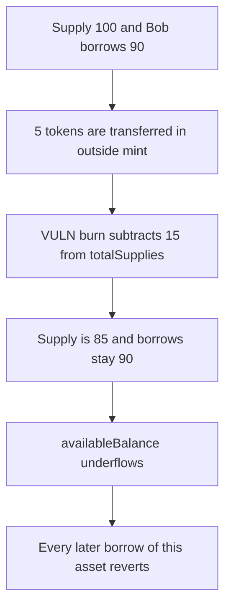

# CAP Labs: a burn drops total supply below borrows and every later borrow reverts

> **Vulnerability classes:** `vuln/logic/missing-check` · `vuln/dos/griefing`

<!-- non-defihacklabs -->
<!-- source-auditvault: https://github.com/Auditware/AuditVault/blob/main/findings/61528-inconsistent-balance-tracking-in-vault-creates-dos-for-asset.md -->
<!-- date: 2025-05 -->

## Key info

| Field | Value |
|---|---|
| **Loss** | totalSupplies becomes 85 while totalBorrows stays 90. A 1-token borrow of this asset reverts |
| **Vulnerable contract** | `Vault.burn` |
| **Attacker EOA** | `0x1111111111111111111111111111111111111111` |
| **Attack contract** | `Exploit` |
| **Attack tx** | `Exploit.run()` |
| **Chain / block / date** | Ethereum model · block 0 · 2025-05 |
| **Compiler** | solc 0.8.27, cancun, via IR |
| **Bug class** | Accounting supply is reduced without an idle-balance check |

## TL;DR

The vault tracks `totalSupplies` and `totalBorrows`, but `burn` subtracts from supply whenever the tokens are physically present. Supply starts at 100. Bob borrows 90. A 5-token direct transfer does not touch `totalSupplies`, and a 15-token burn then sets supply to 85. `availableBalance` underflows, so every later borrow reverts. Bob still holds the 90 he borrowed.

## The vulnerable code

```solidity
function burn(address receiver, uint256 amount) external {
    // @> VULN: totalSupplies falls even when the withdrawal exceeds idle accounting balance
    totalSupplies -= amount;
    require(asset.transfer(receiver, amount), "burn");
}
```

`availableBalance` is `totalSupplies - totalBorrows`. After the burn that difference is negative and the subtraction reverts.

## Root cause

`burn` trusts the token balance and ignores the accounting idle balance. Tokens sent in without `mint` can fund a withdrawal that pushes supply below borrows.

## Preconditions

- `totalSupplies` is 100 and `totalBorrows` becomes 90.
- 5 tokens are transferred to the vault outside `mint`.
- `burn` is called for 15.

## Attack walkthrough

1. Mint 100 into the supply and let Bob borrow 90.
2. Transfer 5 tokens directly to the vault.
3. Burn 15. Supply falls from 100 to 85. Borrows stay 90.
4. A 1-token borrow reverts.

## Diagrams



## Impact

Borrowing the asset is bricked for every user. Bob's existing 90-token borrow remains. A burn that requires `totalSupplies - amount >= totalBorrows` rejects the 15 withdrawal, and a later 1-token borrow succeeds.

## Remediation

Reject a burn unless the accounting idle balance covers it. Do not let an unaccounted token transfer fund a supply decrease.

## How to reproduce

```bash
cd 61528-inconsistent-balance-tracking-in-vault-creates-dos-for-asset_exp
forge test -vv
```

## Sources

- AuditVault finding: https://github.com/Auditware/AuditVault/blob/main/findings/61528-inconsistent-balance-tracking-in-vault-creates-dos-for-asset.md
- Trail of Bits review: https://github.com/trailofbits/publications/blob/master/reviews/2025-05-caplabs-coveredagentprotocol-securityreview.pdf
- Reduced source: `test/61528-inconsistent-balance-tracking-in-vault-creates-dos-for-asset.sol`, from VaultLogic.burn and Vault.availableBalance in that review
