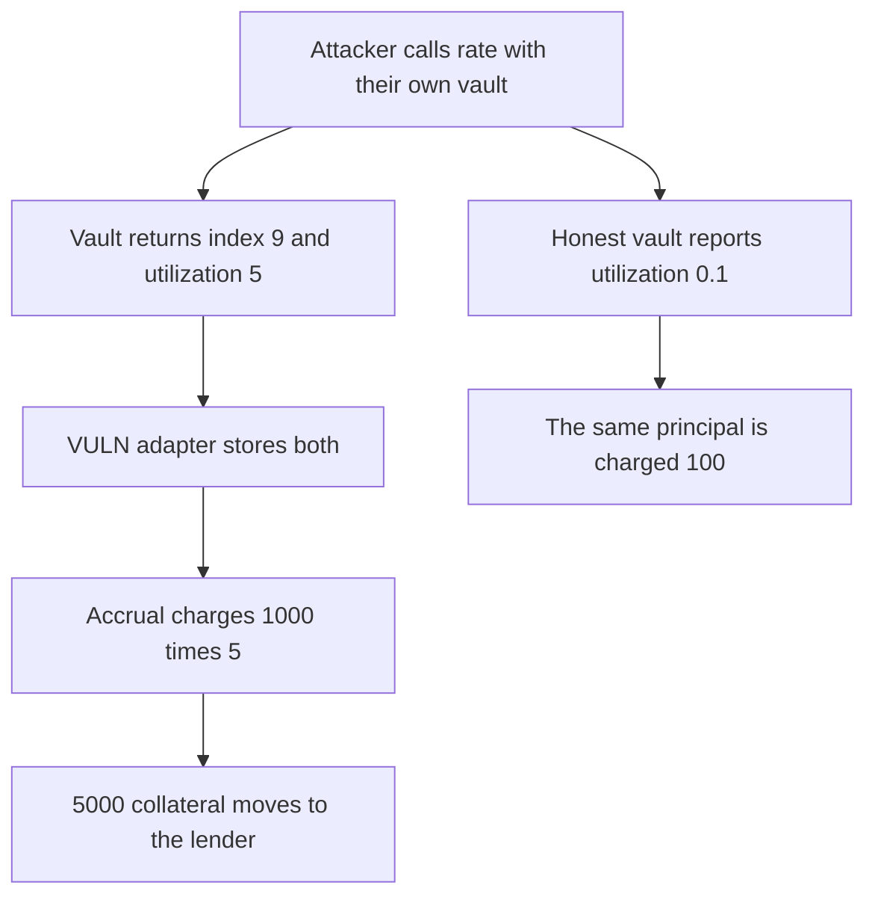

# CAP Labs: VaultAdapter.rate stores an arbitrary vault's utilization and charges 5000 instead of 100

> **Vulnerability classes:** `vuln/oracle/missing-validation` · `vuln/oracle/price-manipulation`

<!-- non-defihacklabs -->
<!-- source-auditvault: https://github.com/Auditware/AuditVault/blob/main/findings/61535-unvalidated-vault-address-in-vaultadapter-allows-interest-r.md -->
<!-- date: 2025-05 -->

**AuditVault taxonomy:** `severity/high` · `has/github` · `has/poc` · `lang/solidity` · `sector/oracle` · `sector/lending` · `platform/trailofbits` · genome: `oracle-manipulation-resistance` · `extcall-return-validation` · `oracle/price-manipulation` · `defi/price-manipulation` · `known-pattern` · `single-tx` · `add-check` · `precondition/privileged-caller` · `misassumption/external-call-is-safe` · `blast-radius/protocol-wide`

## Key info

| Field | Value |
|---|---|
| **Loss** | 5000 collateral seized from a borrower. An honest 10% utilization charges 100 on a 1000 principal |
| **Vulnerable contract** | `VaultAdapter.rate` |
| **Attacker EOA** | `0x1111111111111111111111111111111111111111` |
| **Attack contract** | `Exploit` |
| **Attack tx** | `Exploit.run()` |
| **Chain / block / date** | Ethereum model · block 0 · 2025-05 |
| **Compiler** | solc 0.8.27, cancun, via IR |
| **Bug class** | `_vault` is not checked before its index and utilization are stored |

## TL;DR

`rate(vault, asset)` calls `currentUtilizationIndex` and `utilization` on the address it was given and writes the results into `utilizationData`. A contract that returns index 9 and utilization 5 becomes the stored slope for that asset. Accrual on a 1000 principal then charges `1000 * 5 = 5000` and transfers that much of the borrower's collateral to the caller. The same call against a vault that reports 0.1 charges 100 and leaves 5900 of the 6000 collateral in the adapter.

## Background

Trail of Bits' May 2025 review of the CAP Labs Covered Agent Protocol, Benjamin Samuels, figure 12.1, `contracts/oracle/libraries/VaultAdapter.sol` lines 26 to 49. The function is permissionless in the quoted snippet. The short-term recommendation is an allowlist or access control. The long-term recommendation is input validation on every external address the adapter trusts.

## The vulnerable code

```solidity
uint256 index = IVault(_vault).currentUtilizationIndex(_asset);
// ...
utilization = IVault(_vault).utilization(_asset);
// @> VULN: index, lastUpdate, and the slope input come from an unvalidated _vault
utilizationData[_asset].index = index;
utilizationData[_asset].lastUpdate = block.timestamp;
```

Because `lastUpdate` starts at 0, `elapsed` equals `block.timestamp`, and the branch that reads `utilization()` is the one that runs. Both return values are still attacker-controlled. The stored index is 9 either way.

## Root cause

`_vault` is an argument, not a storage slot that was set by an admin. The adapter treats its return values as the market's utilization index and writes them into the rate state other functions read.

## Preconditions

- `VaultAdapter.rate` can be called by the attacker with any vault address.
- The adapter holds 6000 of borrower collateral against a 1000 principal.
- The attacker's vault returns `currentUtilizationIndex = 9e18` and `utilization = 5e18`. An honest vault returns utilization `0.1e18`.

## Attack walkthrough

1. `rate(evil, asset)` reads index 9 and utilization 5.
2. Storage for that asset becomes index 9, lastUpdate equal to the block timestamp, and utilization multiplier 5.
3. `accrue` computes interest as `1000 * 5` and transfers 5000 collateral to the caller.
4. 1000 collateral remains. The control vault reports 0.1, charges 100, and leaves 5900.

## Diagrams



## Impact

The caller receives 5000 collateral tokens. The fair interest at 10% utilization is 100. The borrower who posted the 6000 is left with 1000 instead of 5900. The stored index and multiplier stay corrupted for later readers of `utilizationData`.

## Remediation

Allowlist the vault, or restrict `rate` to a trusted role, before any external call. Do not write `index`, `lastUpdate`, or `utilizationMultiplier` from an unchecked return value.

## How to reproduce

```bash
cd 61535-unvalidated-vault-address-in-vaultadapter-allows-interest-r_exp
forge test -vv
```

`test_evil_vault_charges_5000_instead_of_100` asserts a 5000 seizure and a fair value of 100. `test_control_honest_vault_charges_100` asserts the 0.1 vault charges 100. Captured output is `output.txt`.

## Sources

- AuditVault finding: https://github.com/Auditware/AuditVault/blob/main/findings/61535-unvalidated-vault-address-in-vaultadapter-allows-interest-r.md
- Trail of Bits report: https://github.com/trailofbits/publications/blob/master/reviews/2025-05-caplabs-coveredagentprotocol-securityreview.pdf
- Blamed lines: `contracts/oracle/libraries/VaultAdapter.sol` lines 26-49, figure 12.1 of that review
