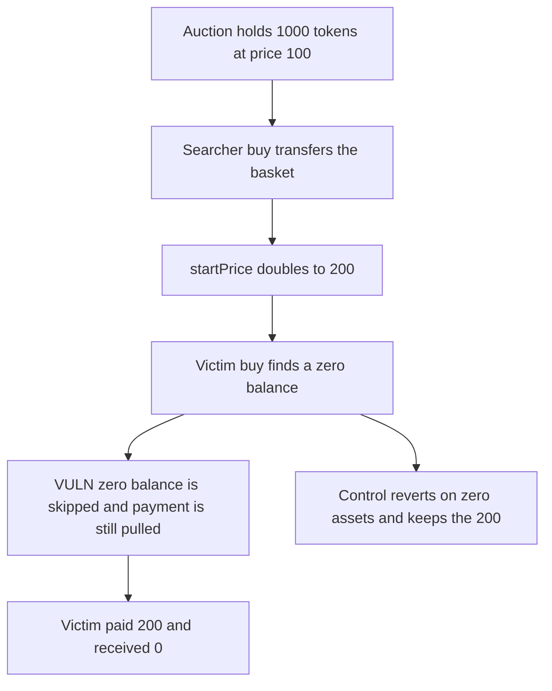

# CAP Labs: a front-run FeeAuction buy takes the basket and the next bidder pays double for nothing

> **Vulnerability classes:** `vuln/defi/sandwich-attack` · `vuln/input-validation/missing`

<!-- non-defihacklabs -->
<!-- source-auditvault: https://github.com/Auditware/AuditVault/blob/main/findings/61536-fee-auction-allows-buying-zero-assets-leading-to-front-runni.md -->
<!-- date: 2025-05 -->

## Key info

| Field | Value |
|---|---|
| **Loss** | Victim pays 200 and receives 0; searcher takes the 1000 token basket for 100 |
| **Vulnerable contract** | `FeeAuction._transferOutAssets` |
| **Attacker EOA** | `0x1111111111111111111111111111111111111111` |
| **Attack contract** | `Exploit` |
| **Attack tx** | `Exploit.run()` |
| **Chain / block / date** | Ethereum model · block 0 · 2025-05 |
| **Compiler** | solc 0.8.27, cancun, via IR |
| **Bug class** | Zero balances are skipped, and `buy` still pulls payment and doubles the price |

## TL;DR

`buy` has no auction id. `_transferOutAssets` transfers an asset only when the auction's balance is non-zero, and it does not revert when every balance is zero. A searcher buys the 1000 token basket for the 100 start price. The next start price becomes 200. The victim's buy then pays 200 and receives nothing. A buy that requires a non-zero transfer reverts and leaves the victim's 200 unspent.

## Background

Trail of Bits, CAP Labs Covered Agent Protocol review, May 2025, by Benjamin Samuels. The fee auction sells whatever tokens the contract holds. Each successful buy doubles the next start price. The reviewed `_transferOutAssets` skipped empty balances instead of rejecting the purchase.

## The vulnerable code

```solidity
uint256 bal = IERC20(asset).balanceOf(address(this));
if (bal > 0) IERC20(asset).transfer(_receiver, bal); // @> VULN: a zero balance is skipped, so the buy still pulls payment
```

Payment is pulled after that loop, and `startPrice` is set to `price * 2`.

```diff
- if (bal > 0) IERC20(asset).transfer(_receiver, bal);
+ require(bal > 0, "zero assets");
+ IERC20(asset).transfer(_receiver, bal);
```

The report's short-term fix is to revert unless the sum of the transferred balances is greater than zero, before payment is accepted.

## Root cause

The transfer is conditional and the payment is not. An empty basket is a successful purchase. Because the function also does not bind the buy to a specific auction, a mempool searcher can take the inventory and leave the next transaction paying the doubled price for a zero transfer.

## Preconditions

- The auction holds 1000 of the asset and the start price is 100.
- The searcher and the victim both approve the payment token. The victim holds 200, the doubled price.
- Both buys list the same asset. There is no auction id to pin the victim's buy to the pre-front-run inventory.

## Attack walkthrough

1. The searcher calls `buy` and receives 1000 tokens for 100.
2. `startPrice` doubles to 200.
3. The victim calls `buy` on the same asset.
4. The balance is now 0, so the transfer is skipped.
5. The victim's 200 is still pulled.
6. `zeroAssetPaid` records 200. The victim's asset balance is 0.

## Diagrams



## Impact

The searcher holds the entire 1000 token basket. The victim's payment balance goes from 200 to 0 and their asset balance stays 0. The treasury has collected 300. The next start price is 400. The control `buyFixed` reverts with `zero assets` on the empty basket and does not take the second payment.

## Remediation

Revert in `_transferOutAssets` when the sum of balances that would be transferred is zero, and do it before `transferFrom` of the payment token. Longer term, bind a buy to a specific auction id so a front-run cannot retarget it.

## How to reproduce

```bash
cd 61536-fee-auction-allows-buying-zero-assets-leading-to-front-runni_exp
forge test -vv
```

`test_exploit_victim_pays_double_and_receives_nothing` asserts the 1000 token basket, the victim's empty asset balance, and the 200 zero-asset payment. `test_control_zero_balance_buy_reverts` asserts the guarded buy reverts. Captured output is `output.txt`.

## Sources

- AuditVault finding: https://github.com/Auditware/AuditVault/blob/main/findings/61536-fee-auction-allows-buying-zero-assets-leading-to-front-runni.md
- Trail of Bits report: https://github.com/trailofbits/publications/blob/master/reviews/2025-05-caplabs-coveredagentprotocol-securityreview.pdf
- Current auction, which now takes minimum amounts: https://github.com/cap-labs-dev/cap-contracts/blob/main/contracts/feeAuction/FeeAuction.sol
